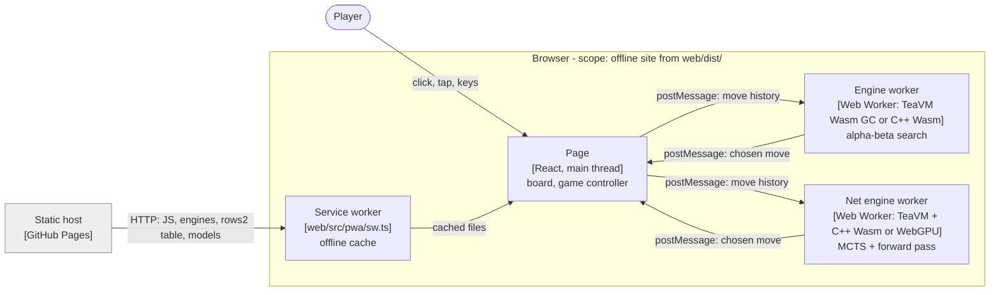
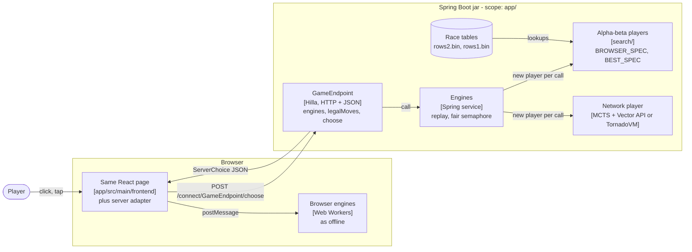
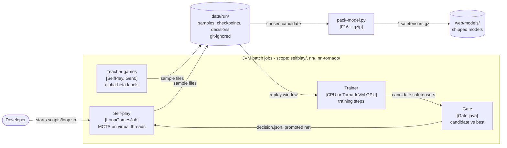

# Marble Lantern

**TL;DR:** A demo of Java on the GPU with [TornadoVM](https://www.tornadovm.org/) and in the browser with [TeaVM](https://teavm.org/).
The workload is a game AI; the game itself is a side effect.
It plays the two-player rules of Chinese Checkers (German: Sternhalma) on the 121-cell star board.

Live page: <https://geggo98.github.io/marble-lantern/>. Everything there runs in your browser.

## Quick start

You need [devenv](https://devenv.sh) and [Git LFS](https://git-lfs.com). The game engines ([web UI, the engines](docs/web-ui.md#the-engines)) need the race table `tablebase/tables/rows2.bin` (precomputed endgame move counts, see [web UI, terms](docs/web-ui.md#terms)). It is a Git LFS file; fetch it with `git lfs pull --include=tablebase/tables/rows2.bin`.

| Goal | Command |
|---|---|
| Build the offline site into `web/dist/` | `devenv tasks run web:build` |
| Serve it at <http://localhost:4173/marble-lantern/> | `cd web && BASE_PATH=/marble-lantern/ devenv shell -- npx vite preview` |
| Run the [online mode](docs/web-ui.md#the-two-modes) (engines also on the server) at <http://localhost:8080/> | `devenv tasks run app:run` |
| Build and test the Java modules | `devenv shell -- ./gradlew --no-build-cache build` |

The TornadoVM SDK setup is in [architecture, getting started](docs/architecture.md#getting-started).

## How it fits together

One code base runs in three ways. The rules and the classical alpha-beta search are Java modules (`engine/`, `search/`, `tablebase/`); `cpp/` holds a C++ port of them. One React UI in `web/src/` serves both the offline site and the online mode. The compile-time constant `__ONLINE__` keeps the server client out of the offline build.

**Offline site.** The static site from `web/dist/` runs every engine in a Web Worker in the browser; no server code runs. TeaVM compiles the Java search to WebAssembly (Wasm GC) or JavaScript, and Emscripten compiles the C++ port to WebAssembly. The page sends the move history by `postMessage`, and the worker replies with the chosen move. To cancel a search, the page terminates the worker. A service worker caches the files for offline play.

**Online mode.** The Spring Boot jar from `app/` serves the same UI and adds server engines. The browser sends the move history to `GameEndpoint` over HTTP. The server keeps no game state: it builds a new player for each call, and a fair `Semaphore` limits the number of searches that run at the same time.

**Training.** Command-line JVM jobs play games, train the network on the CPU or on the GPU through TornadoVM, and keep a new network only if it wins more than half of a gating match against the current best. Everything they write lands in the git-ignored `data/`. `scripts/models/pack-model.py` packs a chosen network into `web/models/` for the browser, and `scripts/models/archive-nets.py` archives every trained network in `models/`.

Solid arrows carry data; the dashed arrow means "starts". The grey box is outside the repository.

The Info part of the live page explains each part for readers new to game AI: [architecture](https://geggo98.github.io/marble-lantern/#/about/architecture), [classical search](https://geggo98.github.io/marble-lantern/#/about/classical), [inference](https://geggo98.github.io/marble-lantern/#/about/inference), [training](https://geggo98.github.io/marble-lantern/#/about/training), [tuning](https://geggo98.github.io/marble-lantern/#/about/tuning), [high-speed Java](https://geggo98.github.io/marble-lantern/#/about/java) and [Java in the browser](https://geggo98.github.io/marble-lantern/#/about/java-web). The design documents are [architecture](docs/architecture.md), [web UI](docs/web-ui.md) and [training](docs/training.md).

## Source-code map

Paths are relative to the repository root. Rows marked *git-ignored* name directories that a build or a run creates; they are not in the repository.

| Path | What is there | Read this first |
|---|---|---|
| `settings.gradle.kts`, `build-logic/`, `gradle/` | Gradle module list, the convention plugin, the wrapper and `libs.versions.toml` | `settings.gradle.kts` |
| `devenv.nix` | the dev shell and every named task (`web:build`, `app:run`, `setup:tornado`, …) | `devenv.nix` |
| `engine/` | rules: the 121-cell board, `RuleSet`, move generation, Zobrist hashing, symmetries | `engine/src/main/java/sternhalma/engine/Position.java` |
| `search/` | classical alpha-beta with evaluators and the race module, MCTS, three-player search, arena | `search/src/main/java/sternhalma/search/AlphaBeta.java`, `search/src/main/java/sternhalma/search/Strategies.java` |
| `tablebase/` | race tables built by retrograde BFS; `tables/` holds `rows2.bin` and `rows1.bin.zst` (Git LFS) | `tablebase/src/main/java/sternhalma/tablebase/RaceTable.java` |
| `nn/` | the network, its Vector API forward pass, safetensors files, the CPU trainer | `nn/src/main/java/sternhalma/nn/Network.java` |
| `nn-tornado/` | TornadoVM kernels: GPU forward pass and GPU trainer | `nn-tornado/src/main/java/sternhalma/tornado/TornadoNetwork.java` |
| `selfplay/` | teacher games, generation 0, the training loop, the gating match | `selfplay/src/main/java/sternhalma/selfplay/Loop.java` |
| `teavm-web/` | Java facade that TeaVM compiles into the classical browser engine | `teavm-web/src/main/java/sternhalma/web/Web.java` |
| `teavm-net/` | Java MCTS for the browser net engines, without the forward pass | `teavm-net/src/main/java/sternhalma/webnet/WebNet.java` |
| `teavm-nn-bench/` | TeaVM benchmark of the Java network in the browser | `teavm-nn-bench/build.gradle.kts` |
| `app/` | online mode: Spring Boot and Hilla, the HTTP endpoint and the server engines | `app/src/main/java/sternhalma/app/Engines.java`, `app/src/main/java/sternhalma/app/GameEndpoint.java` |
| `cpp/` | C++ port of engine, search and forward pass; the WebAssembly builds for the browser | `cpp/README.md` |
| `web/src/app/`, `web/src/game/` | React app shell, game controller, game links in the URL | `web/src/app/App.tsx`, `web/src/game/game.ts` |
| `web/src/engines/` | engine interface, worker protocol, one adapter per engine (`java/`, `cpp/`, `net/`, `server/`) | `web/src/engines/engine.ts`, `web/src/engines/protocol.ts` |
| `web/src/ui/`, `web/design/` | React components; design tokens and notes | `web/design/design-notes.md` |
| `web/src/about/` | the Info pages, their figures and the figure data in `data/` | `web/src/about/routes.ts`, `web/src/about/topics/architecture.tsx` |
| `web/src/pwa/`, `web/tooling/` | service worker and the Vite plugin that writes `sw.js` | `web/src/pwa/sw.ts` |
| `web/models/` | the three shipped networks (F16 + gzip): [4-row expert](web/models/small-2p-adjacent-expert.safetensors.gz), [5-row expert](web/models/small-2p-adjacent-r5-expert.safetensors.gz), [shared](web/models/small-shared-all.safetensors.gz), listed in [`models.json`](web/models/models.json) | `docs/models.md` |
| `models/` | every trained network of the documented runs (F32 + gzip, Git LFS), with sizes, SHA-256, board sizes, strength and kWh in [`index.md`](models/index.md); the run records that `docs/training.md` cites are in `models/runs/` ([5-row SMALL run](models/runs/net5/README.md), [5-row LARGE run](models/runs/net5-large/README.md), [CPU against GPU power](models/runs/net5-cpu-power/README.md)) | `models/README.md` |
| `web/e2e/` | Playwright tests | `web/playwright.config.ts` |
| `scripts/` | one script per devenv task; training, model packing and cloud scripts | `scripts/loop.sh` |
| `docs/` | design documents, ADRs, references | `docs/architecture.md` |
| `web/dist/`, `web/public/engines/`, `web/public/tables/`, `web/public/models/` | *git-ignored*: the built site and the engine, table and model files that the `web:*` tasks generate | `docs/web-ui.md` |
| `data/`, `cloud-results/`, `tornado-sdk/`, `cpp/golden/` | *git-ignored*: training runs, cloud results, the TornadoVM SDK, Java golden files for the C++ comparison | `docs/training.md`, `docs/cloud.md` |

`web/src/about/readme.test.ts` checks that every path in this table exists, and that every *git-ignored* path is listed in `.gitignore`.

## Documentation

- [Web UI](docs/web-ui.md): offline and online mode, the browser engines, game links, move guides, the skill estimate, how to build and test them.
- [Web benchmark](docs/web-benchmark.md): the browser engines compared on identical work.
- [ADR 0002](docs/adr/0002-browser-engines.md): the three browser engines (C++ and two TeaVM builds of Java) and their measurements.
- [ADR 0003](docs/adr/0003-teavm-default-engine.md): why Java compiled by TeaVM to Wasm GC is the default browser engine, with C++ as the fallback for browsers without Wasm GC.
- [Architecture](docs/architecture.md): modules, status, roadmap and TornadoVM setup.
- [Rules](docs/rules.md), [search and evaluation](docs/search-and-evaluation.md), [TornadoVM](docs/tornado.md), [offline mode](docs/offline-mode.md) and the other files in `docs/`.
