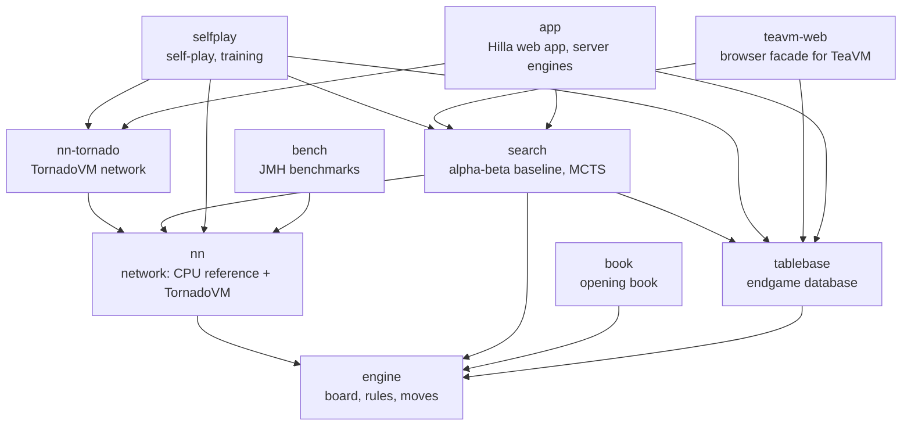
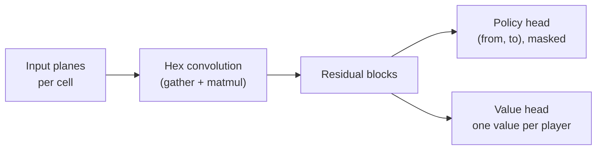
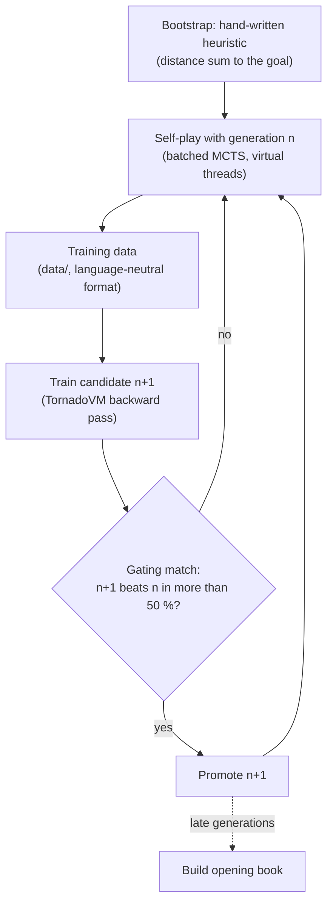

# Architecture

**TL;DR:** Marble Lantern is an AlphaZero-style AI for Chinese Checkers (German: Sternhalma), written in Java 25.
Its main purpose is to show Java on the GPU with TornadoVM and in the browser with TeaVM: batched network inference for self-play and network training run as TornadoVM kernels on the GPU, and the classical player runs in the browser as TeaVM output.
Everything else (rules engine, opening book, user interface) stays deliberately simple.
The Java code is split into Gradle modules; a CPU reference implementation checks every GPU kernel.
Outside Java, a C++ port of the engine (`cpp/`) serves as a performance comparison and as the browser engine for browsers without Wasm GC, WebAssembly with garbage collection, which the default Java engine needs ([ADR 0003](adr/0003-teavm-default-engine.md)), and the browser UI is TypeScript and React (`web/`).
Implementation started with the rules engine and a two-player alpha-beta baseline, before any network code (*project decision*, see [implementation order](#implementation-order)).

> **Status.** This document describes the approved plan and marks what exists.
> The modules `engine`, `search`, `nn`, `nn-tornado`, `tablebase`, `selfplay`, `teavm-web` and `app` exist; `book` and `bench` do not.
> The module `tablebase` has its CPU part only: the rows ≥ 2 race table and the race module's interface (round-2 experiment E03, see [endgame and opening](endgame-and-opening.md#the-race-module)) and the optional rows ≥ 1 table (E09).
> The [status table](#status) lists each part.

How to read the claims in this document:

| Label | Meaning |
|---|---|
| *Established* | Supported by a cited source, for example [Sturtevant2023]. See [references](references.md). |
| *Reported* | Relayed from the project owner's literature survey. Not re-verified. |
| *Project decision* | A choice made for this project. It can change. |
| *Project reasoning* | A conclusion the project derives itself, without a source. |
| *Proposed* | An idea that is neither decided nor scheduled. |

## Terms

- **Approved plan:** the owner's implementation plan from before the repository existed. It is not stored in the repository; this document records the parts that matter.
- **Race table:** for every configuration of one side's ten pieces inside a region of the board, the exact number of moves to fill the goal corner when no other pieces are on the board. "Rows ≥ 2" and "rows ≥ 1" name the region: the rows from row 2 or row 1 (counted from the centre line towards the goal) to the goal corner. The files are `rows2.bin` (13 MB) and `rows1.bin` (254 MB); see [endgame and opening](endgame-and-opening.md#the-race-module).
- **Race play, race arithmetic:** in a position where the two sides no longer touch, choosing the move by the race table without search (race play), or adding race-table counts to the evaluation at the leaves of the search (race arithmetic).
- **S1:** the adjudication criterion that ends a self-play game early once the race table proves its result ([endgame and opening, the criterion S1](endgame-and-opening.md#the-criterion-s1-adjudication)).
- **Round 1, round 2, experiments E00 to E09:** the project improved the classical player in rounds of numbered experiments. The experiments of round 2 are defined in [baseline round 2 plan](baseline-round2-plan.md); "round-1 BEST" is the strongest player before round 2.
- **Blocks 2a to 2h:** the work steps of the network training; [training](training.md) has one "As implemented" section per block.
- **`BEST_SPEC`, `BROWSER_SPEC`:** player specifications in `search/src/main/java/sternhalma/search/Strategies.java`. `BEST_SPEC` is the strongest classical alpha-beta player and reads `rows1.bin`; `BROWSER_SPEC` is the same player reading only `rows2.bin`, for the browser ([ADR 0001](adr/0001-browser-mode-without-rows1.md)).
- **Evaluator names** such as `racelin1-r3` and `linear-r3`: registry names of leaf evaluations, listed in [search and evaluation](search-and-evaluation.md). `bestGain` is one feature of the linear evaluation: the largest one-move distance gain of a side (experiment E07).
- **Fingerprint:** a checksum over the moves (and node counts or scores) of fixed positions or games, pinned in a test, so that any change of the search shows as a changed number.

## Goals and non-goals

Goals (*project decision*):

- Show TornadoVM on a real workload: batched network forward pass and backward pass with an optimiser. Breadth-first search layers for a small single-player endgame database are an optional experiment.
- Measure the gain. A benchmark compares CPU scalar code, the CPU Vector API and the TornadoVM backends over batch sizes from 1 to 1024.
- Play the [default rule set](rules.md) for two players first, then three players. The board and the value head support N players from the start.
- Make every long computation resumable, so that an interrupted run costs little.

Non-goals (*project decision*):

- Strongly solving any variant, and building large tablebases. The project trains a neural network instead; the development machine has too little RAM for strong solving. The project uses [Sturtevant2019] only to verify its rules and, optionally later, as a test oracle.
  For context: the largest variant that [Sturtevant2019, §5] strongly solves is the 6 × 6 board with 6 pieces per player; the paper had not yet validated it with a second solver, and the author's publications page later reports that a different solver verified it [SturtevantPubs]. The paper calls 7 × 7 with 6 pieces "the largest game that can likely be strongly solved on hardware that we have readily accessible" (*established*). The full 121-cell board with 10 pieces per player is larger still.
  The paper gives 1.73 × 10^24 states for one common board size [Sturtevant2019, §1].
- A polished user interface. The [web UI](web-ui.md) is a demo surface for the engines.
- A general-purpose deep-learning framework. The network uses a small set of standard operations, and the project implements only those.
- Languages other than Java on the critical path. The C++ port and the TypeScript UI are not on it: the AI, its training and the TornadoVM kernels are Java.

## Module map



`book` and `bench` do not exist yet.

An arrow points from a module to a module it depends on.
The dependency edges are a *project decision* and can change during implementation.
The alpha-beta baseline in `search` uses `engine` and, for the race module of round 2 (E03), the `RaceCounts` interface of `tablebase`; the edge from `search` to `nn` exists for MCTS (round 2, block 2g: `Mcts`, `MctsPlayer`, `MctsSpec` use `nn.Evaluator` and `ForwardPass`; `nn` depends on `engine` only, so the edge closes no cycle; see [training](training.md#as-implemented-block-2g)).

| Module | Responsibility | Depends on |
|---|---|---|
| `engine` | Board geometry, rule set, move generation, Zobrist hashing, symmetries. Plain Java. Every rule-dependent method takes an immutable `RuleSet` record (see [rules](rules.md)). A small-board mode is proposed (see [below](#ruleset-and-small-board-mode)). | nothing |
| `nn` | Network definition, CPU reference with `jdk.incubator.vector`, safetensors reader and writer. | `engine` (neighbour table) |
| `nn-tornado` | TornadoVM kernels for the forward and backward pass (`TornadoNetwork`); see [TornadoVM](tornado.md). Its tests need the SDK and are skipped without it. | `nn`, TornadoVM |
| `search` | First: alpha-beta for two players with iterative deepening, transposition table and the single-agent distance heuristic. The race module (`Solitaire`, `RaceMove`, `RaceAdjudication`, see [endgame and opening](endgame-and-opening.md#the-race-module)). Monte Carlo tree search with PUCT, virtual loss and leaf batching for two players (`Mcts`, `MctsPlayer`, `MctsSpec`; exists since block 2g). Simulation and time budgets. Strength levels. | `engine`; `tablebase` (interface `RaceCounts`, `RaceTable`) for the race module; `nn` for MCTS only (`api`, because `Mcts` takes a `ForwardPass`) |
| `selfplay` | Batched self-play runner, training-data format, trainer command-line tool, gating matches. Exists (round 2, E05): the classical self-play data tool with layered adjudication, control games, opening sampler and sample files ([training](training.md#self-play-data-tool-round-2-e05)). | `search`; `tablebase` (race table for S1); `nn` (`Orientation` for canonical cells); `nn-tornado` (training on the GPU) |
| `book` | Opening book built from self-play games. | `engine`, self-play data |
| `tablebase` | Single-player endgame database. Exists (CPU): ranking, layered retrograde BFS generic in the region, the table file format, the rows ≥ 2 race table (`RaceTable`, Git LFS) and the optional rows ≥ 1 table (254 M states, built on demand into `tablebase/build/tables/`, never committed, checked against a checksum constant; E09) with `TableValidation`. Planned: BFS layers as a TornadoVM kernel for larger regions. | `engine`; TornadoVM later |
| `bench` | JMH benchmarks: evaluations per second per backend and batch size. | `nn` |
| `teavm-web` | The facade `sternhalma.web.Web` that TeaVM compiles to the browser engines `java-wasmgc` and `java-js`; `BenchReference`, the JVM reference of the [web benchmark](web-benchmark.md). | `engine`, `search`, `tablebase` |
| `app` | The online mode of the [web UI](web-ui.md): a Vaadin Hilla app that serves the browser UI and runs the server engines (`BROWSER_SPEC`, `BEST_SPEC`, the network player). Planned: move suggestions. | `engine`, `search`, `tablebase`, `nn`, `nn-tornado` (run time only) |

Two parts are not Gradle modules: `cpp/` is the C++ port of the engine, search and network ([C++ comparison](cpp-comparison.md)), which also builds the browser engine `cpp-wasm`; `web/` is the React UI of the [web UI](web-ui.md).

The build uses the Gradle Kotlin DSL.
The convention plugin in `build-logic/` holds the shared Gradle settings, and `gradle/libs.versions.toml` holds the dependency versions.

## Implementation order

The modules are built in this order (*project decision*):

1. Rules written down in [rules](rules.md), before the engine code.
2. `engine` with its conformance tests.
3. Alpha-beta baseline for two players in `search`.
4. `nn` CPU reference with the safetensors reader and writer.
5. TornadoVM kernels and the `bench` benchmark.
6. MCTS with the network in `search`.
7. Self-play and training, then `tablebase`, `book`, the Advisor API (move suggestions) and the Opponent API (strength levels), the optional `app` and the cloud runs.

Steps 1 and 3 are additions to the approved implementation plan.
The plan puts all of `search` after `nn` and the kernels; the owner requested the alpha-beta baseline as an earlier step, before the network (2026-11-07).
MCTS keeps its place from the plan.
The [roadmap](#roadmap) lists the same order as numbered milestones.

## RuleSet and small-board mode

The engine takes the rules as an immutable `RuleSet` record and hard-codes none of them (*project decision*).
The switches, their allowed values and their defaults are defined in [rules](rules.md); that document is the single source for them.
This section names only the parts that affect the architecture:

- **Move limit.** A `RuleSet` parameter, 200 plies by default for two players (*project decision*); 300 plies for three players is *proposed*.
- **Blockade.** An opponent piece in the goal counts as filling it, provided at least one own piece is in the goal (*project decision*, owner, 2026-11-07). This is Definition 1 of [Sturtevant2019, §3.2] (*established*).
- **Three players.** Play goes clockwise around the star, and the game ends at the first winner (*project decision*). TODO-OPUS architecture.ranking {FULL_RANKING implemented, see rules.md section Playing on for second place}
- **Games without a winner.** The default `drawHandling = SCORE_BY_DISTANCE` ranks the players by their distance to the goal; `DRAW` stays available for comparisons with the solved tables of [Sturtevant2019, §5], where draws are real draws (*project decision*).
- **Two deliberate deviations.** The defaults `leaveGoal = FORBIDDEN` and `repetition = MOVE_LIMIT` are *project decisions* and differ from [Sturtevant2019, §3]: its rules contain no ban on leaving the goal, and they declare a game drawn when any board state repeats (§3.4, Definition 4). See [rules](rules.md#deliberate-deviations-from-sturtevant2019). The move limit applies as a backstop in both repetition modes.

**Small-board mode (*proposed*, not scheduled).**
The engine could also play on an m × m diamond with k pieces per player under exactly the rules of [Sturtevant2019, §3]: no ban on leaving the goal, a repeated position is a draw (Definition 4, §3.4), and Definitions 1 to 3 for wins and illegal states (§3.2, §3.3).
The counts in Table 1 of [Sturtevant2019, §5] could then serve as an optional, later conformance oracle for the counting rules (*project reasoning*).
The 4 × 4 row with 6 pieces is excluded: the author's publications page reports a copy/paste error in it and promises an updated table [SturtevantPubs].
The same note reports that a different solver verified the 6 × 6 results with 6 pieces; the other rows are used as printed in the paper.
The project does not try to solve any board. For example, as printed in the paper, the 7 × 7 board with 1 piece has 4,704 positions, 2,304 won states for one player, 0 draws and 96 illegal states.
The engine can reproduce these counts only in this mode, because the paper computed them with its own rules.
The mode needs board geometry that is a parameter rather than a constant, so the `engine` design keeps the cell count and the neighbour tables as data (*project reasoning*).

## Data representation

The board has 121 cells (see [rules](rules.md)).
The engine stores it as follows (*project decision*, unless a citation says otherwise):

- **Coordinates.** Cube and axial hex coordinates, as described in [RedBlobHex].
  The engine converts them once into a cell index from 0 to 120.
- **Bitboards.** One bitset of 128 bits (`long[2]`) per player, plus one occupancy bitset.
  121 cells fit into two 64-bit words.
- **Neighbour tables.** Precomputed arrays of 6 directions × 121 cells.
  The same table drives move generation and the hex convolution in the network.
- **Move generation.** Single steps come from a mask operation.
  Jump chains come from a breadth-first search over jump targets with a visited mask.
  Only the pair (start, end) defines a move, so the generator removes duplicates by that pair.
- **Hashing.** Zobrist hashing for the transposition table and the opening book [CPW].

**As implemented (2026-11-07, experiment E02):** `Position` stores an owner byte per cell plus a sorted piece list per player, not bitboards. The generator walks the piece list with flat per-player step and jump-landing tables (allowed cells folded in) and a 128-bit visited set in two `long` values; the jump search is depth-first with an explicit stack, and its order fixes the move order that the search-tree fingerprints pin. Bitboards remain an option for later.

Why bitboards: according to [Sturtevant2023], legal-move generation dominates run time in Chinese Checkers, and bitboards together with the BMI2 instructions PDEP and PEXT give considerable gains.

**Open question.** Java exposes PDEP and PEXT as `Long.expand` and `Long.compress`.
Whether these methods are fast on the target CPUs is not measured yet.
The project makes no performance claim about them until the `bench` module has measured them.

## Neural network

The network follows the AlphaZero pattern: one shared trunk, a policy head and a value head (*project decision*).
AlphaZero-style work on Chinese Checkers exists [Liu2019], and [Sturtevant2019, §1] expects the AlphaZero approach to learn the game.



- **Hex convolution.** A square-grid convolution does not fit a star-shaped board.
  The network therefore implements the convolution as a gather: for each cell it reads the cell and its 6 neighbours (a 7-point stencil) through the neighbour index table, then multiplies by the weight matrix.
- **Residual blocks.** The trunk is a stack of residual blocks built from this hex convolution.
- **Policy head.** A move is a pair (from, to).
  The head scores pairs and masks every illegal pair before the softmax.
- **Value head.** One value per player instead of one scalar.
  With three players the game value is a vector, not a scalar (*reported*), so a scalar head cannot express it.
- **Size presets.** "Small": 32 channels × 4 blocks. "Large": 64 channels × 6 blocks.
  The plan trains large and distils into small later.
- **CPU reference.** A plain-Java implementation that uses `jdk.incubator.vector`.
  It is the test oracle: every TornadoVM kernel must match it within a fixed tolerance ε.
- **TornadoVM kernels.** Forward pass for batches; backward pass plus SGD or Adam for training.
- **Weights.** Stored in the safetensors format: a JSON header followed by raw tensor bytes.
  The format is simple enough for a small in-project reader and writer, and other tools can read the files.
- **Self-play data.** Stored in a language-neutral format, so that tools outside the JVM can read it.

## TornadoVM

### How the project uses it

TornadoVM compiles Java methods into GPU kernels at run time.
The project uses its `TaskGraph` API, `@Parallel` loops, and `KernelContext` where a kernel needs explicit tiling (*project decision*).

| Workload | Module | Why the GPU |
|---|---|---|
| Network forward pass (batched) | `nn` | MCTS collects 64 to 256 leaves and evaluates them in one call. |
| Network backward pass and optimiser | `nn` | Training is dense matrix work. |
| BFS layers of the endgame database | `tablebase` | Each layer processes many independent positions. |

### Version and backends

| Item | Value |
|---|---|
| TornadoVM version | 7.3.1 |
| Archive family | `jdk22plus` (the project runs JDK 25) |
| macOS aarch64 backends | `metal`, `opencl` |
| Linux amd64 backends | `cuda`, `opencl` (the `cuda` archive holds the CUDA C backend, compiled with NVRTC; TornadoVM removed PTX and SPIR-V in 6.0.0; checked 2026-11-14, [cloud](cloud.md)) |
| Verified device | `tornado --devices` on the development Mac lists one Metal device: Apple M3 Max, 51.8 GB global memory. |

TornadoVM is not in nixpkgs.
The script `scripts/setup-tornado.sh` installs the pinned release instead.

### Install TornadoVM

The installation steps are in [getting started](#getting-started).
The task `setup:tornado` works as follows:

- The script downloads the archive into a temporary directory in `tornado-sdk/` and compares its SHA-256 with the pinned value.
- If the values are different, the script stops and installs nothing.
- If the values agree, the script extracts the archive, moves it to its final name and points `tornado-sdk/current` at it.
- A new devenv shell adds `tornado-sdk/current/bin` to `PATH`.

You can run the script again at any time.
If a verified installation of the selected backend exists, the script skips the download and exits with code 0.

### Portability

The system is meant to move later from the Mac to cloud machines: NVIDIA GPUs through TornadoVM, and Intel/AMD x86 CPUs through the Vector API (*project decision*; details in [cloud](cloud.md) and [TornadoVM](tornado.md#backends)).
Only the Mac has run any of it so far.

| Concern | How the code handles it |
|---|---|
| Backend and device | `TornadoSupport` selects them from `TORNADO_BACKEND` / `TORNADO_DEVICE` (or the system properties `sternhalma.tornado.backend` / `.device`), logs the choice once, and never falls back to another device. |
| Metal-only kernels | The SIMD-group kernels run on Metal only. Every other backend gets the generic `KernelContext` kernels (`Variant.TILED`, `weightPartialTiled`); `-Dsternhalma.tornado.generic=true` forces them on Metal, which is how they are tested here. |
| Device limits | Work groups of at most 256 items and at most 12.5 KiB of local memory; the device is queried when a network or trainer is built. |
| Unified memory | Not assumed: every transfer is explicit. |
| Vector API | `VectorNetwork` has no hard-coded lane count. The species is `FloatVector.SPECIES_PREFERRED` (128 bit on Apple silicon, 256 or 512 bit on x86) or is forced with `-Dsternhalma.vector.bits=64\|128\|256\|512`. Channels are padded to a multiple of two vectors, so no tail loop exists; `VectorSpeciesTest` runs all four widths against the reference. The Vector API is used by `VectorNetwork` only (the MCTS code calls it through `ForwardPass`). |
| JVM flags | `--add-modules jdk.incubator.vector` always; on x86 `-XX:UseAVX=2\|3` and `-XX:MaxVectorSize` limit the species (see [cloud](cloud.md#vector-api-on-x86)). |

## Self-play and training loop

The training loop follows AlphaZero: self-play, training, gating (*project decision*).



- **Bootstrapping.** A hand-written heuristic (the sum of distances to the goal) guides the first generations, so that they do not play at random.
  The heuristic stages are in [search and evaluation](search-and-evaluation.md).
- **Parallel games.** Many games run at the same time on virtual threads.
  This keeps the GPU batches full.
- **Gating.** A new network replaces the old one only if it wins more than half of a match against it.
- **Implementation.** `Loop` in module `selfplay` (`scripts/loop.sh`) runs the loop on the CPU: self-play with MCTS using the PUCT selection rule, training of a candidate, the gate (with a non-regression clause against `BEST_SPEC`) and a strength record per generation, resumable and abortable at any point ([training](training.md#as-implemented-block-2h)).
- **Downstream products.** The opening book comes from the games of late generations.
  The endgame database replaces the value head in the race endgame, where no contact between the armies remains.
  See [endgame and opening](endgame-and-opening.md).

## Long-running jobs

Self-play, training, book building and the tablebase build can run for hours.
Every such job follows the same conventions (*project decision*):

- **Resumable.** The job derives its state from the artefacts in `data/` (for example generation checkpoints), not from a separate progress file.
  After an interruption, you start the same command again and it continues.
- **Atomic writes.** The job writes each output under a temporary name and renames it when it is complete.
  Only complete files carry the final name.
- **Abortable.** `SIGINT` and `SIGTERM` set a flag.
  The job finishes or discards the current item, prints a summary and exits.
- **Progress.** One line on stderr per interval, with count, rate, ETA and elapsed time. No carriage-return progress bars.
- **Lock.** A lock file prevents two runs of the same job at the same time.
- **Status.** A `--status` flag reports whether the job runs and since when.

## Compute plan

*Project decision:*

1. **Local first.** Development and first training runs happen on the development Mac with the Metal backend. OpenCL is the fallback.
2. **Cloud later.** Large runs move to NVIDIA GPUs with the CUDA backend of TornadoVM (docs/cloud.md).
   The plan packs self-play as a worker into one container image and stores checkpoints in object storage.
   Because every job is resumable, interruptible (spot) instances are acceptable.
   The provider is chosen after a price comparison just before the first cloud run.

Cloud credentials and account details live only in the gitignored `.env` file.
The repository contains only `.env.example` with placeholders.

## Web UI

The web UI exists; [web UI](web-ui.md) describes it. In short:

- One React code base in `web/src/`, built twice: as a static offline site (GitHub Pages) and as the online mode in the Gradle module `app` (Spring Boot with Vaadin Hilla).
- Offline, the engine runs in the browser: the Java engine compiled by TeaVM to Wasm GC (default), or the C++ port compiled to WebAssembly as the fallback for browsers without Wasm GC ([ADR 0002](adr/0002-browser-engines.md), [ADR 0003](adr/0003-teavm-default-engine.md)). It plays `BROWSER_SPEC`, which needs only the small race table ([ADR 0001](adr/0001-browser-mode-without-rows1.md)).
- Online, the server adds `BEST_SPEC` and the network player. The network player can evaluate on the GPU with TornadoVM; without it, it uses the CPU path.
- The board is SVG. The player picks the engine and the strength (a node budget per move).

Planned and not built: a "suggest move" button backed by an `Advisor` API (top-k moves with visit share, value and principal variation), and a live evaluation bar per player.

## Key decisions

Each entry gives the decision, the reason, and the alternatives that the project rejected.
All entries are *project decisions*; a citation inside an entry supports only the statement it is attached to.

1. **Java only.**
   Reason: the project is a TornadoVM showcase, and TornadoVM runs Java.
   Rejected: Rust compiled to WASM, and JAX for training. Only language-neutral ideas were kept: standard network operations, safetensors weights, a neutral self-play data format, leaf batching, train large and distil.
   Later additions outside the critical path: a C++ port of the engine for a performance comparison ([C++ comparison](cpp-comparison.md)), which is also the browser engine for browsers without Wasm GC ([ADR 0003](adr/0003-teavm-default-engine.md)), and the TypeScript browser UI.
2. **One MCTS engine with a neural network for two and three players.**
   Reason: one search covers both player counts, and alpha-beta works for two players only (*reported*, see [search and evaluation](search-and-evaluation.md)).
   Rejected as the main engine: alpha-beta for two players plus Max^n, Paranoid or Best Reply Search for three players [Sturtevant2003], [SchaddWinands2011].
   Alpha-beta with the heuristic stays as a baseline opponent and test oracle.
3. **Start with the alpha-beta baseline, before the network.**
   Context: the approved plan builds `nn` and the TornadoVM kernels before `search`, so the first playable opponent would need a trained network.
   Decision (owner, 2026-11-07): after `engine`, build two-player alpha-beta in `search` with the single-agent distance to the goal as its heuristic. The network and MCTS follow.
   Reason: the engine gets a real user early, the project can play games without a network, and later networks have a fixed opponent to measure against.
   That heuristic is common for play according to [Sturtevant2019, §2], which cites [Sturtevant2002].
   Consequence: `search` gets a part that depends on `engine` only; the MCTS part still depends on `nn`.
   Rejected: the plan's order (network first), which leaves the engine without a search to test it until the kernels work.
4. **The engine takes an immutable `RuleSet`.**
   Reason: the rules of Chinese Checkers vary, and the project needs both its own defaults and the exact rules of [Sturtevant2019, §3] for comparison with the paper's solved tables.
   One record with fixed switch values keeps every variant explicit and testable.
   Rejected: hard-coded rules, and mutable rule flags that could change during a game.
   A small-board mode for optional, later conformance tests against [Sturtevant2019, §5] is *proposed*.
5. **Hex convolution as gather over the neighbour table.**
   Reason: it uses the board as it is and reuses the engine's neighbour table.
   Rejected: embedding the star in a rectangular grid for a standard 2D convolution, which adds cells that do not exist and needs extra masking.
6. **CPU reference as the oracle for every kernel.**
   Reason: GPU kernels fail silently with wrong numbers; a comparison within ε catches that.
   Rejected: testing kernels only against hand-computed values.
7. **Safetensors with an in-project reader and writer.**
   Reason: the format is simple and readable by other tools.
   Rejected: Java serialisation and framework-specific checkpoint formats.
8. **Local first, cloud later.**
   Reason: the Metal backend on the development Mac is enough to build and verify the system.
   Rejected: starting on rented GPUs before the pipeline works.
9. **Optional single-player endgame database for the last k ≤ 4 to 5 pieces in the goal region.**
   Reason: the plan judges a full two-player table not feasible, because the table size grows very fast with the number of cells (size figures *reported*, see [endgame and opening](endgame-and-opening.md)).
   Rejected: a full two-player endgame table.
10. **Simple storage outside the GPU path.**
    Reason: the showcase is TornadoVM; everything else stays simple.
    The opening book is a sorted binary file.
    Rejected: a database server for the book.
11. **Pinned TornadoVM release installed by a script.**
    Reason: TornadoVM is not in nixpkgs; a pinned version with a SHA-256 check is reproducible.
    Rejected: an unpinned "latest" download.

## Getting started

Prerequisites: [devenv](https://devenv.sh), [Git LFS](https://git-lfs.com), and an Apple Silicon Mac or a Linux amd64 machine.
The commands for the web UI are in [web UI, build, run and test](web-ui.md#build-run-and-test).

1. Copy the example settings. Do not commit `.env`.
   ```sh
   cp .env.example .env
   ```
2. Check `TORNADO_BACKEND` in `.env`. The example sets `metal`. On Linux, set `cuda` (`ptx` is accepted as an alias) or `opencl`, because the Linux archives have no Metal backend. Without the variable, the setup script uses `metal` on macOS and `cuda` on Linux.
3. Download and verify the TornadoVM SDK once. A second run skips a verified install.
   ```sh
   devenv tasks run setup:tornado
   ```
4. Start the shell and check that TornadoVM finds a device.
   ```sh
   devenv shell
   tornado --devices
   ```

Build and test with the Gradle wrapper. Use `--no-build-cache` while the build changes:
```sh
devenv shell -- ./gradlew --no-build-cache build
```
The tasks `devenv tasks run agent:build` and `devenv tasks run agent:test` do the same. Without the TornadoVM SDK the build still passes; the TornadoVM tests are skipped.

## Status

| Part | State |
|---|---|
| devenv environment (JDK 25, Gradle, `.env`), TornadoVM 7.3.1 SDK download with SHA-256 check | done |
| Rules document, decisions of 2026-11-07 | done |
| Gradle build (wrapper 9.8.2, dependency verification), `engine` module | done |
| `search` module: alpha-beta baseline, learned linear evaluation, search enhancements, arena (the match tool that plays paired games between two players, see [search and evaluation](search-and-evaluation.md#arena-cpu-column-cost-adjustment-sprt)), strategy contract tests (properties every registered player must pass, see [testing](testing.md#the-strategy-contract)), MCTS | done; round 2 integrated on 2026-11-08: `Strategies.BEST_SPEC` is `racelin1-r3` (race arithmetic over the bestGain evaluation) with futility pruning and race play, and scores 0.95 against the round-1 BEST at equal CPU time ([integration](search-and-evaluation.md#integration-of-round-2-measured-2026-11-08)) |
| `nn` module: network design, safetensors, encoder, CPU reference, Vector API path | done |
| `nn-tornado` module: forward pass, and for training the forward pass, losses, backward pass of the heads and optimiser on the device | done ([TornadoVM](tornado.md)) |
| `selfplay` module: classical self-play data tool (adjudication, control games, sample files; `scripts/selfplay.sh`) | done for classical engines (round 2, E05); generation-0 training (`scripts/gen0.sh`), PUCT self-play and the CPU training loop with gating and a strength record (`scripts/loop.sh`, block 2h) done |
| `tablebase` module: rows ≥ 2 and rows ≥ 1 race tables (Git LFS; `rows1.bin` as `rows1.bin.zst`), race play, S1 adjudication, race arithmetic as a leaf value | done (round 2, E03, E08, E09); GPU build not started |
| C++ port and comparison | done ([C++ comparison](cpp-comparison.md)) |
| Web UI: offline mode with three browser engines, online mode in `app`, benchmark, browser tests, CI and GitHub Pages workflows | done ([web UI](web-ui.md)) |
| `book`, `bench` | not started |

On the development Mac, `tornado --devices` lists one Metal device.

## Roadmap

Each milestone got or gets one commit. Milestones 3 and 5 are additions to the implementation plan; milestone 5 follows the owner decision of 2026-11-07 to build alpha-beta before the network. The [status table](#status) shows how far each one is.

1. Git repository and `.gitignore`.
2. devenv environment and TornadoVM setup.
3. Rules in [rules](rules.md).
4. Gradle scaffold and `engine` with tests: move counts computed by our generator, symmetry tests, property tests.
5. Alpha-beta baseline for two players in `search`, with the single-agent distance heuristic.
6. `nn` CPU reference and safetensors reader and writer.
7. TornadoVM kernels and the `bench` benchmark.
8. `search`: MCTS with PUCT and leaf batching.
9. Local self-play and training loop with gating against the previous network.
10. Optional experiment, `tablebase`: single-player retrograde BFS for the last 4 to 5 pieces, BFS layers as a TornadoVM kernel.
11. `book`: opening book from late self-play generations.
12. Advisor API (move suggestions) and Opponent API (strength levels).
13. `app`: the web UI, built with Vaadin Hilla and React instead of the originally planned Vaadin Flow ([web UI](web-ui.md)).
14. Self-play in the cloud on NVIDIA GPUs (CUDA backend; [cloud](cloud.md)).
