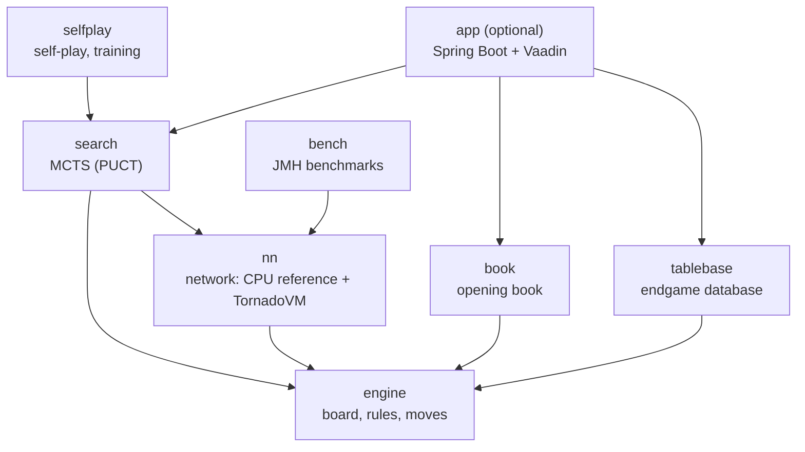
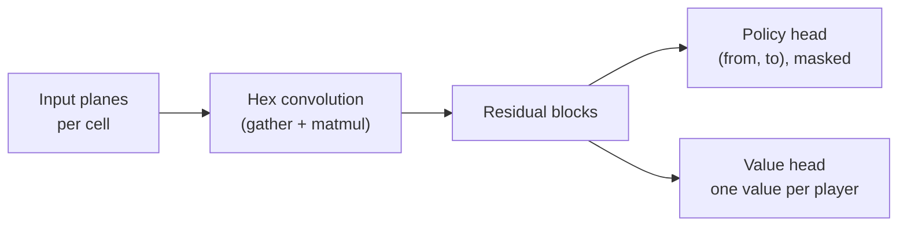
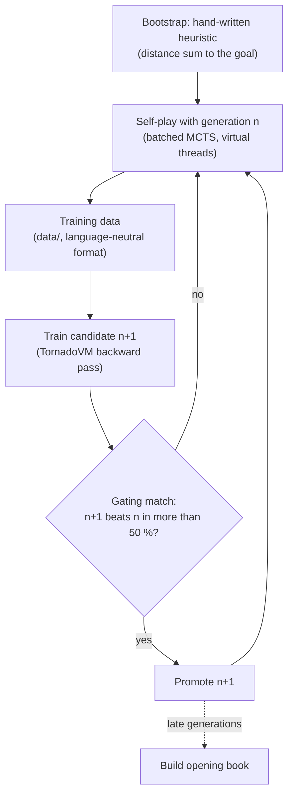

# Architecture

**TL;DR:** The project is an AlphaZero-style AI for Chinese Checkers (German: Stern-Halma), written entirely in Java 25.
Its main purpose is to show TornadoVM: batched network inference for self-play, network training and the BFS layers of the endgame database run as TornadoVM kernels on the GPU.
Everything else (rules engine, opening book, user interface) stays deliberately simple.
The code is split into eight Gradle modules; a CPU reference implementation checks every GPU kernel.

> **Status.** This document describes the approved plan.
> The development environment and the TornadoVM installation exist.
> The Gradle modules described below do not exist yet.

How to read the claims in this document:

| Label | Meaning |
|---|---|
| *Established* | Supported by a cited source, for example [Sturtevant2023]. See [references](references.md). |
| *Reported* | Relayed from the project owner's literature survey. Not re-verified. |
| *Project decision* | A choice made for this project. It can change. |

## Goals and non-goals

Goals (*project decision*):

- Show TornadoVM on a real workload: batched network forward pass, backward pass with an optimiser, and breadth-first search layers for the endgame database.
- Measure the gain. A benchmark compares CPU scalar code, the CPU Vector API and the TornadoVM backends over batch sizes from 1 to 1024.
- Play the [default rule set](rules.md) for two players first, then three players. The board and the value head support N players from the start.
- Make every long computation resumable, so that an interrupted run costs little.

Non-goals (*project decision*):

- Solving the full game. The full 121-cell board with 10 pieces per player is not solved (*established*, [Sturtevant2019]).
- A polished user interface. The web app is optional.
- A general-purpose deep-learning framework. The network uses a small set of standard operations, and the project implements only those.
- Languages other than Java on the critical path.

## Module map

An arrow points from a module to a module it depends on.
The dependency edges are a *project decision* and can change during implementation.

| Module | Responsibility | Depends on |
|---|---|---|
| `engine` | Board geometry, rule set, move generation, Zobrist hashing, symmetries. Plain Java. | nothing |
| `nn` | Network definition, CPU reference with `jdk.incubator.vector`, TornadoVM kernels for forward and backward pass, safetensors reader and writer. | `engine` (neighbour table), TornadoVM |
| `search` | Monte Carlo tree search with PUCT, virtual loss and leaf batching. Time and simulation budgets. Strength levels. | `engine`, `nn` |
| `selfplay` | Batched self-play runner, training-data format, trainer command-line tool, gating matches. | `search` (and through it `engine`, `nn`) |
| `book` | Opening book built from self-play games. | `engine`, self-play data |
| `tablebase` | Single-player endgame database. BFS layers as a TornadoVM kernel. | `engine`, TornadoVM |
| `bench` | JMH benchmarks: evaluations per second per backend and batch size. | `nn` |
| `app` | Optional web app: play against the AI, get move suggestions. | `search`, `book`, `tablebase` |

The build will use the Gradle Kotlin DSL.
A convention plugin in `build-logic/` will hold the shared Gradle settings, and `gradle/libs.versions.toml` will hold the dependency versions.
Neither file exists yet.

## Data representation

The board has 121 cells (see [rules](rules.md)).
The engine stores it as follows (*project decision*, unless a citation says otherwise):

- **Coordinates.** Cube and axial hex coordinates, as described in [RedBlobHex].
  The engine converts them once into a cell index from 0 to 120.
- **Bitboards.** One bitset of 128 bits (`long[2]`) per player, plus one occupancy bitset.
  121 cells fit into two 64-bit words.
- **Neighbour tables.** Precomputed arrays of 6 directions × 121 cells.
  The same table drives move generation and the hex convolution in the network.
- **Move generation.** Single steps come from a mask operation.
  Jump chains come from a breadth-first search over jump targets with a visited mask.
  Only the pair (start, end) defines a move, so the generator removes duplicates by that pair.
- **Hashing.** Zobrist hashing for the transposition table and the opening book [CPW].

Why bitboards: according to [Sturtevant2023], legal-move generation dominates run time in Chinese Checkers, and bitboards together with the BMI2 instructions PDEP and PEXT give considerable gains.

**Open question.** Java exposes PDEP and PEXT as `Long.expand` and `Long.compress`.
Whether these methods are fast on the target CPUs is not measured yet.
The project makes no performance claim about them until the `bench` module has measured them.

## Neural network

The network follows the AlphaZero pattern: one shared trunk, a policy head and a value head (*project decision*).
AlphaZero-style work on Chinese Checkers exists [Liu2019].

- **Hex convolution.** A square-grid convolution does not fit a star-shaped board.
  The network therefore implements the convolution as a gather: for each cell it reads the cell and its 6 neighbours (a 7-point stencil) through the neighbour index table, then multiplies by the weight matrix.
- **Residual blocks.** The trunk is a stack of residual blocks built from this hex convolution.
- **Policy head.** A move is a pair (from, to).
  The head scores pairs and masks every illegal pair before the softmax.
- **Value head.** One value per player instead of one scalar.
  With three players the game value is a vector, not a scalar (*reported*), so a scalar head cannot express it.
- **Size presets.** "Small": 32 channels × 4 blocks. "Large": 64 channels × 6 blocks.
  The plan trains large and distils into small later.
- **CPU reference.** A plain-Java implementation that uses `jdk.incubator.vector`.
  It is the test oracle: every TornadoVM kernel must match it within a fixed tolerance ε.
- **TornadoVM kernels.** Forward pass for batches; backward pass plus SGD or Adam for training.
- **Weights.** Stored in the safetensors format: a JSON header followed by raw tensor bytes.
  The format is simple enough for a small in-project reader and writer, and other tools can read the files.
- **Self-play data.** Stored in a language-neutral format, so that tools outside the JVM can read it.

## TornadoVM

### How the project uses it

TornadoVM compiles Java methods into GPU kernels at run time.
The project uses its `TaskGraph` API, `@Parallel` loops, and `KernelContext` where a kernel needs explicit tiling (*project decision*).

| Workload | Module | Why the GPU |
|---|---|---|
| Network forward pass (batched) | `nn` | MCTS collects 64 to 256 leaves and evaluates them in one call. |
| Network backward pass and optimiser | `nn` | Training is dense matrix work. |
| BFS layers of the endgame database | `tablebase` | Each layer processes many independent positions. |

### Version and backends

| Item | Value |
|---|---|
| TornadoVM version | 7.3.1 |
| Archive family | `jdk22plus` (the project runs JDK 25) |
| macOS aarch64 backends | `metal`, `opencl` |
| Linux amd64 backends | `ptx`, `opencl` (the PTX backend ships in the `cuda` archive) |
| Verified device | `tornado --devices` on the development Mac lists one Metal device: Apple M3 Max, 51.8 GB global memory. |

TornadoVM is not in nixpkgs.
The script `scripts/setup-tornado.sh` installs the pinned release instead.

### Install TornadoVM

The installation steps are in the [quick start](../README.md#quick-start).
The task `setup:tornado` works as follows:

- The script downloads the archive into a temporary directory in `tornado-sdk/` and compares its SHA-256 with the pinned value.
- If the values are different, the script stops and installs nothing.
- If the values agree, the script extracts the archive, moves it to its final name and points `tornado-sdk/current` at it.
- A new devenv shell adds `tornado-sdk/current/bin` to `PATH`.

You can run the script again at any time.
If a verified installation of the selected backend exists, the script skips the download and exits with code 0.

## Self-play and training loop

The training loop follows AlphaZero: self-play, training, gating (*project decision*).

- **Bootstrapping.** A hand-written heuristic (the sum of distances to the goal) guides the first generations, so that they do not play at random.
  The heuristic stages are in [search and evaluation](search-and-evaluation.md).
- **Parallel games.** Many games run at the same time on virtual threads.
  This keeps the GPU batches full.
- **Gating.** A new network replaces the old one only if it wins more than half of a match against it.
- **Downstream products.** The opening book comes from the games of late generations.
  The endgame database replaces the value head in the race endgame, where no contact between the armies remains.
  See [endgame and opening](endgame-and-opening.md).

## Long-running jobs

Self-play, training, book building and the tablebase build can run for hours.
Every such job follows the same conventions (*project decision*):

- **Resumable.** The job derives its state from the artefacts in `data/` (for example generation checkpoints), not from a separate progress file.
  After an interruption, you start the same command again and it continues.
- **Atomic writes.** The job writes each output under a temporary name and renames it when it is complete.
  Only complete files carry the final name.
- **Abortable.** `SIGINT` and `SIGTERM` set a flag.
  The job finishes or discards the current item, prints a summary and exits.
- **Progress.** One line on stderr per interval, with count, rate, ETA and elapsed time. No carriage-return progress bars.
- **Lock.** A lock file prevents two runs of the same job at the same time.
- **Status.** A `--status` flag reports whether the job runs and since when.

## Compute plan

*Project decision:*

1. **Local first.** Development and first training runs happen on the development Mac with the Metal backend. OpenCL is the fallback.
2. **Cloud later.** Large runs move to NVIDIA GPUs with the PTX backend.
   The plan packs self-play as a worker into one container image and stores checkpoints in object storage.
   Because every job is resumable, interruptible (spot) instances are acceptable.
   The provider is chosen after a price comparison just before the first cloud run.

Cloud credentials and account details live only in the gitignored `.env` file.
The repository contains only `.env.example` with placeholders.

## Optional web app

The `app` module is optional and comes last (*project decision*):

- Spring Boot with Vaadin Flow.
- The board is an SVG component. You play against the AI and choose its level with a slider.
- A "suggest move" button calls the `Advisor` API. It returns the top-k moves, each with visit share, value and principal variation.
- A live evaluation bar per player. Before you commit a move, the app shows how the move changes your value.
- The engine runs in the same process. TornadoVM is optional; without it, the app uses the CPU reference.

## Key decisions

Each entry gives the decision, the reason, and the alternatives that the project rejected.
All entries are *project decisions*.

1. **Java only.**
   Reason: the project is a TornadoVM showcase, and TornadoVM runs Java.
   Rejected: Rust compiled to WASM, and JAX for training. Only language-neutral ideas were kept: standard network operations, safetensors weights, a neutral self-play data format, leaf batching, train large and distil.
2. **One MCTS engine with a neural network for two and three players.**
   Reason: one search covers both player counts, and alpha-beta works for two players only (*reported*, see [search and evaluation](search-and-evaluation.md)).
   Rejected as the main engine: alpha-beta for two players plus Max^n, Paranoid or Best Reply Search for three players [Sturtevant2003], [SchaddWinands2011].
   Alpha-beta with the heuristic stays as a baseline opponent and test oracle.
3. **Hex convolution as gather over the neighbour table.**
   Reason: it uses the board as it is and reuses the engine's neighbour table.
   Rejected: embedding the star in a rectangular grid for a standard 2D convolution, which adds cells that do not exist and needs extra masking.
4. **CPU reference as the oracle for every kernel.**
   Reason: GPU kernels fail silently with wrong numbers; a comparison within ε catches that.
   Rejected: testing kernels only against hand-computed values.
5. **Safetensors with an in-project reader and writer.**
   Reason: the format is simple and readable by other tools.
   Rejected: Java serialisation and framework-specific checkpoint formats.
6. **Local first, cloud later.**
   Reason: the Metal backend on the development Mac is enough to build and verify the system.
   Rejected: starting on rented GPUs before the pipeline works.
7. **Single-player endgame database for the last k ≤ 4 to 5 pieces in the goal region.**
   Reason: the plan judges a full two-player table not feasible, because the table size grows very fast with the number of cells (size figures *reported*, see [endgame and opening](endgame-and-opening.md)).
   Rejected: a full two-player endgame table.
8. **Simple storage outside the GPU path.**
   Reason: the showcase is TornadoVM; everything else stays simple.
   The opening book is a sorted binary file.
   Rejected: a database server for the book.
9. **Pinned TornadoVM release installed by a script.**
   Reason: TornadoVM is not in nixpkgs; a pinned version with a SHA-256 check is reproducible.
   Rejected: an unpinned "latest" download.
