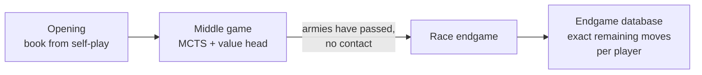

# Endgame and opening

**TL;DR:** An endgame can be solved exactly. When the armies no longer touch, each player
faces a separate solitaire problem, and a database gives the exact number of remaining moves.
No opening can be called "best", because nobody has solved the full game.
This project builds two things.
The first is a small single-player endgame database for the last 4 to 5 pieces, computed on the GPU with TornadoVM.
The second is an opening book from self-play.
The book will be good, but it will not be optimal.

## How to read this document

Each claim belongs to one of three levels:

| Level | Meaning | Marker in the text |
|---|---|---|
| Established | A published source supports the claim. | Citation key, for example [Bell2009] |
| Reported | The project owner's literature survey relays the claim. Nobody has checked it again against the source. | "reported" |
| Project decision | The project chose this. It can change. | "project decision" |

Numbers that this document computes are marked as computed.
The game rules are in [rules](rules.md).
The module layout is in [architecture](architecture.md).
Search and the value head are in [search and evaluation](search-and-evaluation.md).
Full bibliographic entries are in [references](references.md).

Terms used below:

- **Goal triangle:** the 10 cells in the opposite corner that a player must fill.
- **Contact:** a player can still jump over an opponent piece, or block one.
- **Race endgame:** a position without contact. Each player only moves their own pieces home.
- **Retrograde analysis:** a search that starts at the final position and works backwards, one move layer at a time.
- **Ranking function:** a bijection from a position to an integer index in `0 .. N-1`. With it, a table needs no keys.

## Why a best endgame exists and a best opening does not

**The full game is unsolved.**
Nobody has solved the standard board with 121 cells and 10 pieces per player [Sturtevant2019].
Only small two-player variants are strongly solved (see [Status of the game](rules.md#status-of-the-game)).
Without a solved game, "best opening" has no defined meaning.
Only heuristic opening knowledge exists, such as ladders, bridges and compact groups (reported),
plus the solitaire optimum described [below](#the-27-move-solitaire-pattern-as-a-template) [Bell2009].

**A race endgame splits into two independent problems.**
After the armies have passed each other, no piece can jump over a foreign piece.
Then the database value for each player plus the side to move determines the outcome (reported).
The game becomes two separate solitaire problems.
A database can solve each of them exactly.
In this sense, a best possible endgame is computed, not played.

With 3 players the game is not zero-sum and has no unique game value (see [Three-player specifics](rules.md#three-player-specifics)).
A race endgame still splits into independent solitaire problems, one per player.
This document infers that the winner then follows from the remaining-move counts and the turn order.
No cited source states this for 3 players.

## The endgame database principle

[RoschkeSturtevant2013] combined UCT search with an endgame database.
The database stores, for every configuration of the 10 pieces in the last n rows,
the exact number of moves that remain until the goal triangle is full.
A retrograde breadth-first search (BFS) from the filled goal triangle builds it.
This description of the principle is reported: it comes from the owner's survey, not from a new reading of [RoschkeSturtevant2013].

The retrograde procedure:

1. Mark the position with all pieces in the goal triangle as distance 0.
2. For layer d, find all positions that reach a position of layer d in one move.
3. Give each of these positions distance d + 1 if it has no distance yet.
4. Repeat until a layer is empty.

Two points make this practical.
First, a ranking function maps each configuration to an array index, so the table stores only values.
[Sturtevant2023] covers ranking for Chinese Checkers.
Second, a solver can search forward from the start or backward from the goal.
[SturtevantSaffidine2017] compares forward and backward endgame solvers with results in Chinese Checkers.

### Size of a full 10-piece database

The table needs one entry per way to place 10 identical pieces on n cells.
That count is the binomial coefficient C(n, 10).
The region sizes come from the star shape (computed from the board geometry): the goal triangle has 4 rows (10 cells), the next rows have 13, 12, 11, 10 and 9 cells.

The exact values below are computed with `python3 -c "from math import comb; print(comb(35,10), comb(46,10), comb(65,10))"`.
The approximations in the third column are reported from the owner's survey.

| Region | Cells n | C(n, 10), exact (computed) | Reported approximation | Size at 1 byte per entry (computed) |
|---|---|---|---|---|
| Last 6 rows | 35 | 183,579,396 | about 1.8e8, about 180 MB | about 184 MB (0.17 GiB) |
| Last 7 rows | 46 | 4,076,350,421 | about 4.1e9, about 4 GB | about 4.1 GB (3.80 GiB) |
| Up to the middle row | 65 | 179,013,799,328 | about 1.8e11, disk only, needs ranking | about 179 GB (167 GiB) |

The computed values agree with the reported approximations.
The 65-cell table does not fit into the 51.8 GB of global memory that the development GPU reports.
It needs disk storage and a ranking function.

## Project scope for the endgame database

This section is a **project decision**, taken from the implementation plan.

- **Single player only.** The plan judges a full two-player table not feasible. The database stores "distance to finished" for one player.
- **Last k pieces, k ≤ 4 to 5.** The table covers positions in which at most k pieces of one player are outside the goal triangle, inside a fixed region near the goal.
- **Retrograde BFS on the GPU.** Each BFS layer runs as a TornadoVM kernel. This is the second showcase of the project, after the network kernels.
- **Size first.** The project computes the table size before it builds the table.

A first size estimate (computed): the number of positions with at most k of the 10 pieces outside the goal triangle,
inside a region of n cells, is the sum over m = 0 .. k of C(10, 10 − m) · C(n − 10, m).

| Region cells n | k = 4 (computed) | k = 5 (computed) |
|---|---|---|
| 35 | 2,946,251 | 16,335,011 |
| 46 | 13,255,561 | 108,257,545 |
| 65 | 74,837,126 | 951,484,898 |

At 1 byte per entry, the largest of these tables needs about 951 MB (0.89 GiB), which is less than 1 GB.
The region and k are not fixed yet.
The estimate assumes that every piece stays inside the region.
A backward move can lead out of it, so the builder must either cut such moves or enlarge the region.
The rule set also changes which positions are reachable, because it decides whether a piece may leave the goal triangle again
(see `leaveGoal` in [rules](rules.md)).

### When the database replaces the value head

The database replaces the value head only in a race endgame, that is, when no contact is possible (project decision).
The search then reads the exact remaining-move count for each player from the table.
In a 2-player game, the value follows from the difference of the two counts and the side to move.
While contact is possible, the value head stays in charge, because the database ignores blocks and jump bridges over foreign pieces.

The contact test must never report "no contact" while contact is still possible.
If it does, the search uses a wrong exact value and trusts it fully.
A conservative test, which reports contact in some cases without contact, is acceptable: it costs strength, not correctness.

## Opening book from self-play

This section is a **project decision**.

The book comes from the self-play games of late network generations.

- **Horizon:** positions up to about move 12.
- **Key:** a Zobrist hash of the position [CPW].
- **Canonicalisation by symmetry:** before hashing, the position is mapped to one canonical image of its symmetry class. The [Symmetry](rules.md#symmetry) section of the rules defines the symmetries that the engine implements. The project has not yet chosen the canonical image; one option is the image with the smallest hash.
- **Stored values:** visit counts and results for each position.
- **File format:** a simple sorted binary file. A sorted file allows binary search without an index structure. The exact record layout is not fixed yet.

The canonicalisation must also map moves.
A book entry for the canonical image must be mapped back to the actual orientation of the board before the engine plays it.

### Honest limits

- The book is "good", not "best possible". It reflects what the network preferred in self-play, including its blind spots.
- Self-play explores narrowly. Lines that the network never chose have few or no visits.
- The results depend on the network generation. A new generation can make old book entries obsolete.
- Zobrist hashes can collide. A 64-bit key makes this rare, not impossible.
- With 3 players, a result is a vector, not a single number. The book format must allow one result per player.

## The 27-move solitaire pattern as a template

In solitaire, one player moves all 10 pieces across the board alone.
Levenspiel found a solution with 27 moves in 1971 (reported via [Bell2009]).
[Bell2009] proved that this solution is optimal: no shorter solution exists.

The project uses this pattern as a template, for two purposes (project decision):

- **Test oracle:** the solitaire solver of the engine must find no solution shorter than 27 moves.
- **Opening idea:** the first moves of the pattern can seed the book or guide early search.

The pattern is optimal only without an opponent.
It is not a proof of optimality against an opponent, because a real opponent blocks cells and offers jump bridges.

## Validation plan

This section is a **project decision**. The implementation plan requires that sampled database entries match brute force. The other checks below extend that requirement.

1. **Small boards first.** Build the database for a small region and a small k. Compute every entry again with a forward brute-force search (BFS or IDA*). All entries must match.
2. **Samples on the real board.** Draw random positions from the full table. Solve each position with a forward solver. The values must match.
3. **Layer consistency.** For each entry with distance d > 0, at least one move must lead to distance d − 1, and no move may lead to a distance below d − 1. A short check program tests every entry.
4. **GPU against CPU.** Run the retrograde BFS once on the CPU and once as a TornadoVM kernel. The two tables must be identical byte for byte.
5. **Ranking round trip.** For every index i, `rank(unrank(i))` must equal i.
6. **Solitaire check.** The full solitaire solver must return 27 moves for the standard start [Bell2009]. Nobody has estimated the cost of this search yet. If it is too expensive, the check replays the known 27-move solution and confirms that every move is legal.

For the opening book:

1. Load a position, compute its canonical key, apply every symmetry, and compute the key again. All keys must be equal.
2. Map a book move to the actual orientation and check that it is legal in the original position.
