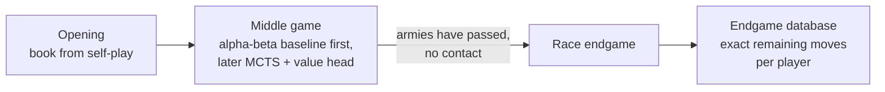

# Endgame and opening

**TL;DR:** An endgame can be solved exactly. When the armies no longer touch, each player
faces a separate solitaire problem, and a database gives the exact number of remaining moves.
No opening can be called "best", because nobody has solved the full game.
This project plans two things.
The first, an optional experiment, is a small single-player endgame database for the last 4 to 5 pieces, computed on the GPU with TornadoVM.
The second is an opening book from self-play.
The book will be good, but it will not be optimal.

## How to read this document

Each claim belongs to one of three levels:

| Level | Meaning | Marker in the text |
|---|---|---|
| Established | A published source supports the claim. | Citation key, for example [Bell2009] |
| Reported | The project owner's literature survey relays the claim. Nobody has checked it again against the source. | "reported" |
| Project decision | The project chose this. It can change. | "project decision" |

Numbers that this document computes are marked as computed.
The game rules are in [rules](rules.md).
The module layout is in [architecture](architecture.md).
Search and the value head are in [search and evaluation](search-and-evaluation.md).
Full bibliographic entries are in [references](references.md).

Terms used below:

- **Goal triangle:** the 10 cells in the opposite corner that a player must fill.
- **Contact:** a player can still jump over an opponent piece, or block one.
- **Race endgame:** a position without contact. Each player only moves their own pieces home.
- **Retrograde analysis:** a search that starts at the final position and works backwards, one move layer at a time.
- **Ranking function:** a bijection from a position to an integer index in `0 .. N-1`. With it, a table needs no keys.

## Why a best endgame exists and a best opening does not

**The full game is unsolved.**
[Sturtevant2019, §5] reports strong solutions only for small two-player variants, up to a 6×6 board with 6 pieces per player.
For one common board size with 1.73 × 10^24 states, the paper says only that it "might be weakly solvable" with a good proof strategy, and that small proofs were hard to construct [Sturtevant2019, §1].
See also [Status of the game](rules.md#status-of-the-game).
Without a solved game, "best opening" has no defined meaning.
Only heuristic opening knowledge exists, such as ladders, bridges and compact groups (reported),
plus the solitaire optimum described [below](#the-27-move-solitaire-pattern-as-a-template) [Bell2009].

**A race endgame splits into two independent problems.**
After the armies have passed each other, no piece can jump over a foreign piece.
Then the database value for each player plus the side to move determines the outcome (reported).
Under the project's move limit, the plies left also count (see [the conversion rule](#when-the-database-replaces-the-evaluation)).
The game becomes two separate solitaire problems.
A database can solve each of them exactly.
In this sense, a best possible endgame is computed, not played.

With 3 players the game is not zero-sum (reported; see [Three-player specifics](rules.md#three-player-specifics)).
A race endgame still splits into independent solitaire problems, one per player.
The project decided that a three-player game ends at the first winner and that the players move clockwise around the star (project decision, 2026-11-07).
With these two rules, the winner follows from the remaining-move counts and the turn order (project reasoning; no cited source states this for 3 players).
A later option `ranking = FULL_RANKING`, which plays on to rank second place, is reserved but not implemented. It would need more than the first-finisher comparison.

## The endgame database principle

Three earlier works on endgame databases for Chinese Checkers are listed in [Sturtevant2019]:

- [RoschkeSturtevant2013], "UCT enhancements in Chinese Checkers using an endgame database".
- [Sturtevant2015], "Challenges and progress on using large lossy endgame databases in Chinese Checkers". [Sturtevant2019, §2] cites it for the use of full-board single-agent distances in play.
- [SturtevantSaffidine2017], "A study of forward versus backwards endgame solvers with results in Chinese Checkers".

[Sturtevant2019] cites these works but does not describe their databases.
The project has not read them yet.

The principle that this project uses is reported (owner's survey, not checked against [RoschkeSturtevant2013]):
the database stores, for every configuration of the 10 pieces in the last n rows,
the exact number of moves that remain until the goal triangle is full.
A retrograde breadth-first search (BFS) from the filled goal triangle builds it.

The retrograde procedure:

1. Mark the position with all pieces in the goal triangle as distance 0.
2. For layer d, find all positions that reach a position of layer d in one move.
3. Give each of these positions distance d + 1 if it has no distance yet.
4. Repeat until a layer is empty.

Two points make this practical.
First, a ranking function maps each configuration to an array index, so the table stores only values.
[Sturtevant2023] covers ranking for Chinese Checkers.
Second, a solver can search forward from the start or backward from the goal.
[SturtevantSaffidine2017] compares forward and backward endgame solvers with results in Chinese Checkers (title as listed in [Sturtevant2019]).

### What the small-board solves teach

[Sturtevant2019] does not build an endgame database for the full board.
It strongly solves small two-player boards. Three of its findings are relevant to this project's database builder (project reasoning).

- **Solver design** [Sturtevant2019, §4]: three choices matter most. They are (1) the ranking function that orders the states, (2) the order in which states are proven, and (3) the immediate propagation of a proven win to the parent states. On 7×7 with 3 pieces per player, good choices give the value of 99% of the states in one pass and finish the proof in 8 passes. Without parent propagation or an optimised proof order, the proof takes up to 34 passes, with 0.5% of the states proven in the first pass.
- **Storage** [Sturtevant2019, §5]: the 6×6 board with 6 pieces per player has 2,313,100,389,600 positions. The solvers use two bits per state. With both symmetries, the solve stores 500 billion states in 135 GB. This exceeds the main memory of the computer that the paper used, so the solver works on disk (external memory).
- **Symmetry** [Sturtevant2019, §3.5]: there are two kinds. A left-right flip gives a position with the same value. It reduces the stored states by a factor of 1.998 on 6×6 with 6 pieces, not by 2, because some positions are identical after the flip. The second kind is player symmetry: flip the board top to bottom and swap the colours and the side to move.

The project's single-player builder is a different problem: it stores distances, not win/loss values (see [Project scope](#project-scope-for-the-endgame-database)).
The project expects the ranking and storage lessons to apply anyway (project reasoning).
A distance needs more than two bits per entry, so the 2-bit figure applies only to a win/loss/draw table.

### Size of a full 10-piece database

The table needs one entry per way to place 10 identical pieces on n cells.
That count is the binomial coefficient C(n, 10).
The region sizes come from the star shape (computed from the board geometry, `Rows.regionCells`): the goal triangle has 4 rows (10 cells); the rows before it, counted in the player's own rows 4, 3, 2, 1, 0, have 5, 6, 7, 8 and 9 cells that the player may enter. Rows 4 and 3 of the board also hold cells of the two side corners, which no player may enter; an earlier version of this table counted them (13, 12, 11, 10 and 9 cells per row) and so overstated every region.

| Region (player's rows) | Cells n | C(n, 10), exact (computed) | Size at 1 byte per entry | Built |
|---|---|---|---|---|
| rows ≥ 4 | 15 | 3,003 | 3 KB | in a test |
| rows ≥ 3 | 21 | 352,716 | 353 KB | in a test |
| rows ≥ 2 | 28 | 13,123,110 | 12.5 MB | yes, `tablebase/tables/rows2.bin` (E03) |
| rows ≥ 1 | 36 | 254,186,856 | 242 MB | yes, `tablebase/tables/rows1.bin` with Git LFS (E09, [below](#the-rows--1-table-e09-optional)); rebuilt into the cache if only a pointer exists |
| rows ≥ 0, the middle row | 45 | 3,190,187,286 | 3.0 GB | planned on the GPU (E12) |

The rows ≥ 0 table fits into the 51.8 GB of global memory that the development GPU reports; the earlier estimate of 179 GB came from the overstated cell count.

## Project scope for the endgame database

This section is a **project decision**, taken from the implementation plan. The database is an optional experiment, not a goal of the project.

- **Single player only.** The plan judges a full two-player table not feasible. The database stores "distance to finished" for one player.
- **Last k pieces, k ≤ 4 to 5.** The table covers positions in which at most k pieces of one player are outside the goal triangle, inside a fixed region near the goal.
- **Retrograde BFS on the GPU.** Each BFS layer runs as a TornadoVM kernel. This is the second showcase of the project, after the network kernels.
- **Size first.** The project computes the table size before it builds the table.

A first size estimate (computed): the number of positions with at most k of the 10 pieces outside the goal triangle,
inside a region of n cells, is the sum over m = 0 .. k of C(10, 10 − m) · C(n − 10, m).

| Region cells n | k = 4 (computed) | k = 5 (computed) |
|---|---|---|
| 35 | 2,946,251 | 16,335,011 |
| 46 | 13,255,561 | 108,257,545 |
| 65 | 74,837,126 | 951,484,898 |

At 1 byte per entry, the largest of these tables needs about 951 MB (0.89 GiB), which is less than 1 GB.
The region and k are not fixed yet.
The estimate assumes that every piece stays inside the region.
A backward move can lead out of it, so the builder must either cut such moves or enlarge the region.
The rule set also changes the table, in three ways (project reasoning):

- **`leaveGoal`** decides whether a piece may leave the goal triangle again, and so which backward moves the BFS generates. The default is `FORBIDDEN` (project decision; differs from [Sturtevant2019, §3], which allows leaving the goal). The database must be built for one fixed value, and a table built for `FORBIDDEN` is not valid for `ALLOWED`.
- **Win condition:** the project uses Definition 1 of [Sturtevant2019, §3.2]. The goal counts as filled when every goal cell is occupied and at least one piece belongs to the player; opponent pieces fill the other cells. The single-player table assumes a goal with own pieces only. A position with an opponent piece in the goal is therefore not a race endgame for the database.
- **Move limit:** the default is 200 plies for two players (project decision, 2026-11-07). The table gives remaining moves without a limit, so the search must compare each count with the plies left before the limit (see the next section).

### When the database replaces the evaluation

The database replaces the evaluation only in a race endgame, that is, when no contact is possible (project decision).
The evaluation is the single-agent distance heuristic of the alpha-beta baseline first, and the value head of the network later (project decision, 2026-11-07).
The search then reads the exact remaining-move count for each player from the table.
While contact is possible, the evaluation stays in charge, because the database ignores blocks and jump bridges over foreign pieces.

How a database value becomes a game value in a 2-player game (project reasoning):

1. Let a be the count of the side to move, b the count of the opponent, and L the plies left before the move limit.
2. The side to move fills the goal on its a-th move, which is ply 2a − 1 from now. The opponent fills it on ply 2b.
3. If a ≤ b and 2a − 1 ≤ L, the side to move wins. If b < a and 2b ≤ L, the opponent wins.
4. Otherwise nobody finishes before the limit, and `drawHandling` decides the result.

The default is `drawHandling = SCORE_BY_DISTANCE` (project decision, 2026-11-07).
With this default, case 4 is not a plain draw.
The score comes from the distances at the limit, measured with the single-agent distance table (see [rules](rules.md#draw-handling)), not with the database count.
The database alone therefore does not give the value of case 4: the search must play on to the limit or estimate the distances there.
With `drawHandling = DRAW`, case 4 is a draw.
`DRAW` stays available because the solved tables of [Sturtevant2019, §5] count draws as real draws.

With `repetition = REPETITION_IS_DRAW` (Definition 4 of [Sturtevant2019, §3.4]: any repeated state draws), a race endgame cannot end in a repetition under optimal play, because each player only wants to shorten the own count (project reasoning).
The project default is `repetition = MOVE_LIMIT` (project decision; differs from [Sturtevant2019, §3.4], Definition 4).
The move limit applies in both modes as a backstop.

The contact test must never report "no contact" while contact is still possible.
If it does, the search uses a wrong exact value and trusts it fully.
A conservative test, which reports contact in some cases without contact, is acceptable: it costs strength, not correctness.

**Implemented in round 2 (E08, `RaceEvaluator`, spec names `racelin` and `racelin1`):** the search uses the rule above as a leaf value in passed positions whose two configurations the race table covers, with "passed" as the contact test (conservative in the sense above). Because the table counts are exact only for the restricted solitaire and the rule ignores blockades, the value is a heuristic for the search and lives in its own score band (`|score| >= 5000`), which labels, value targets, the aspiration window and futility pruning recognise and ignore; only S1 labels passed positions. Measured: with the rows ≥ 1 table and race play on both sides about +45 Elo, with the rows ≥ 2 table nothing, because its region covers almost no leaf of a contact search. Details and numbers: [search and evaluation](search-and-evaluation.md#race-arithmetic-as-a-leaf-value-e08-racelin-and-racelin1-measured-2026-11-08).

## The race module

This section is a **project decision**, implemented in round-2 experiment E03 (plan: [baseline-round2-plan.md](baseline-round2-plan.md)). Numbers are measured unless marked otherwise.

**Passed.** A two-player position is *passed* when every piece of player 0 has a larger `r` than every piece of player 1 (`RaceAdjudication.passed`; both players with all 10 pieces). Each army is then entirely ahead of the other in its own direction. This is a conservative form of "no contact": a piece can still turn back, so passing is not yet a proof that the two solitaires are independent; that proof is the job of the criterion S1 below.

**Rows.** In a player's own orientation the row of a cell is `r` (player 0) or `-r` (player 1): both players advance towards higher rows, their goal corner is rows 5 to 8, their start corner rows -8 to -5 (`Rows`). Every step changes the row by at most 1, every jump by exactly 0 or 2 with its hurdle one row short; every cell a player may stand on below the tip has an allowed neighbour on the next row (tested exhaustively, `GeometryRowAxisTest`).

### The rows ≥ 2 table

`tablebase/tables/rows2.bin` (module `tablebase`, 13,123,110 configurations of 10 pieces on the 28 allowed cells of rows 2 to 8, one byte each) holds, for `leaveGoal = FORBIDDEN`, the exact number of moves to fill the goal when every configuration on the way stays inside the region, built by the layered retrograde BFS (`RetrogradeBuilder`, 11.9 s on 8 threads; max count 15; every configuration reaches the goal; layer sizes 1, 14, 164, 1493, 10801, 60633, 258914, 825110, 1919127, 3146725, 3465380, 2382230, 896106, 148408, 7929, 75). Layer consistency on the whole rows ≥ 3 table proves that table exact, the rows ≥ 4 table equals a forward brute force, and the shared table is checked on samples (`RaceTableTest`).

The file is tracked with Git LFS. It starts with a header (format version, rule, region, state count, SHA-256 of the body) and is deterministic, so its SHA-256 (`RaceTable.SHA256`, equal to the LFS object id) identifies it. `RaceTable.rows2()` uses a file only when its SHA-256 equals that constant; a Git LFS pointer file (a clone without LFS content), a missing, stale or corrupt file leads to a rebuild into `tablebase/build/tables/` (or `-Dsternhalma.tablebase.dir`), and the rebuilt file must reproduce the constant.

A count is an **upper bound** of the unrestricted solitaire distance (a route through row 1 might be shorter). It serves play and search heuristics, never a label.

### The rows ≥ 1 table (E09, optional)

The same builder (`RetrogradeBuilder`, generic in the region since E09) produces the table of the 36 allowed cells of rows 1 to 8: 254,186,856 configurations, one byte each, `leaveGoal = FORBIDDEN`. Every configuration reaches the goal inside the region; the largest count is 19; layer sizes 1, 14, 164, 1493, 11353, 72696, 384397, 1638799, 5542557, 14761224, 30633718, 48819428, 58547341, 50838402, 29862660, 10768087, 2108414, 190455, 5610, 43.

**Never committed.** The file (`rows1.bin`, 254,187,064 bytes) is too large for the Git LFS quota. `RaceTable.rows1()` looks for it in `-Dsternhalma.tablebase.dir`, then in the cache `tablebase/build/tables/` (never in `tablebase/tables/`), and otherwise builds it there on first use; a file is used only when its SHA-256 equals `RaceTable.ROWS1_SHA256` (`85850d6f47f526daf45ac5cd3a0dad8841244cb50d0d8d15a5b6a54f09d1bfd1`), and a rebuilt table must reproduce that constant. `./gradlew --no-build-cache :tablebase:buildTable -Prows=1 [-Pthreads=4]` builds it explicitly; the task refuses to write the uncommitted table into `tablebase/tables/`. `RaceTable.rows1IfCached()` returns null instead of building, which is what the tests use: every test that needs the table is skipped with a message when it is absent. Everything else works without the file; the rows ≥ 2 table stays the default of race play, and a spec selects the extended table with `racerows=1` (see below).

**Build cost (measured 2026-11-07, 16 cores shared with other jobs, JDK 25, `-Xmx2g`, direct `java` invocation under `/usr/bin/time -l`):** 305.6 s on 4 threads (0.83 M states/s, 822 CPU-s, 1-minute load 7 before and 14 after) and 113.1 s on 8 threads (2.25 M states/s, 506 CPU-s, load 14 before and 29 after); both builds gave the same SHA-256, so the table does not depend on the thread count. Peak resident set of the JVM 579 MB (the table is a 254 MB array; nothing else is large). Loading the cached file takes 0.8 s. The builder ranks a predecessor by merging the moved piece's region index into the sorted indices of the state (`Ranking.rankReplacing`, no sort) and generates landings into a buffer; the rows ≥ 2 build now takes 9.5 s on 4 threads under load 11 (before E09: 11.9 s on 8 threads), with the committed file reproduced byte for byte (`RaceTableTest`).

**Validation (`TableValidation`, Gradle task `:tablebase:validateTable`, all with the engine's move generator `Position.generate`, independent of the builder's own generator):**

| Check | Result |
|---|---|
| Layer consistency on **every** one of the 254,186,856 entries: entry 0 only at the goal, from entry d > 0 some legal move inside the region reaches d − 1 and none reaches less, no unreachable entry | consistent (226.8 s on 8 threads). As for rows ≥ 3, this proves every entry exact for the restricted solitaire. |
| Against the committed rows ≥ 2 table on all 13,123,110 states both tables define | equal on 13,112,552; shorter by exactly one move on 10,558 (0.08 %; the surveyor's 1.03 % was measured on another table); never longer, never unknown |
| Forward breadth-first search inside the region from 3000 random configurations with count ≤ 6 (cap 2 M states each; 337 M states expanded in 246.6 s on 8 threads) | 3000 solved, 0 mismatches (distances 2 to 6, most at 6) |
| `RowsOneTableTest` (skipped without the file): checksum, layer sizes, the comparison above, layer consistency on 200,000 samples, forward BFS on 300 configurations | green |
| `RaceTableRows1Test` (search, skipped without the file): race moves legal and strictly count-reducing, player flip, a race is won in exactly the count against an opponent outside the region, parity bound ≤ count on 2 M sampled states, the beam ordered by the table finds the 27-move solitaire and never fewer | green |

### Race play (`race=1`, `race=2`)

In a passed position the player with `race=1` does not search: it plays the legal move whose resulting configuration has the smallest table count (ties: larger distance gain, then move order); when its configuration is not covered by the table, the first move of a solitaire plan (`Solitaire`, a beam search of width 200 whose landing cells all lie above the opponent's rearmost piece); when neither yields a legal move, the search decides. `race=2` races only while the table arithmetic does not say the race is lost (the opponent finishes first under the conversion rule above); a lost race goes back to the search, which may find a block. `racetable=0` disables the table; `racerows=1` uses the rows ≥ 1 table instead of the default rows ≥ 2 table (E09; built into the cache on first use when absent). Race play is a strength heuristic and never produces a label.

### The criterion S1 (adjudication)

S1 (`RaceAdjudication`) ends a passed game with a label that cannot be wrong. Its soundness statement and proof are in the class's javadoc; in short, with W the predicted winner, Lo the loser, rows W's rows and F Lo's front (the Lo piece closest to W): if all W pieces stand on rows ≥ F + 3 before a Lo move, no Lo move raises Lo's front by more than one row (a jump that gains two rows needs a hurdle one row short of its landing, and Lo never gets next to a W piece), so after k Lo moves Lo stands on rows ≤ F + k. W's plan is a solitaire sequence over W pieces only whose move t lands (intermediate landings included) on rows ≥ F + k + 1, with W's rearmost piece on rows ≥ F + k + 3 before every Lo move; Lo therefore never blocks it or alters its hurdles. In a passed position no piece stands in the opponent's goal (fewer than 10 cells lie behind a goal's front row), so neither Definition 1 nor Definition 2 interferes, Lo always has a legal move (its rearmost non-goal piece can step back), and Lo plays a solitaire with own hurdles only, so it needs at least the parity-assignment bound LB of moves (a piece reaches a goal cell in one move only by a step to a neighbour or a chain to a cell of the same class `(q mod 2, r mod 2)`). S1 fires only if W's plan of U moves satisfies U ≤ LB (W to move) or U ≤ LB − 1 (Lo to move) and ends by the move limit; it requires two players, `blockingStates = NONE` and `repetition = MOVE_LIMIT` (under `REPETITION_IS_DRAW` a plan position could repeat an earlier game position), and works for both `leaveGoal` and both `blockadeRule` values. The plan comes from the beam (width 300) with these constraints built in and is then re-verified independently (engine legality on the W-only position, an independent path search, the row conditions, the final configuration). S1 need not fire in every won race; it never fires in a race that is not won.

Only S1 may label passed positions (label policy of the round-2 plan); the table and race play may not.

### Race values in the search (E08)

`RaceEvaluator` wraps `linear-r2` and, in a passed position whose two configurations the table covers, returns the conversion rule's verdict as `5000 + 200 x margin` (won) or `-(5000 + 200 x (margin - 1))` (lost), margin being the difference of the table counts; `racelin` reads the rows ≥ 2 table, `racelin1` the rows ≥ 1 table. The band `|score| >= 5000` (`Scores.RACE_BASE`) marks these values as heuristics: the self-play tool's margin layer ignores them, the search widens its aspiration window after one and never prunes by futility where one can appear within the pruning depth (`RaceEvaluator.futilitySafe`: the pieces each side need not move within the depth already pass each other, and neither side has more pieces behind the region than moves). The plan's fallback to the linear value for an uncovered configuration lets the losing side keep a piece behind the region on purpose (measured: 0 instead of 5 to 17 covered passed plies per game); the weight `wout=1` estimates such configurations instead (steps to the region plus the count with the pieces placed on its first row), which is continuous but did not gain. Results, Bench ratios and the label-leak check: [search and evaluation](search-and-evaluation.md#race-arithmetic-as-a-leaf-value-e08-racelin-and-racelin1-measured-2026-11-08); in short, `racelin1` with `racerows=1` on both sides gains +45.4 ± 15.7 and +49.0 ± 17.4 Elo at equal nodes (seeds 33 and 34, 300 pairs) over the wave-1 candidate with race play and futility, `racelin` with the rows ≥ 2 table +5.8 ± 12.2 and +6.9 ± 10.6.

### Measurements (E03)

Measured on 2026-11-07 on the E03 build (branch `exp/E03`), 16 cores shared with other jobs (1-minute load 15 to 40), so every CPU-time figure is a figure under load; node-limited results do not depend on it.

**Self-play replay (`RaceReplay`, seed 1002, 1000 games, 4 random opening plies, S1 at every ply until it fires, then the game is played to the end by the same players):**

| Player | Games decided | Mean plies | Passed plies | S1 fires | Mean first firing ply | Plies saved | Play-outs that ended otherwise | Adversary |
|---|---|---|---|---|---|---|---|---|
| BEST_SPEC at 20 000 nodes | 997 of 1000 | 93.8 | 18.3 % | 997 of 1000 (99.7 %) | 86.0 | 7.45 per game, 7.9 % of all plies | 6 of 997 (see below) | 997 verdicts, 0 failures: exhaustive on every verdict (the loser has at most 6 moves in every plan; 54.0 M nodes, 40.3 M leaves, 0 of 997 hit the cap of 10 M nodes, 26 s on 8 threads) and 5 complete lines each |
| `ab:eval=distance,nodes=1000` (weak-player lower bound) | 995 of 1000 | 128.8 | 7.2 % | 685 of 1000 (68.5 %) | 126.0 | 3.29 per game, 2.6 % of all plies | 7 of 685 | 685 verdicts, 0 failures: exhaustive on 656 (at most 4 loser moves, 0 capped, 2.6 M nodes, 1.97 M leaves), 5 lines each |

Winner plan lengths of the BEST games: 1 move in 19 verdicts, 2 in 43, 3 in 142, 4 in 359, 5 in 388, 6 in 46. No front-bound violation in any game.

**Play-outs that ended otherwise are conversion failures of the player, not label errors.** All 13 such games (6 of BEST, 7 of the distance player) are races decided by one tempo: the predicted winner W was to move with a plan of U = LB moves, the loser needed exactly LB moves, and W, searching with a depth-4 to -5 horizon and a distance-based evaluation, wasted a tempo and lost on the ply after the predicted end (for example game 23: S1 at ply 81, plan of 6 moves, predicted end ply 92, loser's bound 6, the loser won at ply 93). In every one of these games the adversary line "recorded" (W plays its plan, the loser plays the moves it played in the game) ends in W's win on time, as do all other lines. The label of S1 is the game value under the plan, which the proof and the adversary establish; the players who continue the game need not find it. For BEST the one-sided 95 % Clopper-Pearson bound of this play-out disagreement is 1.2 % (6 of 997); the soundness claim rests on the proof, the lemma tests and the exhaustive adversary (0 of 997), not on this sample. This is also the strength argument for race play: BEST at 20 000 nodes throws away won races by one tempo, and 34 further BEST games were won later than the plan predicted.

**Mutation check of the soundness-critical code** (each mutant applied by hand, the race tests run, the source restored): killed were a weakened tempo test (U ≤ LB + 1; by `ExhaustiveAdversaryTest` and the new strict-tempo test), a front gap of two rows instead of three (`RaceAdjudicationTest`, `ExhaustiveAdversaryTest`), `passed` without the ten-piece requirement, the side to move inverted, `leaveGoal` ignored in the solitaire generator (`SolitaireTest`), an off-by-one in the ranking (`RankingTest`, `RaceTableTest`, and the table checksum), the player-1 mirror forgotten in race play (only the symmetry test of `RaceMoveTest` notices; without it player 1 silently fell back to the slower beam), the lower bound without the matching (2 × outside pieces; `LowerBoundAdmissibilityTest` on all 13 M states, `RaceAdjudicationTest`, `ExhaustiveAdversaryTest`) and the rule preconditions dropped. Two mutants survived because they are equivalent: the landing condition of W's plan lowered by one row (condition 2 of the statement follows from condition 1 and the own-hurdle rule, as the javadoc now explains) and the legality filter of the plan move in `RaceMove` removed (a plan move in a passed position is legal by the same argument; the filter is a guard).

**Arena (paired games, colours swapped, 4 random opening plies, `--threads 4`, node limits; B is always BEST_SPEC at 20 000 nodes, A the same spec with race play):**

| A | Seed, pairs | Wins A / draws / wins B | Score (A) | Elo (A − B), 95 % | CPU-ms per move A / B | Arena's equal-cost line for A |
|---|---|---|---|---|---|---|
| `race=1`, 20 000 nodes (tuning) | 31, 150 | 180 / 0 / 120 | 0.6000 | +70.4 ± 23.3 | 23.05 / 24.89 | 18 393 |
| `race=2`, 20 000 nodes (tuning) | 31, 150 | 173 / 0 / 127 | 0.5767 | +53.7 ± 20.6 | 22.28 / 23.56 | 18 760 |
| `race=1,racetable=0` (beam only), 20 000 nodes (tuning) | 31, 150 | 167 / 0 / 133 | 0.5567 | +39.5 ± 20.2 | 21.83 / 23.50 | 18 325 |
| **`race=1`, 20 000 nodes (equal nodes)** | 33, 300 | 353 / 8 / 239 | 0.5950 | **+66.8 ± 16.0** | 21.26 / 22.83 | 18 490 |
| **`race=1`, 20 000 nodes (equal nodes)** | 34, 300 | 349 / 2 / 249 | 0.5833 | **+58.5 ± 15.5** | 21.51 / 23.07 | 18 491 |
| **`race=1`, 18 490 nodes (equal cost)** | 33, 300 | 340 / 0 / 260 | 0.5667 | **+46.6 ± 25.7** | 21.01 / 23.98 | 18 112 |
| **`race=1`, 18 491 nodes (equal cost)** | 34, 300 | 337 / 2 / 261 | 0.5633 | **+44.2 ± 24.6** | 21.42 / 24.49 | 18 098 |
| `race=2`, 20 000 nodes (equal nodes) | 33, 300 | 345 / 8 / 247 | 0.5817 | +57.3 ± 15.0 | 23.23 / 24.48 | 18 770 |

Reading the table:

- **Choice:** `race=1` with the table is the strongest variant on the tuning seed; the beam alone (`racetable=0`) gives about half the gain, as in the surveyor's run, and `race=2` (back to the search in a lost race) gains nothing over `race=1` on either seed. The report seeds were run only after this choice.
- **Equal cost:** the race player's cost per move is lower in every run (race moves cost a table lookup or a beam call instead of 20 000 nodes), so the plan's criterion "CPU-ms per move not above the opponent's" holds. The equal-cost runs give A the node budget that the equal-nodes run on the same seed printed as its equal-cost line (18 490 and 18 491, that is 0.924 and 0.925 of B's nodes); at that budget the race player still uses 12 % less CPU per move than B, so the equal-cost Elo is a conservative figure. The Bench ratio of the search itself is 1.00 (below), so the whole cost difference comes from the race moves.
- **Intervals:** the equal-nodes runs have narrow intervals because the two players search identical trees until the armies pass, so many pairs are decided by colour alone; at equal cost the trees differ from the first move and the pair scores vary more.
- **Acceptance (plan E03):** the lower 95 % bound is above 0 on both report seeds at equal nodes (+50.8, +43.0) and at equal cost (+20.9, +19.6). The verifier re-measures on seeds 41 and 42.
- **Draws** are games that reached the 200-ply limit (scored by distance); they occur in a few pairs of seed 33.

**Bench** of BEST_SPEC on this build against the frozen pre-round build (single thread, thread CPU time, 3 interleaved repetitions, `--ignore-load` because the machine was shared, load 21 to 58): ratio 0.9965 (repetitions 1.0115, 0.9955, 0.9965; 746 426 against 745 559 nodes per CPU-second), 64 of 64 positions and 2 of 2 games with identical trees, so the fingerprint and the speed of the search are unchanged. The race module adds no code to the search path; a race player's cost shows in the arena's CPU column, not in Bench.

### Measurements (E09: the rows ≥ 1 table in race play)

Measured on 2026-11-07 on the E09 build (branch `exp/E09`), the same shared machine (1-minute load 16 to 110 during the runs; node limits make the results independent of it, the CPU figures are figures under load). Data-set seed 1005 (reserved for E09), report seeds 33 and 34.

**Coverage (`RaceCoverage`, 1000 self-play games of BEST_SPEC at 20 000 nodes from the arena openings of seed 1005, 4 random opening plies; both tables are probed at every passed ply of the same games, so the comparison is paired):** 93.6 plies per game, 999 decided; 17 422 passed plies (18.6 % of 93 626), first passed ply 76.2 on average.

| Table | Mover's configuration covered | Both configurations covered | First ply with both covered | Race play would use: table / solitaire plan | Table moves as a share of all plies |
|---|---|---|---|---|---|
| rows ≥ 2 | 68.0 % of passed plies | 57.3 % | 83.3 (973 games) | 68.0 % / 32.0 % | 12.7 % |
| rows ≥ 1 | 88.7 % | 80.9 % | 79.3 (994 games) | 88.7 % / 11.3 % | 16.5 % (+3.8 points) |

Exact table moves therefore replace about 30 % more of the race plies (88.7 % instead of 68.0 % of the passed plies), both sides are covered 4 plies earlier, and the beam (6 to 7 ms per call) is needed in a third as many plies. The surveyor's 87 % for rows ≥ 1 is confirmed.

**Self-play with race play (1000 games each, seed 1005, the players' own counters):** with `race=1` (rows ≥ 2) 16 462 of 88 665 moves after the opening (18.6 %) are race moves: 12 152 (13.7 %) from the table, 4 310 (4.9 %) from the plan; with `race=1,racerows=1` 16 370 of 88 573 (18.5 %) are race moves: 14 932 (16.9 %) from the table, 1 438 (1.6 %) from the plan. The share of plies played without a search is the same; what changes is how many of them are exact.

**Arena (`BEST_SPEC,race=1,racerows=1` as A against `BEST_SPEC,race=1` as B, both at 20 000 nodes, paired games with colours swapped, 4 random opening plies, `--threads 4`):**

| Seed, pairs | Wins A / draws / wins B | Score (A) | Elo (A − B), 95 % | CPU-ms per move A / B |
|---|---|---|---|---|
| 31, 50 (tuning) | 52 / 0 / 48 | 0.5200 | +13.9 ± 19.1 | 12.37 / 12.62 |
| **33, 300** | 301 / 8 / 291 | 0.5083 | **+5.8 ± 5.0** | 11.14 / 11.35 |
| **34, 300** | 301 / 2 / 297 | 0.5033 | **+2.3 ± 3.2** | 11.73 / 11.95 |

The intervals are narrow because both players search identical trees until the armies pass and most pairs are decided by colour alone. The effect is at most a few Elo (lower bound +0.8 on seed 33, −0.9 on seed 34), as the plan expected ("0 to +15 and probably not separable"): the beam already plays the uncovered race plies well. The cost per move is equal (a rows ≥ 1 lookup costs the same as a rows ≥ 2 lookup, and the beam is called less often). The gain of the table is not strength but exactness: 89 % of the race plies in BEST games now have an exact move set and an exact moves-left count at microsecond cost, for policy and auxiliary targets of the network, while value labels of passed positions still come only from S1.

## Opening book from self-play

This section is a **project decision**.

The book comes from the self-play games of late network generations.

- **Horizon:** positions up to about move 12.
- **Key:** a Zobrist hash of the position [CPW].
- **Canonicalisation by symmetry:** before hashing, the position is mapped to one canonical image of its symmetry class. [Sturtevant2019, §3.5] names two kinds of symmetry: the left-right flip and the player symmetry (flip top to bottom, swap colours and side to move). The [Symmetry](rules.md#symmetry) section of the rules defines the symmetries that the engine implements. The project has not yet chosen the canonical image; one option is the image with the smallest hash.
- **Stored values:** visit counts and results for each position.
- **File format:** a simple sorted binary file. A sorted file allows binary search without an index structure. The exact record layout is not fixed yet.

The canonicalisation must also map moves.
A book entry for the canonical image must be mapped back to the actual orientation of the board before the engine plays it.

### Honest limits

- The book is "good", not "best possible". It reflects what the network preferred in self-play, including its blind spots.
- Self-play explores narrowly. Lines that the network never chose have few or no visits.
- The results depend on the network generation. A new generation can make old book entries obsolete.
- Zobrist hashes can collide. A 64-bit key makes this rare, not impossible.
- With 3 players, a result is a vector, not a single number. The book format must allow one result per player.

## The 27-move solitaire pattern as a template

In solitaire, one player moves all 10 pieces across the board alone.
Levenspiel found a solution with 27 moves in 1971 (reported via [Bell2009]).
[Bell2009] proved that this solution is optimal: no shorter solution exists.

The project uses this pattern as a template, for two purposes (project decision):

- **Test oracle:** the solitaire solver of the engine must find no solution shorter than 27 moves.
- **Opening idea:** the first moves of the pattern can seed the book or guide early search.

The pattern is optimal only without an opponent.
It is not a proof of optimality against an opponent, because a real opponent blocks cells and offers jump bridges.

## Validation plan

This section is a **project decision**. The implementation plan requires that sampled database entries match brute force. The other checks below extend that requirement, including an optional small-board oracle from [Sturtevant2019].

1. **Small boards first.** Build the database for a small region and a small k. Compute every entry again with a forward brute-force search (BFS or IDA*). All entries must match.
2. **Small-board oracle from the literature.** Table 1 of [Sturtevant2019, §5] gives positions, wins, draws and illegal states for solved small boards. The project proposes the two smallest rows for this optional test, because they are the smallest state spaces (project reasoning):

   | Board | Pieces | Positions | Wins | Draws | Illegal | Start |
   |---|---|---|---|---|---|---|
   | 7×7 | 1 | 4,704 | 2,304 | 0 | 96 | P1 win |
   | 7×7 | 2 | 2,542,512 | 1,265,851 | 0 | 10,810 | P1 win |

   The values are as printed in the paper; [SturtevantPubs] neither confirms nor corrects these two rows.
   The win counts are for one player and ignore symmetry [Sturtevant2019, §5].
   An engine reproduces them only in the proposed small-board mode with exactly the paper's rules: `leaveGoal = ALLOWED`, repetition is a draw, `drawHandling = DRAW`, and Definitions 1 to 3 (see [What Sturtevant2019 defines](rules.md#what-sturtevant2019-defines)).
   This mode is proposed, not scheduled.
   According to the paper, all rows except 6×6 with 6 pieces were computed multiple times and by multiple solvers [Sturtevant2019, §5]. The author's publications page later reports that a different solver verified the 6×6 results, and that the 4×4 row with 6 pieces appears to contain a copy/paste error; an updated table is promised [SturtevantPubs]. The 4×4 row is therefore known erroneous and is not an oracle; see [Oracles from the paper](rules.md#oracles-from-the-paper). Check [SturtevantPubs] for the updated table before relying on any row.
   This oracle is optional and comes later. The paper is used only for verification; the project trains a neural network and does not try to solve any board.
   The test uses only the "Positions" and "Illegal" columns, which come from enumeration; it checks the shared move generator, ranking function and rule code, not the single-player distance table. The "Wins" and "Draws" columns would need a win/loss/draw solver for the whole board, and the project does not plan one (see [Small-board mode](rules.md#small-board-mode)).
3. **Samples on the real board.** Draw random positions from the full table. Solve each position with a forward solver. The values must match.
4. **Layer consistency.** For each entry with distance d > 0, at least one move must lead to distance d − 1, and no move may lead to a distance below d − 1. A short check program tests every entry.
5. **GPU against CPU.** Run the retrograde BFS once on the CPU and once as a TornadoVM kernel. The two tables must be identical byte for byte.
6. **Ranking round trip.** For every index i, `rank(unrank(i))` must equal i.
7. **Solitaire check.** The full solitaire solver must return 27 moves for the standard start [Bell2009]. Nobody has estimated the cost of this search yet. If it is too expensive, the check replays the known 27-move solution and confirms that every move is legal.

For the opening book:

1. Load a position, compute its canonical key, apply every symmetry, and compute the key again. All keys must be equal.
2. Map a book move to the actual orientation and check that it is legal in the original position.
