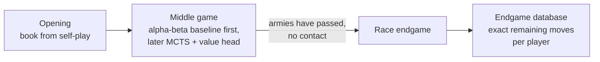

# Endgame and opening

**TL;DR:** An endgame can be solved exactly. When the armies no longer touch, each player
faces a separate solitaire problem, and a database gives the exact number of remaining moves.
No opening can be called "best", because nobody has solved the full game.
This project plans two things.
The first, an optional experiment, is a small single-player endgame database for the last 4 to 5 pieces, computed on the GPU with TornadoVM.
The second is an opening book from self-play.
The book will be good, but it will not be optimal.

## How to read this document

Each claim belongs to one of three levels:

| Level | Meaning | Marker in the text |
|---|---|---|
| Established | A published source supports the claim. | Citation key, for example [Bell2009] |
| Reported | The project owner's literature survey relays the claim. Nobody has checked it again against the source. | "reported" |
| Project decision | The project chose this. It can change. | "project decision" |

Numbers that this document computes are marked as computed.
The game rules are in [rules](rules.md).
The module layout is in [architecture](architecture.md).
Search and the value head are in [search and evaluation](search-and-evaluation.md).
Full bibliographic entries are in [references](references.md).

Terms used below:

- **Goal triangle:** the 10 cells in the opposite corner that a player must fill.
- **Contact:** a player can still jump over an opponent piece, or block one.
- **Race endgame:** a position without contact. Each player only moves their own pieces home.
- **Retrograde analysis:** a search that starts at the final position and works backwards, one move layer at a time.
- **Ranking function:** a bijection from a position to an integer index in `0 .. N-1`. With it, a table needs no keys.

## Why a best endgame exists and a best opening does not

**The full game is unsolved.**
[Sturtevant2019, §5] reports strong solutions only for small two-player variants, up to a 6×6 board with 6 pieces per player.
For one common board size with 1.73 × 10^24 states, the paper says only that it "might be weakly solvable" with a good proof strategy, and that small proofs were hard to construct [Sturtevant2019, §1].
See also [Status of the game](rules.md#status-of-the-game).
Without a solved game, "best opening" has no defined meaning.
Only heuristic opening knowledge exists, such as ladders, bridges and compact groups (reported),
plus the solitaire optimum described [below](#the-27-move-solitaire-pattern-as-a-template) [Bell2009].

**A race endgame splits into two independent problems.**
After the armies have passed each other, no piece can jump over a foreign piece.
Then the database value for each player plus the side to move determines the outcome (reported).
Under the project's move limit, the plies left also count (see [the conversion rule](#when-the-database-replaces-the-evaluation)).
The game becomes two separate solitaire problems.
A database can solve each of them exactly.
In this sense, a best possible endgame is computed, not played.

With 3 players the game is not zero-sum (reported; see [Three-player specifics](rules.md#three-player-specifics)).
A race endgame still splits into independent solitaire problems, one per player.
The project decided that a three-player game ends at the first winner and that the players move clockwise around the star (project decision, 2026-11-07).
With these two rules, the winner follows from the remaining-move counts and the turn order (project reasoning; no cited source states this for 3 players).
A later option `ranking = FULL_RANKING`, which plays on to rank second place, is reserved but not implemented. It would need more than the first-finisher comparison.

## The endgame database principle

Three earlier works on endgame databases for Chinese Checkers are listed in [Sturtevant2019]:

- [RoschkeSturtevant2013], "UCT enhancements in Chinese Checkers using an endgame database".
- [Sturtevant2015], "Challenges and progress on using large lossy endgame databases in Chinese Checkers". [Sturtevant2019, §2] cites it for the use of full-board single-agent distances in play.
- [SturtevantSaffidine2017], "A study of forward versus backwards endgame solvers with results in Chinese Checkers".

[Sturtevant2019] cites these works but does not describe their databases.
The project has not read them yet.

The principle that this project uses is reported (owner's survey, not checked against [RoschkeSturtevant2013]):
the database stores, for every configuration of the 10 pieces in the last n rows,
the exact number of moves that remain until the goal triangle is full.
A retrograde breadth-first search (BFS) from the filled goal triangle builds it.

The retrograde procedure:

1. Mark the position with all pieces in the goal triangle as distance 0.
2. For layer d, find all positions that reach a position of layer d in one move.
3. Give each of these positions distance d + 1 if it has no distance yet.
4. Repeat until a layer is empty.

Two points make this practical.
First, a ranking function maps each configuration to an array index, so the table stores only values.
[Sturtevant2023] covers ranking for Chinese Checkers.
Second, a solver can search forward from the start or backward from the goal.
[SturtevantSaffidine2017] compares forward and backward endgame solvers with results in Chinese Checkers (title as listed in [Sturtevant2019]).

### What the small-board solves teach

[Sturtevant2019] does not build an endgame database for the full board.
It strongly solves small two-player boards. Three of its findings are relevant to this project's database builder (project reasoning).

- **Solver design** [Sturtevant2019, §4]: three choices matter most. They are (1) the ranking function that orders the states, (2) the order in which states are proven, and (3) the immediate propagation of a proven win to the parent states. On 7×7 with 3 pieces per player, good choices give the value of 99% of the states in one pass and finish the proof in 8 passes. Without parent propagation or an optimised proof order, the proof takes up to 34 passes, with 0.5% of the states proven in the first pass.
- **Storage** [Sturtevant2019, §5]: the 6×6 board with 6 pieces per player has 2,313,100,389,600 positions. The solvers use two bits per state. With both symmetries, the solve stores 500 billion states in 135 GB. This exceeds the main memory of the computer that the paper used, so the solver works on disk (external memory).
- **Symmetry** [Sturtevant2019, §3.5]: there are two kinds. A left-right flip gives a position with the same value. It reduces the stored states by a factor of 1.998 on 6×6 with 6 pieces, not by 2, because some positions are identical after the flip. The second kind is player symmetry: flip the board top to bottom and swap the colours and the side to move.

The project's single-player builder is a different problem: it stores distances, not win/loss values (see [Project scope](#project-scope-for-the-endgame-database)).
The project expects the ranking and storage lessons to apply anyway (project reasoning).
A distance needs more than two bits per entry, so the 2-bit figure applies only to a win/loss/draw table.

### Size of a full 10-piece database

The table needs one entry per way to place 10 identical pieces on n cells.
That count is the binomial coefficient C(n, 10).
The region sizes come from the star shape (computed from the board geometry): the goal triangle has 4 rows (10 cells), the next rows have 13, 12, 11, 10 and 9 cells.

The exact values below are computed with `python3 -c "from math import comb; print(comb(35,10), comb(46,10), comb(65,10))"`.
The approximations in the third column are reported from the owner's survey.

| Region | Cells n | C(n, 10), exact (computed) | Reported approximation | Size at 1 byte per entry (computed) |
|---|---|---|---|---|
| Last 6 rows | 35 | 183,579,396 | about 1.8e8, about 180 MB | about 184 MB (0.17 GiB) |
| Last 7 rows | 46 | 4,076,350,421 | about 4.1e9, about 4 GB | about 4.1 GB (3.80 GiB) |
| Up to the middle row | 65 | 179,013,799,328 | about 1.8e11, disk only, needs ranking | about 179 GB (167 GiB) |

The computed values agree with the reported approximations.
The 65-cell table does not fit into the 51.8 GB of global memory that the development GPU reports.
It needs disk storage and a ranking function.

## Project scope for the endgame database

This section is a **project decision**, taken from the implementation plan. The database is an optional experiment, not a goal of the project.

- **Single player only.** The plan judges a full two-player table not feasible. The database stores "distance to finished" for one player.
- **Last k pieces, k ≤ 4 to 5.** The table covers positions in which at most k pieces of one player are outside the goal triangle, inside a fixed region near the goal.
- **Retrograde BFS on the GPU.** Each BFS layer runs as a TornadoVM kernel. This is the second showcase of the project, after the network kernels.
- **Size first.** The project computes the table size before it builds the table.

A first size estimate (computed): the number of positions with at most k of the 10 pieces outside the goal triangle,
inside a region of n cells, is the sum over m = 0 .. k of C(10, 10 − m) · C(n − 10, m).

| Region cells n | k = 4 (computed) | k = 5 (computed) |
|---|---|---|
| 35 | 2,946,251 | 16,335,011 |
| 46 | 13,255,561 | 108,257,545 |
| 65 | 74,837,126 | 951,484,898 |

At 1 byte per entry, the largest of these tables needs about 951 MB (0.89 GiB), which is less than 1 GB.
The region and k are not fixed yet.
The estimate assumes that every piece stays inside the region.
A backward move can lead out of it, so the builder must either cut such moves or enlarge the region.
The rule set also changes the table, in three ways (project reasoning):

- **`leaveGoal`** decides whether a piece may leave the goal triangle again, and so which backward moves the BFS generates. The default is `FORBIDDEN` (project decision; differs from [Sturtevant2019, §3], which allows leaving the goal). The database must be built for one fixed value, and a table built for `FORBIDDEN` is not valid for `ALLOWED`.
- **Win condition:** the project uses Definition 1 of [Sturtevant2019, §3.2]. The goal counts as filled when every goal cell is occupied and at least one piece belongs to the player; opponent pieces fill the other cells. The single-player table assumes a goal with own pieces only. A position with an opponent piece in the goal is therefore not a race endgame for the database.
- **Move limit:** the default is 200 plies for two players (project decision, 2026-11-07). The table gives remaining moves without a limit, so the search must compare each count with the plies left before the limit (see the next section).

### When the database replaces the evaluation

The database replaces the evaluation only in a race endgame, that is, when no contact is possible (project decision).
The evaluation is the single-agent distance heuristic of the alpha-beta baseline first, and the value head of the network later (project decision, 2026-11-07).
The search then reads the exact remaining-move count for each player from the table.
While contact is possible, the evaluation stays in charge, because the database ignores blocks and jump bridges over foreign pieces.

How a database value becomes a game value in a 2-player game (project reasoning):

1. Let a be the count of the side to move, b the count of the opponent, and L the plies left before the move limit.
2. The side to move fills the goal on its a-th move, which is ply 2a − 1 from now. The opponent fills it on ply 2b.
3. If a ≤ b and 2a − 1 ≤ L, the side to move wins. If b < a and 2b ≤ L, the opponent wins.
4. Otherwise nobody finishes before the limit, and `drawHandling` decides the result.

The default is `drawHandling = SCORE_BY_DISTANCE` (project decision, 2026-11-07).
With this default, case 4 is not a plain draw.
The score comes from the distances at the limit, measured with the single-agent distance table (see [rules](rules.md#draw-handling)), not with the database count.
The database alone therefore does not give the value of case 4: the search must play on to the limit or estimate the distances there.
With `drawHandling = DRAW`, case 4 is a draw.
`DRAW` stays available because the solved tables of [Sturtevant2019, §5] count draws as real draws.

With `repetition = REPETITION_IS_DRAW` (Definition 4 of [Sturtevant2019, §3.4]: any repeated state draws), a race endgame cannot end in a repetition under optimal play, because each player only wants to shorten the own count (project reasoning).
The project default is `repetition = MOVE_LIMIT` (project decision; differs from [Sturtevant2019, §3.4], Definition 4).
The move limit applies in both modes as a backstop.

The contact test must never report "no contact" while contact is still possible.
If it does, the search uses a wrong exact value and trusts it fully.
A conservative test, which reports contact in some cases without contact, is acceptable: it costs strength, not correctness.

## Opening book from self-play

This section is a **project decision**.

The book comes from the self-play games of late network generations.

- **Horizon:** positions up to about move 12.
- **Key:** a Zobrist hash of the position [CPW].
- **Canonicalisation by symmetry:** before hashing, the position is mapped to one canonical image of its symmetry class. [Sturtevant2019, §3.5] names two kinds of symmetry: the left-right flip and the player symmetry (flip top to bottom, swap colours and side to move). The [Symmetry](rules.md#symmetry) section of the rules defines the symmetries that the engine implements. The project has not yet chosen the canonical image; one option is the image with the smallest hash.
- **Stored values:** visit counts and results for each position.
- **File format:** a simple sorted binary file. A sorted file allows binary search without an index structure. The exact record layout is not fixed yet.

The canonicalisation must also map moves.
A book entry for the canonical image must be mapped back to the actual orientation of the board before the engine plays it.

### Honest limits

- The book is "good", not "best possible". It reflects what the network preferred in self-play, including its blind spots.
- Self-play explores narrowly. Lines that the network never chose have few or no visits.
- The results depend on the network generation. A new generation can make old book entries obsolete.
- Zobrist hashes can collide. A 64-bit key makes this rare, not impossible.
- With 3 players, a result is a vector, not a single number. The book format must allow one result per player.

## The 27-move solitaire pattern as a template

In solitaire, one player moves all 10 pieces across the board alone.
Levenspiel found a solution with 27 moves in 1971 (reported via [Bell2009]).
[Bell2009] proved that this solution is optimal: no shorter solution exists.

The project uses this pattern as a template, for two purposes (project decision):

- **Test oracle:** the solitaire solver of the engine must find no solution shorter than 27 moves.
- **Opening idea:** the first moves of the pattern can seed the book or guide early search.

The pattern is optimal only without an opponent.
It is not a proof of optimality against an opponent, because a real opponent blocks cells and offers jump bridges.

## Validation plan

This section is a **project decision**. The implementation plan requires that sampled database entries match brute force. The other checks below extend that requirement, including an optional small-board oracle from [Sturtevant2019].

1. **Small boards first.** Build the database for a small region and a small k. Compute every entry again with a forward brute-force search (BFS or IDA*). All entries must match.
2. **Small-board oracle from the literature.** Table 1 of [Sturtevant2019, §5] gives positions, wins, draws and illegal states for solved small boards. The project proposes the two smallest rows for this optional test, because they are the smallest state spaces (project reasoning):

   | Board | Pieces | Positions | Wins | Draws | Illegal | Start |
   |---|---|---|---|---|---|---|
   | 7×7 | 1 | 4,704 | 2,304 | 0 | 96 | P1 win |
   | 7×7 | 2 | 2,542,512 | 1,265,851 | 0 | 10,810 | P1 win |

   The values are as printed in the paper; [SturtevantPubs] neither confirms nor corrects these two rows.
   The win counts are for one player and ignore symmetry [Sturtevant2019, §5].
   An engine reproduces them only in the proposed small-board mode with exactly the paper's rules: `leaveGoal = ALLOWED`, repetition is a draw, `drawHandling = DRAW`, and Definitions 1 to 3 (see [What Sturtevant2019 defines](rules.md#what-sturtevant2019-defines)).
   This mode is proposed, not scheduled.
   According to the paper, all rows except 6×6 with 6 pieces were computed multiple times and by multiple solvers [Sturtevant2019, §5]. The author's publications page later reports that a different solver verified the 6×6 results, and that the 4×4 row with 6 pieces appears to contain a copy/paste error; an updated table is promised [SturtevantPubs]. The 4×4 row is therefore known erroneous and is not an oracle; see [Oracles from the paper](rules.md#oracles-from-the-paper). Check [SturtevantPubs] for the updated table before relying on any row.
   This oracle is optional and comes later. The paper is used only for verification; the project trains a neural network and does not try to solve any board.
   The test uses only the "Positions" and "Illegal" columns, which come from enumeration; it checks the shared move generator, ranking function and rule code, not the single-player distance table. The "Wins" and "Draws" columns would need a win/loss/draw solver for the whole board, and the project does not plan one (see [Small-board mode](rules.md#small-board-mode)).
3. **Samples on the real board.** Draw random positions from the full table. Solve each position with a forward solver. The values must match.
4. **Layer consistency.** For each entry with distance d > 0, at least one move must lead to distance d − 1, and no move may lead to a distance below d − 1. A short check program tests every entry.
5. **GPU against CPU.** Run the retrograde BFS once on the CPU and once as a TornadoVM kernel. The two tables must be identical byte for byte.
6. **Ranking round trip.** For every index i, `rank(unrank(i))` must equal i.
7. **Solitaire check.** The full solitaire solver must return 27 moves for the standard start [Bell2009]. Nobody has estimated the cost of this search yet. If it is too expensive, the check replays the known 27-move solution and confirms that every move is legal.

For the opening book:

1. Load a position, compute its canonical key, apply every symmetry, and compute the key again. All keys must be equal.
2. Map a book move to the actual orientation and check that it is legal in the original position.
