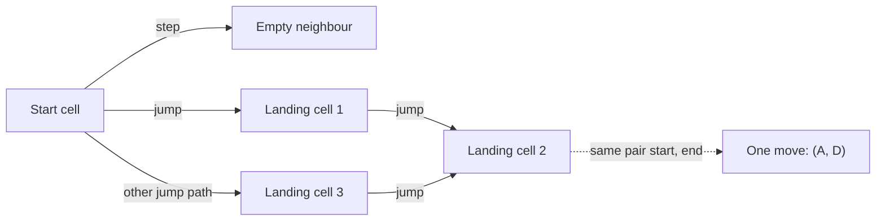
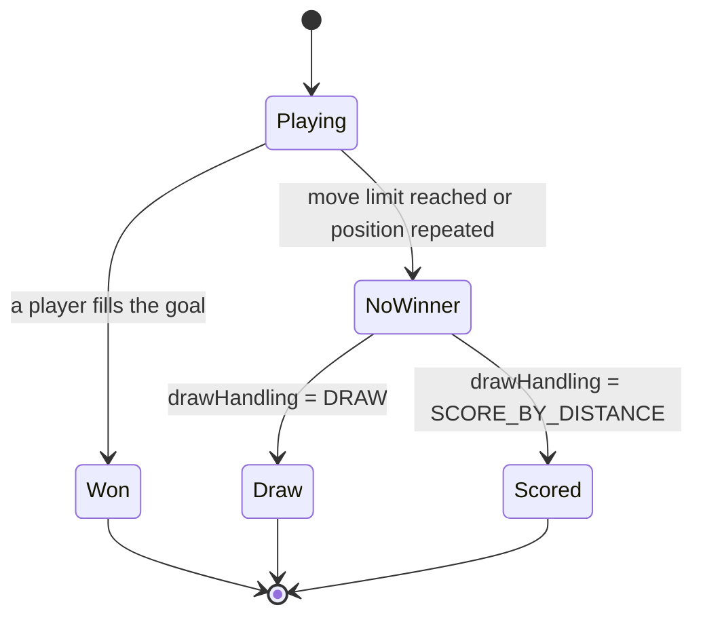

# Rules of the game

**TL;DR:** This document fixes the rules that the engine implements. The default rule set (**project decision**) is a two-player game modelled on the complete rule set in [Sturtevant2019]: a piece that enters the goal area must not leave it, the blockade rule is on, and a move limit ends the game. All other variants are switches of one immutable `RuleSet` record. The engine must pass the conformance tests at the end of this document before anyone writes search code.

Chinese Checkers is called Stern-Halma in German. This document uses the name Chinese Checkers.

## How to read this document

Each claim about the literature and each project choice has one of three levels. The level is always visible. Geometry and arithmetic that anyone can recompute have no marker.

| Level | Meaning | Marker |
|---|---|---|
| Established | A cited source supports the claim. | A citation key, e.g. [Sturtevant2019]. Full entries are in [references](references.md). |
| Reported | The project owner relayed the claim from a literature survey. Nobody has checked it against the source yet. | The word **reported**. |
| Project decision | The project chose this. No source makes it true. | The words **project decision**. |

## Scope

This document covers:

- the board, the coordinates and the start layouts for 2 and 3 players,
- legal moves, the goal and the win condition,
- the rule switches and their default values,
- draws, three-player specifics and symmetry,
- the test values that the engine must reproduce.

This document does not cover search, evaluation, the endgame database or the opening book. See [search and evaluation](search-and-evaluation.md), [endgame and opening](endgame-and-opening.md) and [architecture](architecture.md).

**Project decision:** the rules are written down here before the engine code exists (phase 0). If the code and this document disagree, the code is wrong until this document changes.

## Board and coordinates

The board is a six-pointed star with 121 cells. It has two parts:

- a central hexagon with 61 cells,
- six corner triangles with 10 cells each (rows of 1, 2, 3 and 4 cells).

61 + 6 × 10 = 121.

The engine uses cube and axial hex coordinates as described in [RedBlobHex]. A cube coordinate is a triple (q, r, s) with q + r + s = 0. The axial form stores only (q, r) and computes s = −q − r. Each cell has up to six neighbours. The six direction vectors are (+1, 0, −1), (−1, 0, +1), (0, +1, −1), (0, −1, +1), (+1, −1, 0) and (−1, +1, 0).

**Project decision:** the board is the set of cells that satisfies at least one of these two conditions:

- max(q, r, s) ≤ 4,
- min(q, r, s) ≥ −4.

Each condition describes one large triangle with 91 cells. The two triangles overlap in the hexagon with |q|, |r|, |s| ≤ 4 (61 cells). The union has 91 + 91 − 61 = 121 cells. The six corners are the cells with q > 4, q < −4, r > 4, r < −4, s > 4 or s < −4. The corner opposite to "q > 4" is "q < −4", and so on.

The engine stores the board as a cell index from 0 to 120 with precomputed neighbour tables (6 directions × 121 cells). Each player's pieces are a 121-bit set in two `long` values. The [architecture](architecture.md) document describes this in detail.

## Pieces and start layouts

In the standard game each player has 10 pieces. At the start, a player's pieces fill one corner triangle. The goal of each player is the opposite corner.

| Players | Occupied corners | Goal |
|---|---|---|
| 2 | Two opposite corners, e.g. r < −4 and r > 4. | The opposite corner, which is the other player's start corner. |
| 3 | Every second corner around the star. | The opposite corner. That corner is empty at the start. |

For 3 players, the occupied corners alternate with empty corners around the star. Each player's goal is the empty corner opposite to their start corner. This layout is from the owner's survey (**reported**).

Around the star, the corners come in this order: q > 4, s < −4, r > 4, q < −4, s > 4, r < −4. The three corners r < −4, q < −4 and s < −4 are therefore every second corner. Their goals r > 4, q > 4 and s > 4 are the three empty corners. **Project decision (proposed):** the three-player game uses the start corners r < −4, q < −4 and s < −4. This keeps the two-player start corner r < −4 for player 0. The play order around the star is an open point.

The engine takes the corner assignment from the `RuleSet` and does not hard-code it. A conformance test checks that no two occupied corners are neighbours around the star and that each goal is empty at the start.

**Project decision:** player 0 moves first. Players then move in a fixed cyclic order.

## Legal moves

A move takes one own piece from a start cell to an end cell. There are two kinds of move.

1. **Step.** The piece moves to an empty neighbour cell.
2. **Jump chain.** The piece jumps over an occupied neighbour cell (own or opponent) and lands on the empty cell directly behind it, on the same line. After a jump, the piece may jump again from the landing cell. The chain can have any length and any direction, including backwards. The player can stop after any jump.

A move cannot mix the two kinds. A step ends the move. A jumped piece stays on the board; jumping does not capture.

The path of a jump chain has no effect on the result. Only the pair (start cell, end cell) matters. The move generator therefore returns each (start, end) pair exactly once, even when several jump paths reach the same end cell. **Project decision:** a jump chain that returns to its start cell is not a move.

**Project decision:** the move generator finds jump chains by breadth-first search over jump targets with a visited mask. This makes deduplication automatic.

In the mid-game, the branching factor is often well above 50, because every end cell of a jump chain counts as its own move (**reported**).

## Goal and win condition

A player wins when the goal is filled. With the blockade rule off, "filled" means: all 10 goal cells hold the player's own pieces. With the blockade rule on, see the next section.

In the two-player game the first player to fill the goal wins, and the game ends. Section [Draw handling](#draw-handling) describes the end of a game without a winner.

## The contested rules and why they matter

Different rule books answer three questions in different ways:

1. May a player keep a piece in the start corner to block the opponent's goal?
2. May a piece leave the goal area again after it has entered it?
3. What happens when a position repeats?

These questions are not cosmetic. Without a blockade rule, a player can leave one piece in the start corner forever. The opponent then cannot fill the goal, and the game has no winner. Without a rule against leaving the goal, a player can move pieces in and out of the goal, and the game can go on forever. A program that searches or solves the game needs a complete rule set, or the value of a position is not defined.

[Sturtevant2019] addresses exactly this. It describes what is needed to strongly solve variants of the game and gives a complete rule set. According to the owner's summary (**reported**), Sturtevant states that the value of Chinese Checkers positions had, to his knowledge, not been determined before, and that he found no rule set that handles drawn positions.

## Rule switches

The `RuleSet` record is immutable. Each switch has a fixed set of allowed values.

| Switch | Allowed values | Default | Effect |
|---|---|---|---|
| `players` | 2, 3 (later 4 and 6) | 2 | Number of players and start layout. |
| `leaveGoal` | `FORBIDDEN`, `ALLOWED` | `FORBIDDEN` | With `FORBIDDEN`, a piece in its goal area must not move to a cell outside the goal area. |
| `blockadeRule` | `NONE`, `OPPONENT_FILLS` | `OPPONENT_FILLS` | With `OPPONENT_FILLS`, an opponent piece in the goal counts as filled once all free goal holes are occupied. |
| `repetition` | `MOVE_LIMIT`, `REPETITION_IS_DRAW` | `MOVE_LIMIT` | How the game ends when nobody wins. |
| `drawHandling` | `DRAW`, `SCORE_BY_DISTANCE` | `DRAW` | The result when the game ends without a winner. |

**Project decision** (owner, 2026-11-06): the default is the Sturtevant-2019-style two-player game. Leaving the goal is forbidden, the blockade rule is on, and a move limit ends the game. The other values stay available as switches.

**Project decision (proposed):** the default for `drawHandling` is `DRAW`. The owner's decision fixes the first three switches. It does not name a value for `drawHandling`. Confirm or change this default before the engine code starts.

Details that this document fixes for the engine:

- **`leaveGoal = FORBIDDEN`** checks only the end cell of a move. A jump chain may pass through cells outside the goal, because the path has no effect (see [Legal moves](#legal-moves)). **Project decision (proposed).**
- **`blockadeRule = OPPONENT_FILLS`**: the goal is filled when every goal cell is occupied and every goal cell without an opponent piece holds an own piece. **Open point:** decide whether the player needs at least one own piece in the goal.
- **Move limit:** the limit is a parameter of the `RuleSet`. **Open point:** the default value is not fixed yet.

## Draw handling

A game ends without a winner in one of two ways:

- With `repetition = MOVE_LIMIT`: the move limit is reached.
- With `repetition = REPETITION_IS_DRAW`: a position repeats. **Project decision:** a position includes the side to move.

`drawHandling` then gives the result:

- `DRAW`: every player gets the draw value.
- `SCORE_BY_DISTANCE`: each player gets a score from the remaining distance of the own pieces to the goal. The player with the smaller distance scores better. **Project decision:** the distance measure is the single-agent distance table described in [search and evaluation](search-and-evaluation.md).

## Three-player specifics

With three players the game is not zero-sum. There is no unique game value, only equilibria (**reported**). The kingmaker problem appears: a player who can no longer win can still decide which of the other two players wins (**reported**).

Consequences for the engine:

- The result of a game is a vector with one value per player, not a single number.
- Alpha-beta search does not apply. See [search and evaluation](search-and-evaluation.md) for Max^n, Paranoid, Best Reply Search and MCTS.
- **Project decision (proposed):** after the first player fills the goal, the game ends. Ranking the remaining players is an open point.

## Symmetry

For two players, a position maps to an equivalent position by a mirror along the playing axis plus a colour swap [Sturtevant2019].

In the coordinates above, with the players on the r axis, the left-right mirror keeps r and swaps q and s: (q, r, s) → (s, r, q). This mirror maps each player's corners to themselves. **Project decision:** the engine implements this mirror and the 180-degree rotation (q, r, s) → (−q, −r, −s) combined with a colour swap and a swap of the side to move. Opening book keys and test counts use these symmetries.

## Known values that serve as test oracles

Values from the literature, as relayed by the owner (**reported**, to be verified against [Sturtevant2019]):

| Quantity | Value |
|---|---|
| Legal first moves from the start position | 14 |
| First moves up to symmetry | 7 |
| \|L2\| | 98 |

The notes do not define \|L2\|. A quick count by the project on the full 121-cell board, with the rules above, gives these numbers:

- 14 legal first moves,
- 7 classes of first moves under the left-right mirror,
- 196 distinct positions after two plies, which is 98 classes under the mirror.

This count agrees with the reading "\|L2\| = number of positions after two plies, up to symmetry". The count is a quick check, not a verification. Read the definition in [Sturtevant2019] before the test depends on it.

## Status of the game

- **Full board:** the game with 121 cells and 10 pieces per player is not solved [Sturtevant2019].
- **Small boards:** the two-player game is strongly solved on boards up to 6×6 with 6 pieces per player. All these small variants are first-player wins [Sturtevant2019].
- **Solitaire:** with one player alone on the board, [Bell2009] proves that a 27-move solution, found by Levenspiel in 1971, is optimal. No shorter solution exists. The [endgame and opening](endgame-and-opening.md#the-27-move-solitaire-pattern-as-a-template) document explains how the project uses it and why it proves nothing against an opponent.

## Conformance tests

The engine must pass all of these tests before anyone writes search code. Each test runs with the default `RuleSet` unless the test names a switch.

1. The board has 121 cells: 61 in the hexagon and 10 in each of the six corners.
2. Each neighbour relation is symmetric. Each cell has between 2 and 6 neighbours.
3. Each player starts with 10 pieces in the start corner. For 2 players the corners are opposite. For 3 players no two occupied corners are neighbours around the star, and each goal is empty.
4. The start position has 14 legal moves for the first player.
5. Under the left-right mirror, the 14 first moves form 7 classes.
6. After two plies there are 196 distinct positions, or 98 up to symmetry. Mark this test as provisional until the \|L2\| definition is verified.
7. The move list has no duplicate (start, end) pair. Test this on a position where two jump paths reach the same end cell.
8. A jump chain can turn backwards. Test it on a position where the only path to an end cell goes away from the goal.
9. With `leaveGoal = FORBIDDEN`, no move takes a piece from inside its goal to a cell outside the goal. With `ALLOWED`, such a move exists in a constructed position.
10. With `blockadeRule = OPPONENT_FILLS`, a player wins when the goal is full and one goal cell holds an opponent piece. With `NONE`, the same position is not a win.
11. With `repetition = MOVE_LIMIT`, the game ends after exactly the limit. With `REPETITION_IS_DRAW`, the first repeated position ends the game.
12. With `drawHandling = SCORE_BY_DISTANCE`, the player with the smaller remaining distance gets the better score.
13. Each symmetry maps a legal position to a legal position. The move count of a position equals the move count of its image.
14. Property test (jqwik): for random legal positions, every generated move is legal, and applying then undoing a move restores the position and its hash.
