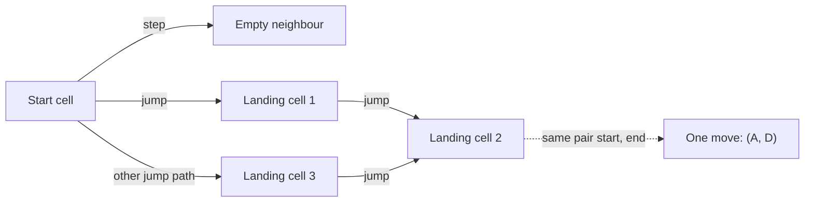
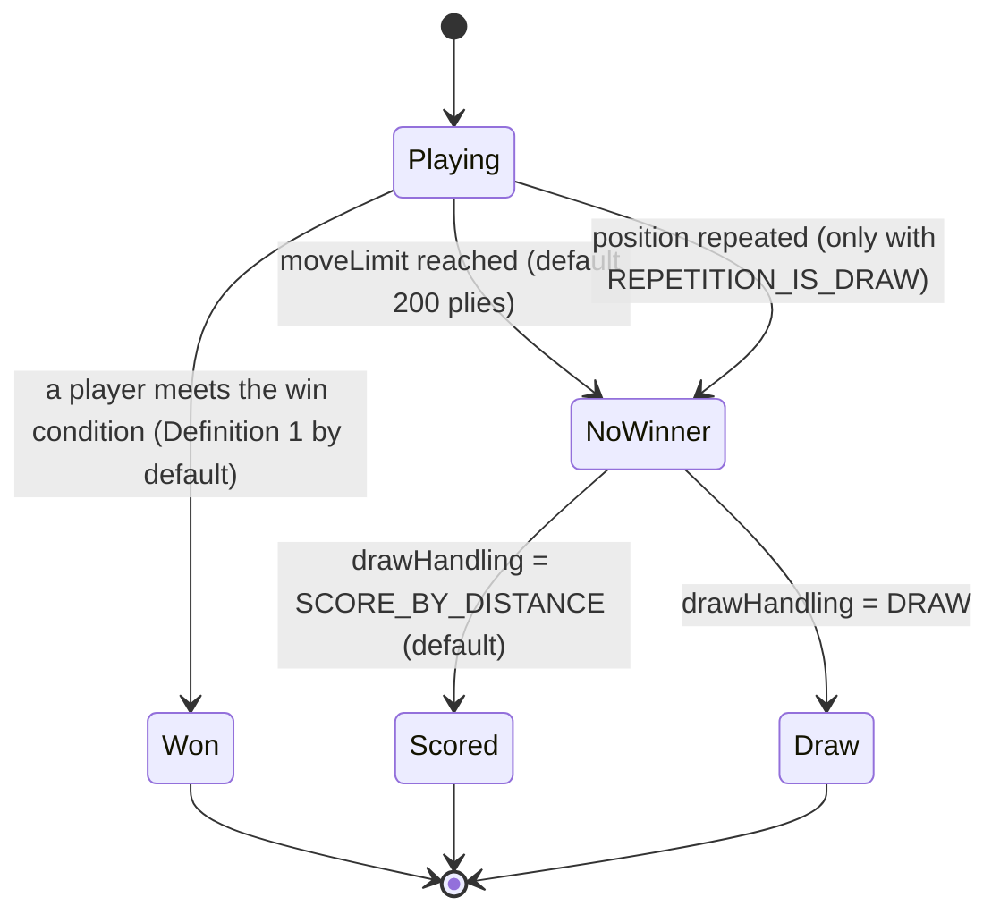

# Rules of the game

**TL;DR:** This document fixes the rules that the engine implements. [Sturtevant2019, §3] defines a complete two-player rule set: a player wins when the goal is filled and holds at least one own piece (Definition 1), two kinds of states are illegal (Definitions 2 and 3), and the first repeated position draws the game (Definition 4). The paper does not forbid a piece to leave its goal. The project default (**project decision**) uses Definition 1, ends a game without a winner after 200 plies and scores that game by distance to the goal. Two defaults deviate from the paper on purpose (**project decision**): `leaveGoal = FORBIDDEN` and `repetition = MOVE_LIMIT`. The project uses the paper only to verify its rules; it does not try to solve any variant. All variants are switches of one immutable `RuleSet` record. The jump rule is one of these switches: the default `ADJACENT` jumps over a neighbour, the optional `LONG` is the Halma long hop (see [Jump rule](#jump-rule)). The house size is another: the default `FOUR` gives each player 10 pieces in a corner triangle, the optional `FIVE` gives 15 pieces in a larger triangle on the same 121-cell board (see [Board size (triangle rows)](#board-size-triangle-rows)). The engine must pass the conformance tests at the end of this document before anyone writes search code.

Chinese Checkers is called Stern-Halma in German. This document uses the name Chinese Checkers.

## How to read this document

Each claim about the literature and each project choice has one of three levels. The level is always visible. Geometry and arithmetic that anyone can recompute have no marker.

| Level | Meaning | Marker |
|---|---|---|
| Established | A cited source supports the claim. | A citation key, with the section where one exists, e.g. [Sturtevant2019, §3.2]. Full entries are in [references](references.md). |
| Reported | The project owner relayed the claim from a literature survey. Nobody has checked it against the source yet. | The word **reported**; "source not located" when a check found no source. |
| Project decision | The project chose this. No source makes it true. | The words **project decision**. |

Two markers qualify a project decision. **Proposed** means that the owner has not confirmed it yet. **Open point** means that nothing is decided yet. A third marker, **project reasoning**, marks a conclusion that the project draws itself, without a source.

## Scope

This document covers:

- the board, the coordinates and the start layouts for 2 and 3 players, with 10 or 15 pieces per player,
- legal moves, the goal and the win condition,
- the rule switches and their default values,
- draws, three-player specifics and symmetry,
- the test values that the engine must reproduce, and the optional, later oracles from [Sturtevant2019].

The variant Connection, in which the players build a line between two star tips, is described but not implemented (see [Connection](#connection-described-not-implemented)).

This document does not cover search, evaluation, the endgame database or the opening book. See [search and evaluation](search-and-evaluation.md), [endgame and opening](endgame-and-opening.md) and [architecture](architecture.md).

**Project decision:** the rules are written down here before the engine code exists (phase 0). If the code and this document disagree, the code is wrong until this document changes.

## Board and coordinates

The board is a six-pointed star with 121 cells [MITSlides2010]. [Sturtevant2019, §3] describes a star-shaped board with six corners and 10 pieces per player; it does not give the cell count. The board has two parts:

- a central hexagon with 61 cells,
- six corner triangles with 10 cells each (rows of 1, 2, 3 and 4 cells).

61 + 6 × 10 = 121.

The engine uses cube and axial hex coordinates as described in [RedBlobHex]. A cube coordinate is a triple (q, r, s) with q + r + s = 0. The axial form stores only (q, r) and computes s = −q − r. Each cell has up to six neighbours. The six direction vectors are (+1, 0, −1), (−1, 0, +1), (0, +1, −1), (0, −1, +1), (+1, −1, 0) and (−1, +1, 0).

**Project decision:** the board is the set of cells that satisfies at least one of these two conditions:

- max(q, r, s) ≤ 4,
- min(q, r, s) ≥ −4.

Each condition describes one large triangle with 91 cells. The two triangles overlap in the hexagon with |q|, |r|, |s| ≤ 4 (61 cells). The union has 91 + 91 − 61 = 121 cells. The six corners are the cells with q > 4, q < −4, r > 4, r < −4, s > 4 or s < −4. The corner opposite to "q > 4" is "q < −4", and so on.

The engine stores the board as a cell index from 0 to 120 with precomputed neighbour tables (6 directions × 121 cells). Each player's pieces are a 121-bit set in two `long` values. The [architecture](architecture.md) document describes this in detail.

## Pieces and start layouts

In the standard game each player has 10 pieces. At the start, a player's pieces fill one corner triangle. The goal of each player is the opposite corner. In the two-player game the players start at the top and at the bottom, and each goal is the corner where the opponent started [Sturtevant2019, §3].

| Players | Occupied corners | Goal |
|---|---|---|
| 2 | Two opposite corners, e.g. r < −4 and r > 4. | The opposite corner, which is the other player's start corner. |
| 3 | Every second corner around the star. | The opposite corner. That corner is empty at the start. |

For 3 players, the occupied corners alternate with empty corners around the star. Each player's goal is the empty corner opposite to their start corner. This layout is from the owner's survey (**reported**).

This section and the rest of this document describe the 4-row board (`triangleRows = FOUR`, the default). With `triangleRows = FIVE` each player has 15 pieces, and the start and goal areas grow by the hexagon row in front of each corner; see [Board size (triangle rows)](#board-size-triangle-rows).

Around the star, the corners come in this order: q > 4, s < −4, r > 4, q < −4, s > 4, r < −4. The three corners r < −4, q < −4 and s < −4 are therefore every second corner. Their goals r > 4, q > 4 and s > 4 are the three empty corners. **Project decision (proposed):** the three-player game uses the start corners r < −4, q < −4 and s < −4. This keeps the two-player start corner r < −4 for player 0.

### Screen orientation and clockwise order

"Clockwise" needs a picture of the board. **Project decision:** the engine draws the board with the pointy-top layout of [RedBlobHex]: a cell (q, r) has the screen position x = √3 · (q + r/2), y = 3/2 · r, with x to the right and **y downwards**. In this picture r < −4 is the top corner and r > 4 is the bottom corner.

The centre of each corner then has these screen angles, measured from the x axis (computed by the project, 2026-11-07):

| Corner | Position on screen | Angle |
|---|---|---|
| q > 4 | upper right | −30° |
| s < −4 | lower right | 30° |
| r > 4 | bottom | 90° |
| q < −4 | lower left | 150° |
| s > 4 | upper left | 210° |
| r < −4 | top | 270° |

With y downwards, a rising angle turns clockwise on the screen. The corner order above is therefore the clockwise order.

**Project decision** (owner, 2026-11-07): three players move clockwise around the star. Player 0 starts at r < −4 (top), player 1 at s < −4 (lower right), player 2 at q < −4 (lower left). Player 0 moves first. Two players alternate, so the direction has no effect for them.

The counter-clockwise order (r < −4, q < −4, s < −4) gives an equivalent game. The left-right mirror (q, r, s) → (s, r, q) keeps the corner r < −4, swaps the corners q < −4 and s < −4, swaps their goals q > 4 and s > 4, and maps every legal move to a legal move. The mirror therefore turns one order into the other. Only the player labels change.

The engine takes the corner assignment and the play order from the `RuleSet` and does not hard-code them. A conformance test checks that no two occupied corners are neighbours around the star, that each goal is empty at the start, and that the play order is clockwise.

## Legal moves

A move takes one own piece from a start cell to an end cell. There are two kinds of move.

1. **Step.** The piece moves to an empty neighbour cell.
2. **Jump chain.** The piece jumps over an occupied neighbour cell (own or opponent) and lands on the empty cell directly behind it, on the same line. After a jump, the piece may jump again from the landing cell. The chain can have any length and any direction, including backwards. The player can stop after any jump.

This section describes the default `jumpRule = ADJACENT`. The section [Jump rule](#jump-rule) defines the optional long hop.

A move cannot mix the two kinds. A step ends the move. A jumped piece stays on the board; jumping does not capture. [Sturtevant2019, §3.1] defines the same two kinds of move: a piece can take any number of hops in a turn and can stop when further hops are still possible, and hopped pieces stay on the board. The paper also notes that the game is not acyclic: a position can repeat without progress.

[Sturtevant2019, §3] says that pieces are typically not allowed to move into the four corners that are neither the start nor the goal corner. Some rules allow a piece to pass through them if it does not stay there at the end of the turn. The paper's two-player implementation does not allow this; a footnote says that the passage rule may be more useful with more than two players. The switch `foreignCamps` fixes this rule for the 121-cell board. Its default `CLOSED` keeps a piece out of these corners entirely, as the paper's implementation does; `PASS_THROUGH` and `OPEN` are opt-in (see [Foreign corners](#foreign-corners)). The rule has no effect on the first two plies (see [Move counts on the full board](#move-counts-on-the-full-board)).

The path of a jump chain has no effect on the result. Only the pair (start cell, end cell) matters. The move generator therefore returns each (start, end) pair exactly once, even when several jump paths reach the same end cell. **Project decision:** a jump chain that returns to its start cell is not a move.

**Project decision:** the move generator finds jump chains by a graph search over jump targets with a visited mask (depth-first with an explicit stack in the engine). This makes deduplication automatic.

In the mid-game, the branching factor is often well above 50, because every end cell of a jump chain counts as its own move (**reported**).

## Goal and win condition

A player wins when the goal is filled. The switch `blockadeRule` defines "filled":

- `OPPONENT_FILLS` (default): every goal cell holds a piece, and at least one of these pieces is the player's own. This is Definition 1 of [Sturtevant2019, §3.2]. A goal that holds only opponent pieces is not a win.
- `NONE`: every goal cell holds one of the player's own pieces.

The first player to fill the goal wins, and the game ends. This also holds for three players (see [Three-player specifics](#three-player-specifics)). Section [Draw handling](#draw-handling) describes the end of a game without a winner.

[Sturtevant2019, §3.2] notes a side effect of Definition 1: a player who leaves pieces in the own start corner lets the opponent fill the goal around them. On very small boards this gives a win after 3 plies, which the paper accepts. The paper rejects the rule "imprisoned marbles forfeit the game" as inadequate, because a piece on the outer row of the goal cannot be imprisoned and still blocks the goal.

## The contested rules and why they matter

Different rule books answer three questions in different ways:

1. May a player keep a piece in the start corner to block the opponent's goal?
2. May a piece leave the goal area again after it has entered it?
3. What happens when a position repeats?

These questions are not cosmetic. A player can leave one piece in the start corner and so keep the opponent from ever filling the goal; rule books typically do not handle this [Sturtevant2019, §3.2]. Positions can repeat without progress [Sturtevant2019, §3.1], so a game can go on forever unless a rule ends it. A program that searches or solves the game needs a complete rule set, or the value of a position is not defined.

[Sturtevant2019] addresses exactly this. Its abstract says that it gives "a complete set of rules needed to solve the game". The paper states that, to the author's knowledge, the possible values of Chinese Checkers states had not been determined before, and that the author found no rules that discuss drawn positions [Sturtevant2019, §3.4].

### What [Sturtevant2019] defines

The paper states its rules for the two-player game [Sturtevant2019, §3]:

| Rule | Content | Source |
|---|---|---|
| Definition 1 (win) | A state is won for player n if n's goal area is filled with pieces and at least one of these pieces belongs to n. | §3.2 |
| Definition 2 (illegal, part 1) | A state is illegal for player n if n's winning condition is met and it is n's turn to move. A move that hands the opponent the win is therefore illegal. | §3.3 |
| Definition 3 (illegal, part 2) | A state is illegal if one or more empty cells in player n's goal area are unreachable for n because of other players' pieces. With six pieces it suffices to check the two outer edges of the goal and its tip; with 10 pieces "the conditions are more complicated". | §3.3 |
| Definition 4 (draw) | A game is drawn if any board state is repeated during play. One repetition suffices. | §3.4 |

The paper has no rule that forbids a piece to leave its goal area, and it has no move limit. It says that Definitions 2 and 3 are only necessary in variants with more pieces, and it admits that it may miss cases that matter in human play [Sturtevant2019, §3.3].

## Rule switches

The `RuleSet` record is immutable. Each switch has a fixed set of allowed values.

| Switch | Allowed values | Default | Effect | Relation to [Sturtevant2019] |
|---|---|---|---|---|
| `players` | 2, 3 (later 4 and 6) | 2 | Number of players and start layout. | The paper focuses on two players (§3). |
| `moveLimit` | positive number of plies; off only in the small-board mode | 200 for 2 players; 300 for 3 players (**proposed**) | The game ends without a winner after this many plies. The limit applies with both `repetition` values. | The paper has no move limit. |
| `leaveGoal` | `FORBIDDEN`, `ALLOWED` | `FORBIDDEN` | With `FORBIDDEN`, a piece in its goal area must not move to a cell outside the goal area. | Deviation: the paper allows leaving the goal. |
| `blockadeRule` | `NONE`, `OPPONENT_FILLS` | `OPPONENT_FILLS` | With `OPPONENT_FILLS`, opponent pieces in the goal count as filling it, if at least one own piece is in the goal. | Same as Definition 1 (§3.2). |
| `suicideMoves` | `ILLEGAL`, `LEGAL` | `ILLEGAL` (**proposed**) | With `ILLEGAL`, a move that meets the opponent's winning condition is not legal. | Same as Definition 2 (§3.3). |
| `blockingStates` | `NONE`, `ILLEGAL` | `NONE` (**proposed**) | With `ILLEGAL`, a move to a state with an empty goal cell that its owner cannot reach is not legal. | `ILLEGAL` is Definition 3 (§3.3). The default deviates from the paper. |
| `repetition` | `MOVE_LIMIT`, `REPETITION_IS_DRAW` | `MOVE_LIMIT` | With `REPETITION_IS_DRAW`, the first repeated position also ends the game without a winner. | Deviation: the paper uses Definition 4 (§3.4). |
| `drawHandling` | `DRAW`, `SCORE_BY_DISTANCE` | `SCORE_BY_DISTANCE` | The result when the game ends without a winner. | The paper scores such games as draws. |
| `ranking` | `FIRST_WINNER_ONLY`, `FULL_RANKING` | `FIRST_WINNER_ONLY` | With `FIRST_WINNER_ONLY`, the game ends when the first player fills the goal. With `FULL_RANKING` and three players, that player is finished and the others play on (see [Playing on for second place](#playing-on-for-second-place)). With two players, both values behave the same. | The paper focuses on two players (§3) and gives no rule for ranking. |
| `jumpRule` | `ADJACENT`, `LONG` | `ADJACENT` | With `LONG`, a piece hops over one piece at any distance along a line and lands at the same distance behind it (see [Jump rule](#jump-rule)). | The paper plays adjacent jumps only (§3.1). `LONG` is outside the paper, so its oracles do not apply. |
| `triangleRows` | `FOUR`, `FIVE` | `FOUR` | The size of the start and goal areas (houses): a triangle with 4 cells per side (10 pieces) or 5 cells per side (15 pieces), on the same 121-cell board. `FIVE` sets the default `moveLimit` to 250 plies for 2 players and 375 for 3. See [Board size (triangle rows)](#board-size-triangle-rows). | The paper plays 10 pieces (§3). `FIVE` is outside the paper, so its oracles do not apply. |
| `foreignCamps` | `CLOSED`, `PASS_THROUGH`, `OPEN` | `CLOSED` | Whether a piece may enter a corner that is neither its start nor its goal corner: never (`CLOSED`), only between two jumps of a chain (`PASS_THROUGH`), or also at the end of a move (`OPEN`). See [Foreign corners](#foreign-corners). | `CLOSED` is the paper's implementation (§3). `PASS_THROUGH` is the passage rule that the paper mentions but does not use; `OPEN` is outside the paper. |

### Project defaults and their evidence

- **`moveLimit`** — **project decision** (owner, 2026-11-07): 200 plies for two players. The value for three players, 300 plies (100 per player), is **proposed**.
- **`blockadeRule = OPPONENT_FILLS`** — **project decision** (owner, 2026-11-07): an opponent piece in the goal counts as filling it if at least one own piece is in the goal. This is exactly Definition 1 [Sturtevant2019, §3.2]. A goal that holds only opponent pieces is not a win.
- **`drawHandling = SCORE_BY_DISTANCE`** — **project decision** (owner, 2026-11-07). The value `DRAW` stays available, because comparisons with the solved tables of [Sturtevant2019] need real draws (see [Oracles from the paper](#oracles-from-the-paper)).
- **`foreignCamps = CLOSED`** — **project decision** (owner, 2026-11-20). It is the rule the engine always played, so every golden file, hash, race table and trained net stays valid. `PASS_THROUGH` and `OPEN` were added on the same day at the owner's wish (see [Foreign corners](#foreign-corners)).
- **`triangleRows = FOUR`** — **project decision** (owner, 2026-11-20). The engine default stays the 4-row board, so every golden file, hash, race table and trained net stays valid. The web start dialog offers 5 rows as its default; see [Board size (triangle rows)](#board-size-triangle-rows).
- **`ranking = FIRST_WINNER_ONLY`** — **project decision** (owner, 2026-11-07). It stays the default. `FULL_RANKING` was added on 2026-11-19 at the owner's wish (see [Playing on for second place](#playing-on-for-second-place)).
- **`suicideMoves = ILLEGAL`** — **project decision (proposed)**. It follows Definition 2. The paper focuses on the two-player game [Sturtevant2019, §3]; the three-player form of the rule is an open point.
- **`blockingStates = NONE`** — **project decision (proposed)**. The project deviates from Definition 3 in the default, because the paper itself calls the conditions for 10 pieces "more complicated" [Sturtevant2019, §3.3] and does not give them. Before `ILLEGAL` can be implemented for 10 pieces, the project must define "unreachable" exactly.

### Deliberate deviations from [Sturtevant2019]

The project uses the paper only to verify its rules. Two defaults deviate from it on purpose:

- **`leaveGoal = FORBIDDEN`** — **project decision**; differs from [Sturtevant2019, §3], which allows a piece to leave its goal.
- **`repetition = MOVE_LIMIT`** — **project decision**; differs from [Sturtevant2019, §3.4], which draws the game at the first repeated position (Definition 4). The 200-ply limit applies as a backstop in both modes.

### Details that this document fixes for the engine

- **`leaveGoal = FORBIDDEN`** checks only the end cell of a move. A jump chain may pass through cells outside the goal, because the path has no effect (see [Legal moves](#legal-moves)). **Project decision (proposed).**
- **`moveLimit`** counts plies from the start position. A move that wins on the last allowed ply is a win. After that ply, the game ends without a winner. **Project decision (proposed).**
- **`suicideMoves = ILLEGAL`**: a move that meets the opponent's winning condition is not legal, even if it also fills the mover's own goal. **Project reasoning:** Definition 2 makes the resulting state illegal for the opponent, who is to move; the definition does not exempt the mover's own win.

## Jump rule

**Project decision** (owner request, game-variants feature, 2026-11): the engine supports two jump rules through the switch `jumpRule` (Java enum `RuleSet.JumpRule`). The default stays `ADJACENT`, the rule of [Legal moves](#legal-moves). `LONG` is the Halma long hop (German "Fernsprung").

### Definition

- **`ADJACENT`:** a piece jumps over one adjacent piece to the cell directly behind it.
- **`LONG`:** a piece on cell X looks along each of the six directions. P is the first piece (own or opponent) on that line, at distance k ≥ 1 steps from X. The landing cell L is the mirror image of X across P: k steps behind P, 2k steps from X. The hop is legal when all three conditions hold:
  1. the k − 1 cells strictly between X and P are empty;
  2. the k − 1 cells strictly between P and L, and L itself, are on the board and empty;
  3. the chain may land on L. This is the same landing rule as for `ADJACENT`: under the default `foreignCamps = CLOSED` only a home cell (the central hexagon, the own start corner or the own goal corner); see [Foreign corners](#foreign-corners) for the other values.

The moving piece's own start cell counts as empty during the whole move. Because P is the first piece on the line, each direction gives at most one landing.

Example on the row r = 0 of the central hexagon, in axial coordinates (q, r): a piece on X = (−3, 0), a piece on P = (−1, 0), and the cells (−2, 0), (0, 0) and (1, 0) empty. Then k = 2, and the piece hops to L = (1, 0). Under `ADJACENT` the same piece has no jump in this direction, because (−2, 0) is empty.

Chains of hops work as for `ADJACENT`: any number of hops, in any direction, with a stop after any hop. Only the pair (start cell, end cell) counts, the move generator returns each pair once, and a chain that returns to its start cell is not a move. Steps do not change. `leaveGoal`, `suicideMoves` and the other switches act on the end cell as before.

### Relation between the two rules

A hop with k = 1 is exactly the `ADJACENT` jump. The `LONG` move set therefore contains the `ADJACENT` move set; a seeded property test on random positions checks this. From the start position, the perft leaf counts (number of move sequences of a given depth) are:

| Depth | `ADJACENT` | `LONG` |
|---|---|---|
| 1 | 14 | 14 |
| 2 | 196 | 196 |
| 3 | 4,648 | 4,872 |

**Project reasoning:** a hop lands on the mirror cell L = 2P − X. Every landing therefore has the same coordinate parity (q mod 2, r mod 2) as the start cell of that hop. A landing is never a neighbour of its start cell, because a neighbour differs in parity. So no (start, end) pair can arise both as a step and as a hop.

### Consequences for the rest of the project

Each item is a **project decision**. The reason is the same for all: the components were built and tuned for single jumps.

- **No race table.** The race table (the tablebase behind `race=1` and `race=2`) and the solitaire beam are computed for single jumps and are invalid under `LONG`. A player spec with `jump=long` together with `race=1`, `race=2` or a race evaluator `racelin*` is rejected with an `IllegalArgumentException`.
- **Weaker evaluation.** The evaluators `linear*`, `distance` and `stage4` stay usable but play weaker under `LONG`. Their jump features still count single jumps, and the distance table counts steps.
- **Search margins.** The futility margins of the search were tuned for single jumps.
- **Guard.** A player built for one jump rule refuses a position of the other rule.
- **Browser spec.** `Strategies.BROWSER_LONG_SPEC` is the browser spec without race play, with the evaluator `linear-r3` and `jump=long`.

**Open point:** the playing strength of `LONG` players is not measured.

The golden file `engine/src/test/resources/long-jump-golden.tsv` pins the rule for ports to other languages. It holds 30 positions, each with its move count and the SHA-256 of the sorted move list.

## Foreign corners

**Project decision** (owner, 2026-11-20): the switch `foreignCamps` (Java enum `RuleSet.ForeignCamps` in `engine/src/main/java/sternhalma/engine/RuleSet.java`, C++ `RuleSet::ForeignCamps` in `cpp/src/engine/rules.hpp`) decides whether a piece may enter a foreign corner. The owner first asked for a rule "a move must not end in a foreign triangle, a jump chain may pass through". The engine already forbade even the passage: it never let a jump chain land on such a cell. The owner therefore chose three values, with that rule (`CLOSED`) as the default.

### Definition

The **home cells** of a player p are the cells of the central hexagon, of p's start corner and of p's goal corner (`Layout.allowed(p, cell)`). Every other corner cell is a **foreign cell** of p. The corners here are the 10-cell triangles also on the 5-row board; the larger houses of that board add only hexagon cells, which are home cells anyway ([Board size (triangle rows)](#board-size-triangle-rows)).

- With two players both players have the same home cells: the hexagon and the corners r < −4 and r > 4. The four side corners q > 4, q < −4, s > 4 and s < −4 are foreign for both.
- With three players every corner is the start or the goal of some player, but each player owns only two of the six. The foreign cells of player 0 (start r < −4, goal r > 4) are the corners of q and s; those of player 1 (start s < −4, goal s > 4) are the corners of q and r; those of player 2 (start q < −4, goal q > 4) are the corners of r and s.

| Value | Step | Landing between two jumps of a chain | End of a jump chain |
|---|---|---|---|
| `CLOSED` (default) | home cell only | home cell only | home cell only |
| `PASS_THROUGH` | home cell only | any empty cell | home cell only |
| `OPEN` | any empty cell | any empty cell | any empty cell |

Under `PASS_THROUGH` a chain may land on a foreign cell and jump on from there. The landing itself is not a move, and a chain that only reaches foreign cells gives no move. Only the end cell is checked, as for `leaveGoal`. Everything else applies unchanged on top: `leaveGoal`, `suicideMoves`, the jump rule and the rule that a chain returning to its start cell is not a move.

Example, two players, `jumpRule = ADJACENT`: player 0 on (3, −1), player 1 on (4, −1) and (4, 0). The jump over (4, −1) lands on (5, −1) in the foreign corner q > 4; from there the jump over (4, 0) lands on (3, 1) in the hexagon. `CLOSED` has neither move, `PASS_THROUGH` has (3, −1) → (3, 1), and `OPEN` has both (3, −1) → (3, 1) and (3, −1) → (5, −1).

**No legal move.** A player with no legal move under the rule in force is handled as under `CLOSED`: the game ends with the reason `NO_MOVES` and no winner, and `drawHandling` scores it; with `FULL_RANKING` and three players the players still in play are ranked by distance (see [Playing on for second place](#playing-on-for-second-place)). The rule cannot take away a move that `CLOSED` allows, because the move sets are nested: `CLOSED` ⊆ `PASS_THROUGH` ⊆ `OPEN` on every position.

**Distance.** The distance table (`Layout.distance` in `engine/src/main/java/sternhalma/engine/Layout.java`, C++ `Layout::distance` in `cpp/src/engine/layout.hpp`) counts steps to the nearest goal cell over the home cells. A foreign cell gets the number of steps over all board cells; home cells keep their values. With two and with three players the largest distance of a foreign cell (9) stays below the largest home distance (13); measured on 2026-11-20 over all cells of both layouts, and `ForeignCampsTest` (`engine/src/test/java/sternhalma/engine/`) checks the bound. On the 5-row board the goal is the 15-cell house, and the bound is 8 below 12; `TriangleRowsTest` in the same directory checks it. The distance matters only under `OPEN`, where a piece can rest on a foreign cell; it enters the score of a game without a winner and the evaluation.

### Rationale and limits

- **Default.** `CLOSED` is exactly the move set the engine has generated since the first version: the step and landing tables of `Layout`, which the move generator reads, never held a foreign cell. Keeping it as the default leaves every golden file, hash, race table, opening book and trained net valid.
- **Race play.** Race play ([endgame and opening](endgame-and-opening.md#race-play-race1-race2)), its race table and solitaire beam, and the S1 adjudication ([endgame and opening](endgame-and-opening.md#the-criterion-s1-adjudication)) assume that no piece enters a foreign corner, and a passage through one can shorten a race. They are therefore off unless `foreignCamps = CLOSED`: `RaceAdjudication.applicable` and `passed`, `RaceMove.choose` and `RaceEvaluator.rulesApply` (all in `search/src/main/java/sternhalma/search/`) say no, and the search decides instead.
- **Evaluation.** The incremental linear evaluation ([search and evaluation](search-and-evaluation.md#incremental-evaluation-e13-identical-tree-measured-2026-11-08)) keeps a graph of landings on home cells only. Unless the rule is `CLOSED` it declines the position (`IncrementalLinear.reset` returns false), and the full evaluation runs. The evaluators were tuned under `CLOSED`, so they play weaker under the other values; their features still count steps and jumps onto home cells only.
- **Networks.** Every shipped network was trained under `CLOSED`. Its policy covers all 121 cells, and the search masks it with the legal moves, so a network can play under `PASS_THROUGH` and `OPEN`, but it was never trained for them. Its input plane "playable" ([network](network.md)) still marks home cells only. The replay buffer ([training](training.md#replay-buffer), `selfplay/src/main/java/sternhalma/selfplay/ReplayBuffer.java`) refuses training samples of another rule.
- **Not measured.** The playing strength of any engine under `PASS_THROUGH` or `OPEN` is not measured.

The golden file `engine/src/test/resources/foreign-camps-golden.tsv` pins the rule for the C++ port: 48 positions from seeded playouts (`PASS_THROUGH` and `OPEN`, two and three players, both jump rules), each with its move count and the SHA-256 of the sorted and of the generated move list. `ForeignCampsGoldenTest` checks the file against a fresh run and against an independent coordinate oracle (`ForeignCampsOracle`); both are in `engine/src/test/java/sternhalma/engine/`.

## Board size (triangle rows)

**Project decision** (owner, 2026-11-20): the switch `triangleRows` (Java enum `RuleSet.TriangleRows` in `engine/src/main/java/sternhalma/engine/RuleSet.java`, C++ `RuleSet::TriangleRows` in `cpp/src/engine/rules.hpp`) sets the size of the start and goal areas. `FOUR` (default) is the game of the rest of this document. `FIVE` plays with 15 pieces per player on the same 121-cell board. The owner asked for "5 rows per triangle" with 2 and 3 players.

### Definition

A **house** is the start area or the goal area of a player.

- **`FOUR`:** a house is one corner triangle: 10 cells in rows of 1, 2, 3 and 4.
- **`FIVE`:** a house is the corner triangle plus the 5 hexagon cells of the edge row in front of it. That is a triangle with 5 cells per side, in rows of 1 to 5, and 15 cells. For the top corner r < −4 the added row is r = −4 with q = 0 to 4. In general, the added row is the 5 cells of the central hexagon whose defining coordinate of that corner is ±4: r = −4, r = 4, q = 4, q = −4, s = 4 or s = −4.

Each player starts with 15 pieces that fill the start house. A player wins when the goal house is full and holds at least one own piece (`blockadeRule = OPPONENT_FILLS`, as on the 4-row board). `leaveGoal = FORBIDDEN` keeps a piece inside the goal house, including its edge row.

The German Wikipedia article on Sternhalma [WikipediaSternhalma] supports this reading of "5 rows". It describes one board ("Das Spielbrett für Sternhalma hat 121 in einem Dreieckgitter angeordnete Felder") and gives 15 pieces for 2 and for 3 players:

- 2 players: "Bei zwei Mitspielern werden zwei gegenüberliegende Startfelder mit je 15 Spielfiguren aufgebaut." (Two players set up two opposite start areas with 15 pieces each.)
- 3 players: "Bei drei Mitspielern bekommt jeder Mitspieler je ein Startfeld mit 15 Spielfiguren, die gegenüberliegenden Felder gleicher Farbe bleiben frei." (Each of three players gets a start area with 15 pieces; the opposite areas of the same colour stay empty.)
- 4 or 6 players: 10 pieces each, "die innerste Reihe bleibt frei" (the innermost row stays empty). The engine plays 2 and 3 players only.

A larger star with 5-row points (181 cells) was the other reading of the request. The owner chose the 121-cell board on 2026-11-20. Cell numbers, Zobrist keys, neighbour tables and the game URL payload are therefore the same for both house sizes.

### Three players: shared cells

With three players the houses overlap. Each start house shares the two end cells of its edge row, the vertex cells of the hexagon, with the goal houses of the two other players. Example: player 0 starts at r < −4. Its start house holds (4, −4), which is also in the goal house q > 4 of player 2, and (0, −4), which is also in the goal house s > 4 of player 1. Start houses never overlap each other, and goal houses never overlap each other. Each of the 6 vertex cells is in exactly one start house and one goal house.

Consequence: at the start, every goal house already holds two pieces of other players, and a player may leave a piece there as long as the game runs.

**Project decision** (owner, 2026-11-20): the overlap is accepted, and the win rule stays "goal full and at least one own piece". This rule resolves the overlap: a foreign piece on a shared cell counts as filling the goal, so it cannot block a win. Wikipedia's sentence "die gegenüberliegenden Felder gleicher Farbe bleiben frei" says the same for the setup: a player's goal area starts empty of that player's own colour, not empty of pieces. Limit: under `blockadeRule = NONE` a foreign piece on a shared cell blocks the goal for as long as it stays there. The alternative the owner rejected was 13 pieces with the two vertex cells empty, as in Connection (below).

### Defaults

- **Engine:** `RuleSet.defaults(players)` stays `FOUR`. `RuleSet.defaults(players, TriangleRows.FIVE)` returns the 5-row rules. The 4-row texts, hashes, golden files, shipped nets, race tables and the tablebase are byte-identical to the build before the switch. Rationale: the 4-row board is the game that every existing test, table and net was made for.
- **Web:** the start dialog offers 4 and 5 rows. The dialog preselects 5 rows for a new game, also when the stored choice has no board size; a stored explicit 4 stays 4. Games that already exist keep their size: a game link without `t=` is a 4-row game. Origin: the owner's decisions of 2026-11-20. Details are in [web UI](web-ui.md#start-dialog).

### Move limit

**Project decision** (owner, 2026-11-20): `moveLimit` is 250 plies for 2 players and 375 for 3 on the 5-row board (200 and 300 on 4 rows). Origin: the summed start distance of one side grows from 110 to 140 steps (about 1.27 times), and 200 × 1.27 and 300 × 1.27 were rounded to 250 and 375.

Evidence (measured on 2026-11-20, `cpp/results/rows5-v1-2026-11-20.txt`): the browser players played seeded games against themselves, both jump rules and all three foreign-corner rules, at 1,000 to 500,000 nodes per move. No 5-row game reached the limit: 0 of 345 games in the browser engines under Node.js, and 0 of 288 games in a JVM run with a limit of 1,500 plies ran longer than 250 or 375 plies. The longest games took 223 plies with 2 players (about 89 % of 250) and 302 plies with 3 players (about 81 % of 375). Limit: these are engine games. Human or random play can take longer, and such a game ends at the limit and is scored by distance.

On the 5-row board the largest home distance of a piece is 12 steps (13 on 4 rows), because the goal house reaches one row further. `SCORE_BY_DISTANCE` divides by 15 pieces × 12 steps instead of 10 × 13.

### What is off on the 5-row board

Each item is a **project decision**. The common reason: these components were built, computed or trained for 10 pieces in 10-cell corners.

- **Race play.** The race tables, the solitaire beam, the S1 adjudication and the race evaluators `racelin*` are off. A player spec with `rows=5` and `race=1`, `race=2` or `racelin*` is refused. The 5-row browser players are `BROWSER_ROWS5_SPEC` and its long-hop and three-player forms in `search/src/main/java/sternhalma/search/Strategies.java`.
- **Incremental evaluation and stage 4.** `IncrementalLinear.reset` declines a 5-row position, and the full evaluation runs. The evaluator `stage4` refuses it.
- **Networks.** Network encoding, self-play, training data and the replay buffer refuse a 5-row position with a message that names the board size. The input planes mark 10-cell corners, so a shipped net cannot read the larger houses. The tablebase is reached only through race play, which is off.
- **Evaluation weights.** The linear evaluator reads its tables from the 5-row layout, but its weights were fitted on 10 pieces. One correction keeps the scale; [search and evaluation](search-and-evaluation.md#five-row-boards) describes it. The playing strength on 5 rows is not measured.

### Rationale and limits

- **Foreign corners.** The foreign cells stay the 10-cell corners outside the hexagon. The hexagon edge rows are hexagon cells, so they are home cells of every player under every `foreignCamps` value. **Project decision** (owner, 2026-11-20). Rationale: this keeps the move tables of [Foreign corners](#foreign-corners) unchanged and the hexagon open to everyone.
- **Position identity.** A position includes its house size in equality. Its Zobrist hash does not, because the two boards have the same cells; two positions of different house sizes with the same pieces have the same hash. A game record is only the list of moves, so a replay needs the rule set with its `triangleRows` value.

The golden file `engine/src/test/resources/triangle-rows-golden.tsv` pins the rule for the C++ port: 96 rows from seeded playouts on the 5-row board (2 and 3 players, both jump rules, all three foreign-corner rules, random and greedy playouts, 12 of them played to a win). `TriangleRowsGoldenTest` checks it against a fresh run and against an independent coordinate oracle (`TriangleRowsOracle`). Both are in `engine/src/test/java/sternhalma/engine/`.

### Connection (described, not implemented)

Connection is a variant on the same board, described in the German Wikipedia article on Sternhalma [WikipediaSternhalma]. The project does not implement it. This section records what the source says, so that a later decision starts from facts.

- **Players:** "Bei Connection können zwei bis drei Mitspieler teilnehmen." (Two or three players.)
- **Pieces and setup:** "Jeder Spieler bekommt jeweils 13 Spielfiguren und stellt diese in seinem Startfeld so auf, dass die beiden inneren Eckfelder frei bleiben." (Each player sets up 13 pieces in the start area so that the two inner corner cells stay empty.) In the terms of this document, these are the two hexagon vertex cells of the 15-cell house, the cells that [Three players: shared cells](#three-players-shared-cells) describes.
- **Goal:** "Ziel jedes Spielers ist es, mit den eigenen Spielfiguren eine ununterbrochene Linie zu bilden, die eine beliebige Sternspitze mit einer anderen verbindet." (Each player tries to build an unbroken line of own pieces that connects any star tip with another.)
- **Solo form:** "Auch die oben beschriebene Spielvariante Connection kann als Solospiel gespielt werden." (Connection can also be played alone.)
- **Photo:** the article shows the file `160409_Sternhalma_Connection_01.jpg` with the caption "Connection als Sternhalma-Variante: Die blauen Spielfiguren stellen die Anfangsstellung, die grünen die Zielstellung dar." (Blue pieces show the start position, green pieces the goal position.) The owner described a photo of the one-player form: blue start pieces in one corner and green goal pieces along the line through the opposite corner.

**Open points:** the exact start and goal cells of the solo form, and its piece count. The article gives them only in the photo, and the text gives 13 pieces for the multiplayer form only.

Why it is not implemented: its goal is a connected line, not a full goal house. The engine knows only race goals: `Position`, `Outcome` and every evaluator measure the distance to a goal house. Connection would need a one-player game (`players = 1`), a configurable start set and a win test "connected line between two tips".

## Draw handling

A game ends without a winner in one of two ways:

- **Move limit (both modes):** the game reaches `moveLimit` plies (default 200 for two players). The limit is a backstop: it also applies with `repetition = REPETITION_IS_DRAW`.
- **Repetition (only with `repetition = REPETITION_IS_DRAW`):** a position repeats for the first time. This is Definition 4 [Sturtevant2019, §3.4]. **Project decision:** a position includes the side to move. Definition 4 speaks of a repeated "board state" and does not say whether the side to move is part of it.

`drawHandling` then gives the result:

- `SCORE_BY_DISTANCE` (default, **project decision**, owner 2026-11-07): each player gets a score from the remaining distance of the own pieces to the goal. The player with the smaller distance scores better. Equal distances give equal scores (**proposed**). **Project decision:** the distance measure is the single-agent distance table described in [search and evaluation](search-and-evaluation.md).
- `DRAW`: every player gets the draw value. This is how [Sturtevant2019] scores a game without a winner. Use it in the small-board mode and in every comparison with Table 1 of the paper.

## Three-player specifics

With three players the game is not zero-sum. There is no unique game value, only equilibria (**reported**). The kingmaker problem appears: a player who can no longer win can still decide which of the other two players wins (**reported**).

Consequences for the engine:

- The result of a game is a vector with one value per player, not a single number.
- Alpha-beta search does not apply. See [search and evaluation](search-and-evaluation.md) for Max^n, Paranoid, Best Reply Search and MCTS.
- **Project decision** (owner, 2026-11-07): play goes clockwise (see [Screen orientation and clockwise order](#screen-orientation-and-clockwise-order)), and the game ends when the first player fills the goal (`ranking = FIRST_WINNER_ONLY`). With `ranking = FULL_RANKING` the game goes on for second place; see [Playing on for second place](#playing-on-for-second-place).
- **Project decision (proposed):** `moveLimit = 300` plies for three players, which is 100 plies per player.
- [Sturtevant2019, §3] focuses on the two-player game. **Open point:** the three-player form of Definitions 2 and 3.

## Playing on for second place

**Project decision** (owner wish, 2026-11-19): with `ranking = FULL_RANKING`, a three-player game does not end at the first winner. The players who are left play on for second place. The rule applies to three players only. With two players, `FULL_RANKING` behaves exactly like `FIRST_WINNER_ONLY`.

- **Finishing.** After each move, every player still in play whose goal is filled under Definition 1 finishes and takes the next free rank. The check runs in turn order, starting with the player after the mover and ending with the mover. At most `players - 1` players finish this way; the last player in play takes the last rank when the game ends.
- **Finished players.** A finished player makes no more moves, and the turn order skips it. Its pieces stay on the board: they block cells and can be jumped over. Its goal no longer counts for Definition 2, so a move that fills it is not suicidal.
- **End of the game.** The game ends when only one player is still in play. Then the ranking is complete, and the reason is `WIN`. It also ends at the move limit, at a repeated position with `repetition = REPETITION_IS_DRAW`, or when the player to move has no legal move (`NO_MOVES`). In these cases the finished players keep their ranks, and the others are ranked by their distance sum, the smaller sum first; equal sums go to the lower player number. This mode has no draw.
- **Values.** The ranks are worth 1, 0 and −1. In a game that ends without a complete ranking, the players without a rank share the remaining rank values: evenly with `drawHandling = DRAW`, or with `SCORE_BY_DISTANCE` the even share plus (mean distance sum of the players without a rank − own distance sum) divided by the largest possible distance sum.
- **Position identity.** The hash and the equality of a position include the set of finished players. A position before a finish therefore never repeats a position after it. A game record is only the list of moves, so a replay needs the rule set with its `ranking` value.

The three-player search handles finished players as described in [search and evaluation](search-and-evaluation.md#value-scalar-for-two-players-vector-for-three).

## Symmetry

[Sturtevant2019, §3.5] names two symmetries of the two-player game:

1. **Left-right symmetry:** flipping the board left to right gives a position with the same value. Some positions are identical to their image, so the saving is close to, but below, a factor of 2. On the 6×6 board with 6 pieces the paper's implementation reduces the number of stored states by a factor of 1.998.
2. **Player symmetry:** flipping the board top to bottom, swapping the colours and swapping the player to move gives a symmetric position.

In the coordinates above, with the players on the r axis (top r < −4, bottom r > 4), the two symmetries have these forms. The screen positions in [Screen orientation and clockwise order](#screen-orientation-and-clockwise-order) confirm them: x depends on q − s, and y depends on r.

| Symmetry | Map of cells | Other changes |
|---|---|---|
| Left-right flip | (q, r, s) → (s, r, q) | none; each player keeps its corners |
| Player symmetry | (q, r, s) → (−s, −r, −q) | colours swapped, side to move swapped |

**Project decision:** the engine also uses the 180-degree rotation (q, r, s) → (−q, −r, −s) with a colour swap and a swap of the side to move. This rotation is the project's own definition, not a symmetry that the paper names. It equals the player symmetry followed by the left-right flip, so it adds no new equivalence class. Opening book keys and test counts use these symmetries.

For three players the left-right flip changes the play order (see [Screen orientation and clockwise order](#screen-orientation-and-clockwise-order)). **Open point:** which symmetries the three-player engine uses.

## Move counts on the full board

The owner's survey relayed three figures for the start position: 14 legal first moves, 7 of them up to symmetry, and \|L2\| = 98 (**reported**, source not located). These figures are **not** in [Sturtevant2019]. The survey does not define \|L2\|.

The paper says only this about first moves: "There are six possible adjacent moves at the beginning of the game" [Sturtevant2019, §3.1]. The sentence refers to the start position in the paper's Figure 2, and it counts steps only, no hops. The text does not say which board size Figure 2 shows. The sentence is therefore not a figure for the 121-cell board, and this document does not use it as one.

**Project decision:** the engine's own move generator computes the full-board counts. A test fixes a value only after two independent counts agree. A first count by a project script (2026-11-07, rules of this document, two players at r < −4 and r > 4) gives:

- 14 legal first moves,
- 7 classes of first moves under the left-right flip,
- 196 distinct positions after two plies, which is 98 classes under the left-right flip.

The script gets the same numbers whether pieces may enter the four side corners or not. The count agrees with the reading "\|L2\| = number of positions after two plies, up to the left-right flip".

**Update (2026-11-07):** the engine's move generator and an independent reference generator in the test code (axial coordinate arithmetic, recursive jump search, no shared tables) both give 14 first moves, 7 classes, 196 positions after two plies and 98 classes. Three independent counts now agree, so tests 4 to 6 are no longer provisional. They stay values computed by the project, not oracles from the literature.

**5-row board** (`triangleRows = FIVE`, two players, both jump rules): 18 legal first moves and 324 distinct positions after two plies. A hand count gives the 18: the 5 pieces of the edge row r = −4 step to 2 empty cells each (10 moves), and the 4 pieces of the row r = −5 jump over the edge row to 2 cells each (8 moves). The engine and the coordinate oracle `TriangleRowsOracle` both give 18 and 324, and `TriangleRowsTest` (`engine/src/test/java/sternhalma/engine/`) checks both counts (2026-11-20). The two sides cannot interact in the first two plies, so 324 = 18 × 18, as 196 = 14 × 14 on 4 rows.

## Oracles from the paper

Table 1 of [Sturtevant2019, §5] gives exact counts for strongly solved small boards. The board is the central m × m diamond without corners, and each player has k pieces [Sturtevant2019, §3]. The table as printed in the paper:

| Board | Pieces per player | Positions | Wins | Draws | Illegal | Start position |
|---|---|---|---|---|---|---|
| 7×7 | 1 | 4,704 | 2,304 | 0 | 96 | first-player win |
| 7×7 | 2 | 2,542,512 | 1,265,851 | 0 | 10,810 | first-player win |
| 7×7 | 3 | 559,352,640 | 279,297,470 | 180,860 | 576,840 | first-player win |
| 7×7 | 4 | 63,136,929,240 | 31,532,340,944 | 51,686,042 | 20,561,310 | first-player win |
| 4×4 | 6 | 3,363,360 | 1,205,441 | 547,058 | 405,420 | first-player win (whole row known erroneous per [SturtevantPubs]; not an oracle) |
| 5×5 | 6 | 9,610,154,400 | 4,749,618,788 | 47,056,118 | 63,860,706 | first-player win |
| 6×6 | 6 | 2,313,100,389,600 | 1,153,000,938,173 | 5,199,820,604 | 1,898,692,650 | first-player win |

How to read the table, according to [Sturtevant2019, §5]:

- "Wins" counts the won states of one player. The game is symmetric between the players, so the losses have the same count.
- The counts are for the full game and ignore symmetry.
- All rows except 6×6 with 6 pieces were solved several times with different solvers. The paper adds: "The exact count of wins should not be considered correct until this verification has been completed."
- Table 1 also lists 7×7 with 6 pieces per player, 170,503,381,976,928 positions, without a result. The paper names this board as its next goal.

The author's publications page adds a later note to the paper [SturtevantPubs]: "The 6x6 results in Table 1 have now been verified with a different solver. The 4x4 board with 6 piece numbers appears to contain a copy/paste error and are not consistent with any current or historical implementation of the code. An updated table will be provided shortly." The project therefore treats the rows as follows:

- **4×4, 6 pieces:** not an oracle. Do not use this row.
- **6×6, 6 pieces:** confirmed by a second solver, according to the author's note.
- **7×7 with 1 to 4 pieces, 5×5 with 6 pieces:** as printed in the paper; the note does not mention them.

Check [SturtevantPubs] for the promised updated table before a test relies on any row.

**Project reasoning:** the counts follow the paper's own rules, Definitions 1 to 4, because the paper sets up these rules to solve the game. The paper does not say this next to Table 1. An engine can only expect to reproduce the counts in a mode with exactly these rules.

**Project reasoning:** the "Positions" column counts every placement of the pieces on the m × m cells, times 2 for the side to move, including illegal states. The project recomputed three rows (2026-11-07):

- 7×7, 1 piece: 49 × 48 × 2 = 4,704.
- 7×7, 2 pieces: C(49, 2) × C(47, 2) × 2 = 2,542,512.
- 4×4, 6 pieces: C(16, 6) × C(10, 6) × 2 = 3,363,360. The "Positions" figure of this row fits the formula; the author's note does not say which numbers of the row are wrong, so the row stays excluded.

**Project reasoning:** on 7×7 with 1 piece the illegal count also follows by hand, if the goal of a one-piece game is the single tip cell. Under Definition 2 a state is illegal when the player to move already stands on the own goal cell. Each player has 48 such states, and 2 × 48 = 96.

### Small-board mode

**Project decision (proposed, not scheduled):** a small-board mode of the engine as an optional, later conformance target for Table 1. It tests only the engine's counting rules; the project does not try to solve any board. It uses:

- the m × m diamond without corner cells and k pieces per player,
- the exact rules of [Sturtevant2019]: `leaveGoal = ALLOWED`, `blockadeRule = OPPONENT_FILLS`, `suicideMoves = ILLEGAL`, `blockingStates = ILLEGAL`, `repetition = REPETITION_IS_DRAW`, `drawHandling = DRAW`, no move limit.

The mode checks the counts that come from enumeration alone: "Positions" and "Illegal", first for the 7×7 rows with 1 and 2 pieces (the 4×4 row is excluded, see [Oracles from the paper](#oracles-from-the-paper)). "Wins" and "Draws" would need a retrograde solver for the whole state space. That is solving the board, and the project does not plan it. For six pieces the paper gives a simple test for Definition 3: check whether the two outer edges of the goal are occupied and the tip is empty [Sturtevant2019, §3.3]. **Open point:** the start layouts for each piece count. The paper shows them only in its figures, not in the text.

## Status of the game

- **Full board:** [Sturtevant2019] reports no solution for the full board. It says that one common board size, with 1.73 × 10^24 states, "might be weakly solvable, given a good proof strategy" (§1), and it names 7×7 with 6 pieces per player as its next goal (§5).
- **Small boards:** the two-player game is strongly solved on boards up to 6×6 with 6 pieces per player. All these small variants are first-player wins [Sturtevant2019, §5, Table 1].
- **Solitaire:** with one player alone on the board, [Bell2009] proves that a 27-move solution is optimal. According to [Bell2009], Levenspiel found this solution in 1971. No shorter solution exists. The [endgame and opening](endgame-and-opening.md#the-27-move-solitaire-pattern-as-a-template) document explains how the project uses it and why it proves nothing against an opponent.

## Conformance tests

The engine must pass all of these tests before anyone writes search code. **Project decision** (owner, 2026-11-07): the first search code is the two-player alpha-beta baseline with the single-agent distance heuristic; the network and MCTS come later (see [architecture](architecture.md)). Each test runs with the default `RuleSet` unless the test names a switch.

1. The board has 121 cells: 61 in the hexagon and 10 in each of the six corners.
2. Each neighbour relation is symmetric. Each cell has between 2 and 6 neighbours.
3. Each player starts with 10 pieces in the start corner. For 2 players the corners are opposite. For 3 players no two occupied corners are neighbours around the star, each goal is empty, and the play order is clockwise: r < −4, then s < −4, then q < −4.
4. The move generator computes the number of legal first moves from the start position. The expected value is 14 (computed by a project script, see [Move counts on the full board](#move-counts-on-the-full-board)). Confirmed by the engine and by an independent reference generator (2026-11-07).
5. Under the left-right flip, the first moves form 7 classes. Confirmed, as test 4.
6. After two plies there are 196 distinct positions, or 98 up to the left-right flip. Confirmed, as test 4. The figure "\|L2\| = 98" from the owner's survey is not in [Sturtevant2019] and is not an oracle.
7. The move list has no duplicate (start, end) pair. Test this on a position where two jump paths reach the same end cell.
8. A jump chain can turn backwards. Test it on a position where the only path to an end cell goes away from the goal.
9. With `leaveGoal = FORBIDDEN`, no move takes a piece from inside its goal to a cell outside the goal. With `ALLOWED`, such a move exists in a constructed position.
10. With `blockadeRule = OPPONENT_FILLS` (Definition 1), three constructed positions give these results:
    - goal full, at least one own piece, the other cells opponent pieces: win;
    - goal full, only own pieces: win;
    - goal full, only opponent pieces: not a win.

    With `NONE`, only the position with only own pieces is a win.
11. With `suicideMoves = ILLEGAL`, a move that fills the opponent's goal under the active `blockadeRule` is not in the move list. With `LEGAL`, the same move exists, and the opponent wins.
12. With `blockingStates = ILLEGAL`, a move that blocks the outer two rows of the opponent's goal while a goal cell behind them stays empty is not in the move list (the case of [Sturtevant2019, §3.3, Fig. 4(b)]). With `NONE`, the move exists. This test waits until the project defines "unreachable" for 10 pieces.
13. With `repetition = MOVE_LIMIT` and `moveLimit = 200`, a game without a winner ends after exactly 200 plies, and a win on ply 200 counts. With `REPETITION_IS_DRAW`, the first repeated position (same cells, same side to move) ends the game, and the 200-ply limit still applies.
14. With `drawHandling = SCORE_BY_DISTANCE`, the player with the smaller remaining distance gets the better score, and equal distances give equal scores. With `DRAW`, both players get the draw value.
15. With 3 players and `ranking = FIRST_WINNER_ONLY`, the game ends at the first win. The switch also accepts `FULL_RANKING`; with two players it changes nothing. With three players the rules of [Playing on for second place](#playing-on-for-second-place) hold: the first finisher leaves the turn order, its pieces stay and block, a finished goal no longer makes a move suicidal, the second finisher ends the game, the finished set is part of hash and equality, and the move limit, a repeated position or a player without a legal move rank the players still in play by distance. `engine/src/test/java/sternhalma/engine/FullRankingTest.java` checks these cases. The C++ port reproduces the golden file `engine/src/test/resources/three-player-ranking-golden.tsv` (both jump rules, won and running games, every side to move).
16. Each symmetry of [Symmetry](#symmetry) maps a legal position to a legal position. The move count of a position equals the move count of its image. The 180-degree rotation equals the player symmetry followed by the left-right flip.
17. Property test: for random legal positions, every generated move is legal, and applying then undoing a move restores the position and its hash. The engine tests use seeded random playouts for this; jqwik is not used yet.
18. With `jumpRule = LONG`, on seeded random positions, the move set contains the `ADJACENT` move set, equals the move set of an independent oracle built from the definition in [Jump rule](#jump-rule), and has no duplicate (start, end) pair. The engine reproduces the move counts and hashes of the golden file `engine/src/test/resources/long-jump-golden.tsv`.
19. With `foreignCamps`, on seeded random positions for two and three players and both jump rules, the move set equals the move set of an independent coordinate oracle built from the definition in [Foreign corners](#foreign-corners), and has no duplicate (start, end) pair. The move sets are nested: `CLOSED` ⊆ `PASS_THROUGH` ⊆ `OPEN`. In the constructed position of that section, `CLOSED` has no move through the corner, `PASS_THROUGH` has only the move (3, −1) → (3, 1), and `OPEN` also ends on (5, −1). A step into a foreign corner is a move only under `OPEN`, and a setup that puts a piece on a foreign cell is refused unless the rule is `OPEN`. A game under `PASS_THROUGH` never leaves a piece on a foreign cell. The engines reproduce the golden file `engine/src/test/resources/foreign-camps-golden.tsv`, and the Java and C++ engines built for the browser agree with the TypeScript move generator of the web tests (`tinyLegalMoves` in `web/src/engines/testing/tiny-moves.ts`) in `web/src/engines/camps.cross.test.ts`.
20. With `triangleRows = FIVE`, for two and three players, each house has 15 cells (the corner and its hexagon edge row), each player starts with 15 pieces, and with three players each start house shares its two vertex cells with the goal houses of the two neighbours. On seeded playouts of both jump rules and all three foreign-corner rules, the move set and the winner equal those of an independent coordinate oracle built from [Board size (triangle rows)](#board-size-triangle-rows). The engines reproduce the golden file `engine/src/test/resources/triangle-rows-golden.tsv`; the Java test is `TriangleRowsGoldenTest`, the C++ test `cpp/tests/triangle_rows_test.cpp`. With the 4-row default every existing golden file and hash stays unchanged.

**Proposed, not scheduled:** in the [small-board mode](#small-board-mode), the engine reproduces the "Positions" and "Illegal" columns of Table 1 for 7×7 with 1 and 2 pieces. The "Wins" and "Draws" columns are not a test target, because they need a solver.
