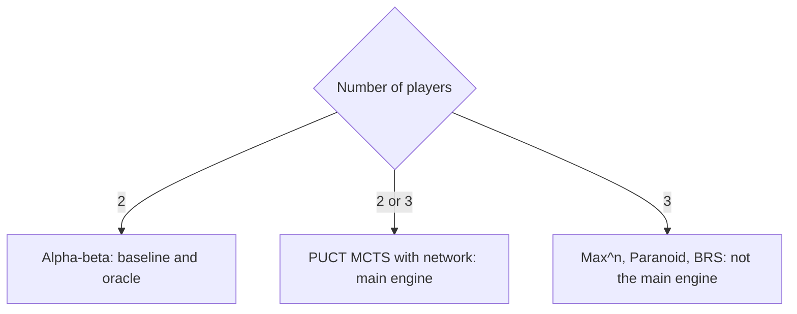
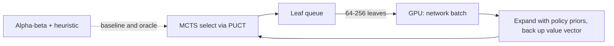

# Search and evaluation

**TL;DR:** The engine estimates the value of a position in five stages of rising cost, from a free row-distance sum up to exact solitaire distances. For two players the value is one number; for three players it is a vector with one entry per player. Implementation starts with a two-player alpha-beta baseline that uses the single-agent distance heuristic. After that comes the main engine for both player counts: AlphaZero-style MCTS with PUCT and leaf batching on the GPU. Alpha-beta stays in the code as a baseline opponent and as a test oracle. Strength levels come from the search budget, temperature and noise, not from search depth. A round-robin tournament between the levels must give a monotone Elo ladder.

This document builds on the [rules](rules.md) and the [architecture](architecture.md). The [endgame and opening](endgame-and-opening.md) document covers the endgame database and the opening book. Full bibliographic entries are in the [references](references.md).

## How to read the claims

Each claim in this document has one of three levels:

| Level | Meaning | Marker in the text |
|---|---|---|
| Established | A published source supports the claim. | A citation key, for example [Sturtevant2019] |
| Reported | The project owner's literature survey contains the claim. Nobody has checked it again against the source. | "reported" or "per the owner's survey" |
| Project decision | The project chose this. It is a choice, not a result. | "project decision" |

Some claims carry a citation key and the word "reported". This means that the owner's survey attributes the claim to the source, but this document did not re-verify the wording.

## Terms

- **Distance:** the number of moves one player needs to bring all pieces into the goal triangle, if no opponent piece stands on the board.
- **Heuristic:** a fast estimate of the value of a position. It is not exact.
- **Plateau:** a set of positions that the heuristic scores equally. A search cannot tell the moves inside a plateau apart.
- **Playout:** in MCTS, a fast simulated game from a leaf position to an end or a cut-off.
- **PUCT:** the tree policy used by AlphaZero. It combines the mean value of a child with a prior probability from the policy network.
- **Leaf batching:** the search collects many leaf positions and sends them to the network in one GPU call.

## Evaluation stages

The stages below come from the owner's survey (reported). Each stage adds information and costs more. The engine can stop at any stage.

| Stage | What it computes | Cost | Blind spot |
|---|---|---|---|
| 1. Row distance | Sum of the row distances of all pieces to the goal. | Free | Full of plateaus. A sideways move scores 0. |
| 2. Single-agent distance table | Breadth-first search (BFS) from the goal triangle on an empty board. One table of 121 entries per player. | Equally cheap (one table lookup per piece) | Ignores interaction: blocks and jump bridges over other pieces. |
| 3. Assignment bound | The 10 pieces must fill 10 *different* goal holes. The Hungarian method solves this assignment. | About 1000 operations on a 10x10 matrix | Still ignores interaction. |
| 4. Correction terms | A straggler term on the maximum distance, because the game ends only when the *last* piece arrives. A cohesion term, because pieces close together create jump bridges. | Not given in the survey | The weights are free parameters. Only tournament tuning can set them. |
| 5. Exact solitaire distance | Exact remaining moves for one player, by IDA* or BFS, when the position allows it. | Expensive in the mid-game | Exact only for one player alone. It is exact in the endgame, where the armies no longer interact. |

Stage 2 is the established starting point: "A common heuristic used for play is the single-agent distance to the goal" [Sturtevant2019, §2]. The paper cites [Sturtevant2002] for this heuristic. It also states that single-agent distances on the full board can be calculated [SturtevantRutherford2013] and used for game play [Sturtevant2015], both as cited in [Sturtevant2019, §2].

Per the owner's survey, stage 2 is slightly better than stage 1 (reported). Stage 3 corrects a systematic error of stage 2: the sum of single distances underestimates, because two pieces cannot both use the same goal hole.

The stage 4 terms match ideas from a lecture slide deck [MITSlides2010]: moving a marble a long distance by a sequence of jumps is best, lateral moves are of doubtful efficiency, and trailing marbles that cannot hop over anything take long to catch up. The slides are background for teaching, not a tested result.

### Why every stage has a blind spot

Project reasoning: the single-agent distance is an abstraction of the true value, because it ignores interaction with other pieces, such as blocks and jump bridges. Stages 1 to 5 all compute values for one player alone. None of them sees that a piece of the opponent can be a bridge for a jump, or a block. Therefore a hand-written heuristic will always miss some tactical positions. The search or a learned network must find these.

Stage 5 becomes exact when the armies are past each other. The [endgame and opening](endgame-and-opening.md) document explains this case and the endgame database.

## Value: scalar for two players, vector for three

**Two players (reported):** the value is the difference of the two distances, with a correction for the side to move. One number is enough. A gain for one player is a loss for the other.

**Three players (reported):** the value is a vector with one entry per player. The game is not zero-sum, so one number cannot describe a position. A losing player can decide which of the other two players wins (the kingmaker problem). The [rules](rules.md) document explains why three players have no unique game value.

**End of game (project decisions of 2026-11-07, defined in the [rules](rules.md#rule-switches)):** a game that reaches the move limit (default 200 plies for two players) without a winner is scored by distance (`drawHandling = SCORE_BY_DISTANCE`, the default). The search uses the same score for these terminal positions. `DRAW` stays available for comparisons with solved tables. A three-player game ends at the first winner. The switch value `ranking = FULL_RANKING` (play on to rank second place) is reserved and not implemented.

Two rule switches change the search tree. `leaveGoal = FORBIDDEN` is a project decision; it differs from [Sturtevant2019, §3], whose rule set does not forbid leaving the goal. `repetition = MOVE_LIMIT` is a project decision; it differs from [Sturtevant2019, §3.4], where a game is drawn if any board state is repeated (Definition 4). The [rules](rules.md#deliberate-deviations-from-sturtevant2019) document records both.

**Project decision:** the value head of the network has one output per player from the start. The same network layout serves two and three players. The [architecture](architecture.md) document describes the head.

## Alpha-beta baseline for two players

**Project decision (2026-11-07):** the alpha-beta baseline is the first search the project builds, directly after the engine and before the neural network. Its heuristic is the single-agent distance (stage 2). Later stages are added only when experiment 1 shows a gain.

For two players the classical approach is alpha-beta search [CPW]. The baseline uses:

- iterative deepening,
- a transposition table with Zobrist hashing,
- move ordering by the heuristic change of the move (the "heuristic delta").

The branching factor in the mid-game is often well above 50 (reported), because every end cell of a jump chain is a separate move. This makes deep full-width search expensive.

Two pruning methods reduce the width. Both are risky (reported):

- **Forbid backward moves.** Backward jumps can be part of the best line. The search then cannot find these lines.
- **Beam search:** keep only the k best moves by the heuristic. The beam inherits every blind spot of the heuristic.

Only a tournament can measure the cost of these blind spots. The [experiment list](#experiments) contains this measurement.

## Algorithms for more than two players

Alpha-beta assumes that one player's gain is the other player's loss. With three players this is false. The literature offers four families:

| Algorithm | Idea | Pruning | Source |
|---|---|---|---|
| Max^n | Each player maximises its own entry of the value vector. | Almost none | [Sturtevant2003] |
| Paranoid | The root player assumes that all opponents play together against it. This turns the game into a two-player game. | Alpha-beta possible | [Sturtevant2003] |
| Best Reply Search (BRS) | Only the strongest single reply among all opponents is searched; the other opponents pass. | Alpha-beta possible | [SchaddWinands2011] |
| Multiplayer MCTS | Monte-Carlo tree search with one value per player and heuristic playouts. | Not needed (selective by sampling) | [NijssenWinands2010], [Nijssen2013] |

The source column names where the survey places each algorithm. The pruning entries for Max^n and Paranoid come from the survey. The idea column and the other pruning entries are this document's summary of the usual definitions, not statements checked against the sources.

Paranoid is pessimistic: real opponents seldom cooperate perfectly. Per the owner's summary, [SchaddWinands2011] tested BRS on Chinese Checkers, and BRS beat both Max^n and Paranoid there (reported).

## Warning: random playouts do not end

Purely random MCTS playouts practically never end in Chinese Checkers (reported). Pieces can move backwards, so a random game has no bound on its length. A random playout gives no useful result.

The fix (reported) has two parts:

1. **Epsilon-greedy playouts** along the distance heuristic. In the usual meaning of the term, the playout plays the move with the best heuristic value with probability 1 − ε, and a random move with probability ε. The survey does not give more detail.
2. **Move limit.** After a fixed number of moves, the playout stops. The heuristic evaluates the position at the cut-off. This playout cut-off is a search parameter. It is separate from the game's move limit in the rules (default 200 plies).

The AlphaZero-style search below does not use playouts. The network evaluates the leaf. The fix still matters for any plain MCTS baseline, and for the bootstrap phase if that phase uses playouts.

## Project decision: one PUCT engine for both player counts

**Project decision:** the main engine is one MCTS with PUCT and a neural network, in the style of AlphaZero. It serves two and three players.

**Implementation order (project decision, 2026-11-07):**

1. Engine: board, rules and move generation.
2. Alpha-beta baseline for two players with the single-agent distance heuristic.
3. Neural network, then the MCTS with PUCT on top of it.

The MCTS and the network come after the baseline, so that each network generation has a working opponent and a test oracle from its first day.

- **Leaf batching:** the search collects 64 to 256 leaves and evaluates them in one GPU call (TornadoVM).
- **Virtual loss** keeps parallel simulations from selecting the same path.
- **Parallel games** on virtual threads fill the GPU batches.
- **Bootstrapping:** the first generations use the hand-written distance heuristic, so that early self-play is not random.

Reasons for this decision:

- One engine for both player counts. Max^n, Paranoid and BRS each need their own code and their own tuning.
- MCTS is selective by sampling. It needs no risky pruning rule to handle a branching factor above 50.
- Batched network evaluation is the GPU workload that this project wants to show.

**Alpha-beta keeps two roles:**

1. **Baseline opponent.** Network generations play against it. A generation that loses against the baseline after the bootstrap phase points to a regression. The plan gates each generation against the previous network; this baseline match is an addition.
2. **Test oracle.** In small positions, alpha-beta with a deep search gives a reliable best move. The MCTS should select a move of the same value.

## Strength levels

Search depth alone does not give a smooth strength scale (reported). A depth-1 player is erratic, not weak.

**Project decision:** a strength level is a combination of three settings:

| Setting | Effect |
|---|---|
| Budget | Time or number of simulations per move. A larger budget gives a stronger move. |
| Temperature | Softmax sampling over the root move values. A high temperature selects weaker moves more often. |
| Noise (optional) | Random noise on the evaluation. It adds variation to the move choice. |

The `Opponent` API exposes levels 1 to N. Each level is a fixed tuple of these three settings.

### Elo calibration procedure

Use this procedure after each change to the level table or to the network. The survey gives the round-robin, the rating tools and the goal (reported). Equal game counts, changing start sides and the game file are additions of this document.

1. Set the level table (budget, temperature and noise for each level).
2. Play a round-robin tournament between all levels. Each pair plays the same number of games. Change the start side from game to game (with three players, rotate the seats).
3. Write all results to a game file in PGN-like form.
4. Calculate the Elo rating of each level with BayesElo or Ordo.
5. Sort the levels by number. Make sure that the Elo rating increases with each level.
6. If the ratings do not increase, change the level table and go back to step 2.

**Acceptance criterion:** the Elo ladder is monotone. Level n + 1 has a higher Elo rating than level n, for all n. Any other result means that the levels are a placebo (reported).

## Learning-based work for context

[Sturtevant2019, §1] expects the AlphaZero approach to learn to play Chinese Checkers. Because some board sizes can be strongly solved, the paper says that this gives the opportunity to measure precisely how learning takes place, and suggests Chinese Checkers as a testbed for evaluating learning in two-player games. This project does not solve any variant; it trains a neural network and uses [Sturtevant2019] only for verification. An optional small-board engine mode, proposed in the [rules](rules.md) but not scheduled, could later check the engine's counting rules against the paper's Table 1.

Further AlphaZero-style work on Chinese Checkers exists:

- [Liu2019] studies heuristics, MCTS and deep reinforcement learning for Chinese Checkers.
- A University of Alberta master's thesis (title not verified) [AlbertaThesis] trained an AlphaZero agent on a 4x4 board with 3 pieces and on a 5x5 board with 6 pieces.

Per the owner's survey (reported), the full board needs serious compute, and three players need a multi-value head. This project's value head already has one output per player.

## Experiments

Each experiment names what to measure and which result would change a decision. All experiments are proposals. Experiments 7 and 8 are not in the approved plan. The phase column follows the implementation order: experiments 1 to 3 need only the alpha-beta baseline and run before the network exists. Experiments 4 to 8 need the MCTS or the network. Experiment 9 runs whenever the level table changes.

| # | Phase | Experiment | Measure | Result that changes a decision |
|---|---|---|---|---|
| 1 | Alpha-beta | Evaluation stages | Tournament of alpha-beta with stages 1, 2, 3, 3+4 at equal time. | If stage 3 does not beat stage 2, drop the Hungarian method from the hot path. |
| 2 | Alpha-beta | Correction weights | Tune straggler and cohesion weights by tournament. | If no weight setting beats stage 3 alone, remove stage 4. |
| 3 | Alpha-beta | Risky pruning | Alpha-beta with and without the backward-move ban; beam widths k = 5, 10, 20 against full width. | If a pruned version wins at equal time, use it in the baseline. If it loses, keep full width. |
| 4 | MCTS and network | Playout policy | Mean playout length and share of playouts that end before the limit, for ε = 0, 0.1, 0.3, 1.0. | If most playouts with ε = 1.0 (random) end before the limit, the warning is too strict for this rule set. Record it. |
| 5 | MCTS and network | Leaf batch size | Simulations per second and Elo at equal time for batch sizes 64, 128, 256. | Select the batch size with the best Elo, not with the best throughput. |
| 6 | MCTS and network | PUCT against alpha-beta (2 players) | Win rate of each network generation against the baseline. | If generation n does not beat the baseline after the bootstrap phase, stop scaling and check the training loop. |
| 7 | MCTS and network | PUCT against BRS (3 players) | Win rate of PUCT against a BRS reference player. | If BRS wins clearly, reconsider the single-engine decision for three players. |
| 8 | MCTS and network | Oracle agreement | Share of small test positions where MCTS and deep alpha-beta select the same move. | A low share can point to a bug in search or value backup. Check for a bug before blaming weak play. |
| 9 | Any | Strength ladder | Elo per level from the round-robin. | A non-monotone ladder blocks the release of the level table. |
