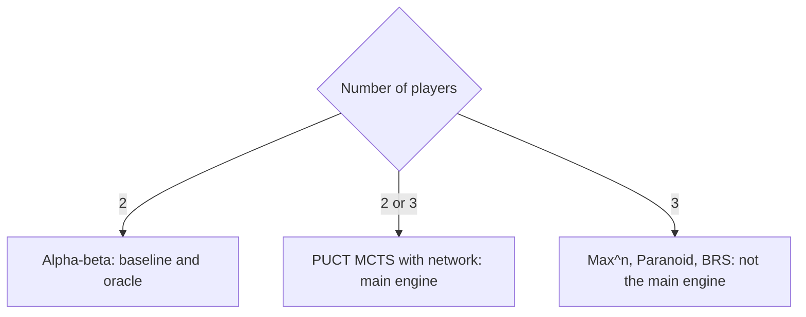
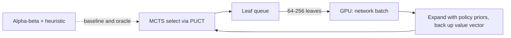

# Search and evaluation

**TL;DR:** The engine estimates the value of a position in five stages of rising cost, from a free row-distance sum up to exact solitaire distances. For two players the value is one number; for three players it is a vector with one entry per player. Implementation starts with a two-player alpha-beta baseline that uses the single-agent distance heuristic. After that comes the main engine for both player counts: AlphaZero-style MCTS with PUCT and leaf batching on the GPU. Alpha-beta stays in the code as a baseline opponent and as a test oracle. Strength levels come from the search budget, temperature and noise, not from search depth. A round-robin tournament between the levels must give a monotone Elo ladder.

This document builds on the [rules](rules.md) and the [architecture](architecture.md). The [endgame and opening](endgame-and-opening.md) document covers the endgame database and the opening book. Full bibliographic entries are in the [references](references.md).

## How to read the claims

Each claim in this document has one of three levels:

| Level | Meaning | Marker in the text |
|---|---|---|
| Established | A published source supports the claim. | A citation key, for example [Sturtevant2019] |
| Reported | The project owner's literature survey contains the claim. Nobody has checked it again against the source. | "reported" or "per the owner's survey" |
| Project decision | The project chose this. It is a choice, not a result. | "project decision" |

Some claims carry a citation key and the word "reported". This means that the owner's survey attributes the claim to the source, but this document did not re-verify the wording.

## Terms

- **Distance:** the number of moves one player needs to bring all pieces into the goal triangle, if no opponent piece stands on the board.
- **Heuristic:** a fast estimate of the value of a position. It is not exact.
- **Plateau:** a set of positions that the heuristic scores equally. A search cannot tell the moves inside a plateau apart.
- **Playout:** in MCTS, a fast simulated game from a leaf position to an end or a cut-off.
- **PUCT:** the tree policy used by AlphaZero. It combines the mean value of a child with a prior probability from the policy network.
- **Leaf batching:** the search collects many leaf positions and sends them to the network in one GPU call.

## Evaluation stages

The stages below come from the owner's survey (reported). Each stage adds information and costs more. The engine can stop at any stage.

| Stage | What it computes | Cost | Blind spot |
|---|---|---|---|
| 1. Row distance | Sum of the row distances of all pieces to the goal. | Free | Full of plateaus. A sideways move scores 0. |
| 2. Single-agent distance table | Breadth-first search (BFS) from the goal triangle on an empty board. One table of 121 entries per player. | Equally cheap (one table lookup per piece) | Ignores interaction: blocks and jump bridges over other pieces. |
| 3. Assignment bound | The 10 pieces must fill 10 *different* goal holes. The Hungarian method solves this assignment. | About 1000 operations on a 10x10 matrix | Still ignores interaction. |
| 4. Correction terms | A straggler term on the maximum distance, because the game ends only when the *last* piece arrives. A cohesion term, because pieces close together create jump bridges. | Not given in the survey | The weights are free parameters. Only tournament tuning can set them. |
| 5. Exact solitaire distance | Exact remaining moves for one player, by IDA* or BFS, when the position allows it. | Expensive in the mid-game | Exact only for one player alone. It is exact in the endgame, where the armies no longer interact. |

Stage 2 is the established starting point: "A common heuristic used for play is the single-agent distance to the goal" [Sturtevant2019, §2]. The paper cites [Sturtevant2002] for this heuristic. It also states that single-agent distances on the full board can be calculated [SturtevantRutherford2013] and used for game play [Sturtevant2015], both as cited in [Sturtevant2019, §2].

Per the owner's survey, stage 2 is slightly better than stage 1 (reported). Stage 3 corrects a systematic error of stage 2: the sum of single distances underestimates, because two pieces cannot both use the same goal hole.

The stage 4 terms match ideas from a lecture slide deck [MITSlides2010]: moving a marble a long distance by a sequence of jumps is best, lateral moves are of doubtful efficiency, and trailing marbles that cannot hop over anything take long to catch up. The slides are background for teaching, not a tested result.

### Stage 4 measured (experiment of 2026-11-07, branch exp/stage4)

`Stage4Evaluator` (arena name `stage4`) adds four weighted terms to the stage 2 distance difference: `ws` per step of the largest piece distance (straggler), `wq` per 10 of the sum of squared distances (smooth straggler), `wc` per adjacent own pair (cohesion) and `wj` per forward single jump that is possible now (jump bridges). The weights were tuned with the arena at 5000 nodes on seeds 3 and 4 and then measured at 20000 nodes on seeds 1 and 2, 200 pairs each:

| Variant | Opponent | Seed 1 | Seed 2 |
|---|---|---|---|
| `ws=15,wq=6,wj=3`, 20000 nodes | `distance`, 20000 nodes | +306 ± 41 | +371 ± 51 |
| `ws=15,wq=6,wj=3`, 16600 nodes (cost-adjusted, 0.83 x nodes/s) | `distance`, 20000 nodes | +343 ± 46 | +343 ± 46 |
| `ws=15,wq=6` (no jump term, equal cost) | `distance`, 20000 nodes | +239 ± 39 | +245 ± 37 |

The straggler terms give most of the gain. The jump term adds about 100 Elo at equal nodes and survives the cost adjustment. The cohesion term did not help: `wc=5` lost by more than 450 Elo, and `wc = ±1` changed nothing measurable, so the tuned setting leaves it at 0.

### Why every stage has a blind spot

Project reasoning: the single-agent distance is an abstraction of the true value, because it ignores interaction with other pieces, such as blocks and jump bridges. Stages 1 to 5 all compute values for one player alone. None of them sees that a piece of the opponent can be a bridge for a jump, or a block. Therefore a hand-written heuristic will always miss some tactical positions. The search or a learned network must find these.

Stage 5 becomes exact when the armies are past each other. The [endgame and opening](endgame-and-opening.md) document explains this case and the endgame database.

## Value: scalar for two players, vector for three

**Two players (reported):** the value is the difference of the two distances, with a correction for the side to move. One number is enough. A gain for one player is a loss for the other.

**Three players (reported):** the value is a vector with one entry per player. The game is not zero-sum, so one number cannot describe a position. A losing player can decide which of the other two players wins (the kingmaker problem). The [rules](rules.md) document explains why three players have no unique game value.

**End of game (project decisions of 2026-11-07, defined in the [rules](rules.md#rule-switches)):** a game that reaches the move limit (default 200 plies for two players) without a winner is scored by distance (`drawHandling = SCORE_BY_DISTANCE`, the default). The search uses the same score for these terminal positions. `DRAW` stays available for comparisons with solved tables. A three-player game ends at the first winner. The switch value `ranking = FULL_RANKING` (play on to rank second place) is reserved and not implemented.

Two rule switches change the search tree. `leaveGoal = FORBIDDEN` is a project decision; it differs from [Sturtevant2019, §3], whose rule set does not forbid leaving the goal. `repetition = MOVE_LIMIT` is a project decision; it differs from [Sturtevant2019, §3.4], where a game is drawn if any board state is repeated (Definition 4). The [rules](rules.md#deliberate-deviations-from-sturtevant2019) document records both.

**Project decision:** the value head of the network has one output per player from the start. The same network layout serves two and three players. The [architecture](architecture.md) document describes the head.

## Alpha-beta baseline for two players

**Project decision (2026-11-07):** the alpha-beta baseline is the first search the project builds, directly after the engine and before the neural network. Its heuristic is the single-agent distance (stage 2). Later stages are added only when experiment 1 shows a gain.

For two players the classical approach is alpha-beta search [CPW]. The baseline uses:

- iterative deepening,
- a transposition table with Zobrist hashing,
- move ordering by the heuristic change of the move (the "heuristic delta"). The order is a selection sort done lazily: step i runs only just before move i is searched (round 2, E01), so a node that cuts off after a few moves never sorts the rest. Ties keep the order of the full selection sort.

The branching factor in the mid-game is often well above 50 (reported), because every end cell of a jump chain is a separate move. This makes deep full-width search expensive.

Two pruning methods reduce the width. Both are risky (reported):

- **Forbid backward moves.** Backward jumps can be part of the best line. The search then cannot find these lines.
- **Beam search:** keep only the k best moves by the heuristic. The beam inherits every blind spot of the heuristic.

Only a tournament can measure the cost of these blind spots. The [experiment list](#experiments) contains this measurement.

### Search enhancements (measured 2026-11-07)

`AlphaBeta` has optional enhancements. Each is a `SearchOptions` field and a player-spec key, and all are off by default, so `ab:eval=distance,nodes=20000` plays exactly as before (a fingerprint test checks this):

| Key | Enhancement | Changes the value of a fixed-depth search? |
|---|---|---|
| `pvs=1` | Principal variation search: null windows after the first move, re-search on a fail high | No |
| `killers=1` | Two killer moves per height, ordered right after the table move | No |
| `history=1` | History table (from, to) breaks ties of the distance gain in move ordering | No |
| `asp=1` or `asp=<w>` | Aspiration window of half-width 50 (or w) around the previous iteration's score | No |
| `ttrep=1` | Table buckets of two: one keeps the deeper entry of the current search, one is always replaced | No |
| `mate=1` | Mate scores are stored relative to the node and converted back on probing | No (fixes the mate distance across moves) |
| `lmr=1/2/3` | Late move reductions after the third move at depth ≥ 3: by 1 ply, by ln d · ln i / 2, by ln d · ln i / 1.25 | Yes, by design |
| `partial=1` | Use the best move of the iteration the node limit interrupts, if the first root move was searched completely | Yes (it uses a deeper, incomplete iteration) |

A test checks the options of the "No" rows against plain negamax.

**Why the exact options alone gain nothing:** with good move ordering, depth 4 costs about 9 000 nodes and depth 5 about 85 000 (mean over 40 random positions). At 20 000 nodes every exact option ends at depth 4 and throws the unfinished depth-5 iteration away. PVS, killers, aspiration and the table save at most 3 % of the nodes, which does not reach depth 5. Their match results stay inside the noise. History changes which of several equal root moves is chosen (about 45 % of positions have ties at depth 4), so its result is noise from tie-breaking (+44 then +15 Elo on the tuning seeds).

**What gains:** the two options that use the wasted nodes. LMR raises the mean completed depth at 20 000 nodes from 4.0 to 4.6. `partial=1` uses the interrupted depth-5 iteration. Together with the exact options they give about +160 Elo at equal nodes, more than 4x nodes for the baseline (+135).

Tuning matches (seeds 3 and 4, 200 pairs each, against `ab:eval=distance,nodes=20000`, Elo with 95 % interval):

| Variant | Seed 3 | Seed 4 |
|---|---|---|
| `pvs=1` | +0 ± 13 | |
| `killers=1` | −17 ± 21 | |
| `history=1` | +44 ± 28 | +15 ± 26 |
| `asp=1` | +5 ± 18 | |
| `ttrep=1,mate=1` | −2 ± 6 | |
| `lmr=1` | +4 ± 28 | |
| `lmr=2` | +53 ± 31 | +51 ± 31 |
| `lmr=3` | +67 ± 32 | +64 ± 34 |
| `partial=1` | +65 ± 28 | |
| `lmr=2,partial=1` | +155 ± 35 | +171 ± 36 |
| `pvs=1,lmr=2,partial=1` | +176 ± 36 | +172 ± 36 |
| all exact options + `partial=1` | +91 ± 31 | |
| all, `lmr=3` | +164 ± 34 | +145 ± 36 |
| all, `lmr=2` | +212 ± 38 | +180 ± 37 |

Result for the best variant `ab:eval=distance,nodes=20000,pvs=1,killers=1,history=1,lmr=2,asp=1,ttrep=1,mate=1,partial=1`, seeds 1 and 2 (not used for tuning), 200 pairs each:

| Match | Seed 1 | Seed 2 |
|---|---|---|
| Equal nodes (20 000 each) | +175 ± 36 | +143 ± 35 |
| Nodes/s, variant vs baseline (same run) | 991 k vs 1 096 k (0.905) | 906 k vs 998 k (0.907) |
| Cost-adjusted (variant 18 094 nodes, baseline 20 000) | +161 ± 37 | +113 ± 32 |

The variant is about 10 % slower per node. It still wins clearly at equal cost on both seeds. The search options are therefore a stronger baseline for the evaluation experiments; compare evaluators with the same options on both sides.

### Learned linear evaluation (`eval=linear`, measured 2026-11-07)

`LinearEvaluator` scores a position with a weighted sum of 12 cheap features, each "side to move minus opponent": summed distance, maximum distance, summed squared distance, pieces in the goal, pieces in the start corner, spread of the distances, distance from the centre line, forward single jumps, touching own pieces, forward steps, the distance difference times the game phase, and a tempo constant. A logistic regression of the game result on 68 255 positions from 2000 baseline games set the weights (`LinearWeights`; `LinearTraining` in the test sources reproduces the fit). On 400 held-out games the model predicts the winner of 78.8 % of the positions, the distance difference alone 76.8 %.

Arena result against `ab:eval=distance,nodes=20000`, 200 pairs each (tuned on seeds 3 and 4 only):

| Variant | Seed 1 | Seed 2 |
|---|---|---|
| `ab:eval=linear,nodes=20000` | +552 ± 89 Elo | +577 ± 96 Elo |
| `ab:eval=linear,nodes=13300` (equal time) | +499 ± 81 Elo | +478 ± 72 Elo |

The evaluation costs about a third of the search speed (nodes/s 0.66 of the baseline), so the equal-time match gives it 13 300 nodes. A second fitting round on games of the linear evaluator itself predicted better but played weaker (seed 4: +440 against +526 Elo), so the first-round weights stay.

## Results of the first improvement round (2026-11-07)

Five ideas were built in separate git worktrees and measured in the arena against `ab:eval=distance,nodes=20000`. An independent verifier repeated each measurement with new seeds (300 pairs) and with a cost-adjusted node budget, and read the diff for unfair advantages. Every author tuned on different seeds than the ones reported.

| Idea | Equal nodes, verifier (Elo, 95% interval) | Cost-adjusted | Decision |
|---|---|---|---|
| Learned linear evaluation (`linear`) | +506 ± 65, +466 ± 58 | +506 ± 63 | merged |
| Stage 4: straggler, squared distances, jump bridges (`stage4`) | +318 ± 34, +308 ± 35 | +299 ± 33 | merged |
| Search enhancements (LMR, partial iteration, killers, table) | +170 ± 28, +166 ± 29 | +153 ± 29 | merged |
| Jump-aware breadth-first distance (`jumpbfs`) | +258 ± 34, +217 ± 30 | **−85 ± 27** | discarded: too slow |
| Optimal piece-to-goal assignment (`assign`, stage 3) | −57 ± 23, −77 ± 25 | −156 ± 27 | discarded: loses |

Head-to-head after the merge (200 pairs each):

| Match | Elo |
|---|---|
| `linear` against `stage4`, equal nodes | +143 ± 35, +168 ± 34 |
| `linear` against `stage4`, `linear` with 0.8 of the nodes (equal cost) | +111 ± 33 |
| `linear` with all search options against plain `linear`, equal cost | +235 ± 39, +246 ± 43 |
| `linear` with all search options against the original baseline, 15 ms per move each | 198 of 200 games won |

What the results say:

- **The evaluation limits strength, not the depth.** Four times the nodes was worth +135 Elo. A better evaluation was worth +300 to +500.
- **Search enhancements alone gain nothing; they gain together.** At 20000 nodes every exact option still ends in depth 4 and throws away the unfinished depth-5 iteration. Late move reductions and the use of the interrupted iteration turn those nodes into depth.
- **`linear` generalises beyond its training opponent.** Its weights were fitted on games of the baseline and its variants. It also beats `stage4`, which is a different evaluation, by +111 Elo at equal cost.
- **Cohesion did not help.** The tuning of `stage4` found no useful weight for pairs of adjacent pieces; large weights lost by more than 450 Elo.
- **`assign` loses.** The authors guess that Definition 1 is the cause: opponent pieces left in the goal fill holes anyway, so forcing own pieces into the deepest cells wastes tempo. No run with another blockade rule has tested this.
- **`jumpbfs` is a real gain per node and a loss per second.** A faster implementation could change the decision.

Limits of these numbers:

- **The arena saturates.** At 99% of the points the Elo estimate is clamped and its interval is wide. The original baseline can no longer separate stronger players. From now on, new strategies are measured against `Strategies.BEST_SPEC`.
- **Openings and opponents.** All games start after 4 random plies and are played against other engines of this family. Strength against humans or against a different kind of player is not measured.
- **Machine load.** Node-limited matches do not depend on load. The nodes-per-second ratios behind the cost adjustment were measured while other runs used the machine and are accurate to a few percent. Round 2 measures them with `Bench` instead (next section).

## Round 2 yardstick

**TL;DR:** Round 2 is measured against a frozen reference player R2 (round 1's best player with its weights frozen as `linear-r1`), whose search tree is pinned by a test, and against a frozen jar of the pre-round build for speed. Speed ratios come only from `Bench` (single thread, thread CPU time, interleaved), never from an arena report. The full plan is [baseline-round2-plan.md](baseline-round2-plan.md); this section is the part that the code implements (experiment E00).

### Reference player and ladder

R2 = `ab:eval=linear-r1,pvs=1,killers=1,history=1,lmr=2,asp=1,ttrep=1,mate=1,partial=1,nodes=20000` (`ReferencePositions.R2_SPEC`). `linear-r1` is the registry name of `LinearWeights.R1`, a literal copy of the round-1 weights; `eval=linear` keeps the live weights (`LinearWeights.WEIGHTS`) and may be refitted. Every later build can construct R2, and the strategy contract tests cover `linear-r1` through `Evaluators.names()`.

| Rung | Spec | Use |
|---|---|---|
| R0 | `ab:eval=distance,nodes=20000` | sanity only (saturated at 198 of 200 games) |
| R1 | R2 at 5000 nodes | lower rung |
| R2 | as above | gating opponent of the round and of every network generation |
| R3 | R2 at 80000 nodes | upper rung, sensitive gate for weight refits |

Re-base rule: when BEST scores above 0.80 against R2 (about +240 Elo), freeze the new BEST as R2' with a new registry alias and fingerprint, and keep R2 in the ladder.

### Seeds

| Seeds | Use |
|---|---|
| 31, 32 | authors' tuning |
| 33, 34 | authors' report (300 pairs each) |
| 41, 42 | verifier (300 pairs; 500 when the claimed gain is below +50 Elo) |
| 43 | integration match |
| 1002 to 1005 | data sets (E03, E04, E05) |

Official numbers use no other seeds. Seeds of round 1 and of the surveyors (1 to 4, 9, 11 to 13, 21 to 25, 77, 1001) are not reused. The reference positions below use the fixed generator seed 1000; they produce no Elo number, only trees and speed.

### Search-tree fingerprint

`ReferencePositions` generates 64 positions deterministically: 8 self-play games of R2 at 1000 nodes from 4 random plies (seed 1000), 8 distinct plies between 8 and 100 drawn from each. Two more openings start the full games. Nothing is stored on disk; the set is a list of move sequences from the start position and takes about a second to generate.

`Fingerprint` computes three checksums for a spec: per position the move, score, completed depth and node count of the node-limited search plus the move, score and exact node count of a depth-4 search (a node-limited search nearly always reports exactly its limit, so only the depth-4 count measures the tree size); and the move sequence and node totals of one self-play game at 1000 and one at 5000 nodes. `BestSpecFingerprintTest` records them for R2 and for `Strategies.BEST_SPEC` at 20000 nodes. At the freeze both specs have the same values, because the weights are the same.

Rules:

- An identical-tree change (E01, E02, E13) keeps all six constants. It needs no arena run: the fingerprint test green without touching a constant, plus the Bench ratio.
- A tree-changing feature is off by default, so it changes no constant while it is off.
- A refit of `linear` (E04) changes the `BEST_*` constants, never the `R2_*` constants.
- Every re-record needs a written reason in the commit message and in this section.
- To find where two trees part: `devenv shell -- ./gradlew --no-build-cache :search:fingerprint --args='<spec>'` prints one line per position and the game moves; diff the output of the two builds.

Re-records: none so far.

### Cost reference: the frozen pre-round build

The pre-round build is frozen as `engine.jar` and `search.jar` in `.reference/` in the repository root (ignored by git), built by `devenv shell -- scripts/freeze-reference.sh`, which refuses to overwrite an existing reference without `--force`. `Bench` reads it from `-Dsternhalma.reference.dir` (default `.reference` in the working directory; the Gradle task runs in the repository root and accepts `-Psternhalma.reference.dir=<dir>`).

| Item | Value |
|---|---|
| Commit | `cb4b75011678758e485700a8605ac864a491d6c3` (the last commit before round 2) |
| Built | 2026-11-07, OpenJDK 25.0.3 |
| SHA-256 `engine.jar` | `6b8e8da29674d7a684919172b48a2f709a91d1e20ac353ce4f222d2c92813223` |
| SHA-256 `search.jar` | `d46b8b89bc0ac073b53b9b5ad22e1a65db1dacfaba004d2211f12a0f58771bda` |

The frozen build has no `linear-r1`; its `eval=linear` holds the same weights, and Bench uses it there automatically (it says so in its output). Bench confirms on every run that both builds search the identical trees.

### Bench: nodes per CPU-second

```bash
devenv shell -- ./gradlew --no-build-cache :search:bench --args='<spec>'           # current vs frozen build
devenv shell -- ./gradlew --no-build-cache :search:bench --args='<specA> <specB>'  # two specs, current build
devenv shell -- ./gradlew --no-build-cache :search:bench --args='<spec> --copy'    # current vs a second copy of it
```

Protocol, as implemented in `Bench`:

- **Items:** the 64 reference positions (a fresh searcher each) plus 2 full self-play games (two fresh players that keep their tables, as in the arena), all at the spec's node budget (`--nodes N` overrides it).
- **Single thread, CPU time:** everything runs on the main thread. `ThreadMXBean.getCurrentThreadCpuTime()` is read around each `search` or `choose` call, never per node. Table allocation and position replay lie outside the timed region. Wall time is printed beside it for information.
- **Same code path for both builds:** both sides, also the current build, are driven by reflection through API that exists in the frozen build (`PlayerSpec.parse`, `Evaluators.byName`, `new AlphaBeta(...)`, `AlphaBeta.search`, `AlphaBetaPlayer.choose`). The frozen jars live in their own class loader whose parent is the platform class loader.
- **Interleaving:** one untimed warm-up pass of both sides over the positions, then 3 repetitions. In each repetition every item runs on both sides directly after each other, in the order A,B when item number plus repetition number is even, otherwise B,A. A change of load therefore hits both sides alike, and neither side always runs first. The ratio of a repetition is nps(A)/nps(B) over all its items; Bench reports the median of the repetitions.
- **Load:** the 1-minute load average is logged before and after. Above the core count Bench refuses to start (before) or prints `REFUSED` instead of `RESULT` (after), with exit code 3; `--ignore-load` reports anyway and marks the line `UNDER_LOAD`.
- **Tree check:** Bench reports on how many positions and games A and B searched identical trees (move, score, depth and nodes; for games the move sequence and the node total).

Measured on 2026-11-07 for R2 on the unchanged code (16 cores, load 3.7 to 4.8; three separate Bench runs against the frozen build):

| Comparison | nps(A) | nps(B) | Ratio (median of 3 repetitions) | Trees |
|---|---|---|---|---|
| current vs frozen, run 1 | 1 252 704 | 1 275 993 | 0.9803 | 64/64, 2/2 identical |
| current vs frozen, run 2 | 1 276 398 | 1 268 658 | 1.0045 | 64/64, 2/2 identical |
| current vs frozen, run 3 | 1 276 770 | 1 278 545 | 0.9991 | 64/64, 2/2 identical |
| current vs a second copy of itself (`--copy`) | 1 267 474 | 1 269 402 | 0.9958 | 64/64, 2/2 identical |
| `linear-r1` vs `linear`, current build | 1 270 823 | 1 275 566 | 0.9946 | 64/64, 2/2 identical |

Arena check of the alias (seed 41, 100 pairs, 20000 nodes, `--threads 4`): `linear-r1` against `linear` with all options scored exactly 0.5000 (100 wins each, every game decided by colour), 18 917 nodes per move on both sides, 15.01 against 14.99 CPU-ms per move.

CPU time per move of R2 at 20000 nodes: about 15 ms. Within one run the repetitions agree to about 1 %; between runs (separate JVMs, separate JIT compilations) the ratio moved between 0.980 and 1.005 on identical code. A speed claim therefore quotes the median of 3 Bench runs, and differences below about 2 % are not resolved.

### Speed packs

| Experiment | Change | Bench ratio vs frozen build (R2, median of 3 runs) | Trees |
|---|---|---|---|
| E01 | `AlphaBeta`: lazy selection in move ordering (`pick`, strict `>`, so the order is unchanged); LMR tables static per mode instead of per searcher | 1.474 (runs 1.474, 1.491, 1.441; 1.37M vs 0.94M nodes/CPU-s in the median run) | 64/64, 2/2 identical in every run; fingerprint tests unchanged |

E01 was measured on 2026-11-07 under load from parallel jobs (1-minute load 11.9 to 14.8 on 16 cores in two runs, 14.3 rising to 52 in the third, which Bench marked `UNDER_LOAD`); the verifier re-measures on an idle machine. Within runs the repetitions ranged from 1.34 to 1.58.

### Arena: CPU column, cost adjustment, SPRT

`GameRunner` measures the thread CPU time and the wall time of every move choice per player, and `Arena` prints CPU-ms and wall-ms per move and nodes per CPU-second for both players. Cost criteria (for example E03's "not slower") use the CPU column. The report also prints the equal-cost node budget `nodes(A) = nodes(B) x nps(A)/nps(B)` from this run's CPU times; that ratio is measured under the arena's own load (`--threads 4` beside other jobs), so claims use the Bench ratio, fixed before the arena run and quoted with it. `--sprt elo0,elo1` (alpha = beta = 0.05, default off) stops a match early once a sequential test on the pair scores, read in pair order, accepts a hypothesis; it is for authors' tuning loops only, and verifier runs stay fixed-size.

### Protocol for strength claims

Paired games with colours swapped, 4 random opening plies, `--threads 4`, node limits. When the candidate's cost per node differs, run equal nodes first, then the candidate at 20000 x nps_candidate/nps_opponent from the Bench ratio. Acceptance: lower 95 % bound above 0 on both verifier seeds against the current BEST_SPEC; the result against R2 is reported as well. Only the integration commit after a wave changes `Strategies.BEST_SPEC`.

**Integration:** the new BEST_SPEC plays R2 and the previous BEST_SPEC, 500 pairs each on seed 43, at equal nodes and at equal cost (BEST at 20000 x nps_new/nps_old nodes, nps_old measured by Bench on the frozen build, against R2 at 20000). Both numbers are reported separately; their difference is the speed share. The parts were measured against different baselines and are not additive: investigate an interaction only when the equal-nodes result falls below the sum of the parts by more than sqrt(sum of the parts' squared half-widths + the integration run's squared half-width).

**Label policy:** scores with |score| >= RACE_BASE (the racelin band, E08) are never labels or value targets; only S1 (E03) may label passed positions. Every error claim for an adjudication rule states the number of firings, the errors found by playing the games to the end and the one-sided 95 % Clopper-Pearson upper bound (0 of n: about 3.0/n; 1 of n: about 4.74/n; 2 of n: about 6.3/n).

## Algorithms for more than two players

Alpha-beta assumes that one player's gain is the other player's loss. With three players this is false. The literature offers four families:

| Algorithm | Idea | Pruning | Source |
|---|---|---|---|
| Max^n | Each player maximises its own entry of the value vector. | Almost none | [Sturtevant2003] |
| Paranoid | The root player assumes that all opponents play together against it. This turns the game into a two-player game. | Alpha-beta possible | [Sturtevant2003] |
| Best Reply Search (BRS) | Only the strongest single reply among all opponents is searched; the other opponents pass. | Alpha-beta possible | [SchaddWinands2011] |
| Multiplayer MCTS | Monte-Carlo tree search with one value per player and heuristic playouts. | Not needed (selective by sampling) | [NijssenWinands2010], [Nijssen2013] |

The source column names where the survey places each algorithm. The pruning entries for Max^n and Paranoid come from the survey. The idea column and the other pruning entries are this document's summary of the usual definitions, not statements checked against the sources.

Paranoid is pessimistic: real opponents seldom cooperate perfectly. Per the owner's summary, [SchaddWinands2011] tested BRS on Chinese Checkers, and BRS beat both Max^n and Paranoid there (reported).



## Warning: random playouts do not end

Purely random MCTS playouts practically never end in Chinese Checkers (reported). Pieces can move backwards, so a random game has no bound on its length. A random playout gives no useful result.

The fix (reported) has two parts:

1. **Epsilon-greedy playouts** along the distance heuristic. In the usual meaning of the term, the playout plays the move with the best heuristic value with probability 1 − ε, and a random move with probability ε. The survey does not give more detail.
2. **Move limit.** After a fixed number of moves, the playout stops. The heuristic evaluates the position at the cut-off. This playout cut-off is a search parameter. It is separate from the game's move limit in the rules (default 200 plies).

The AlphaZero-style search below does not use playouts. The network evaluates the leaf. The fix still matters for any plain MCTS baseline, and for the bootstrap phase if that phase uses playouts.

## Project decision: one PUCT engine for both player counts

**Project decision:** the main engine is one MCTS with PUCT and a neural network, in the style of AlphaZero. It serves two and three players.

**Implementation order (project decision, 2026-11-07):**

1. Engine: board, rules and move generation.
2. Alpha-beta baseline for two players with the single-agent distance heuristic.
3. Neural network, then the MCTS with PUCT on top of it.

The MCTS and the network come after the baseline, so that each network generation has a working opponent and a test oracle from its first day.

- **Leaf batching:** the search collects 64 to 256 leaves and evaluates them in one GPU call (TornadoVM).
- **Virtual loss** keeps parallel simulations from selecting the same path.
- **Parallel games** on virtual threads fill the GPU batches.
- **Bootstrapping:** the first generations use the hand-written distance heuristic, so that early self-play is not random.

Reasons for this decision:

- One engine for both player counts. Max^n, Paranoid and BRS each need their own code and their own tuning.
- MCTS is selective by sampling. It needs no risky pruning rule to handle a branching factor above 50.
- Batched network evaluation is the GPU workload that this project wants to show.

**Alpha-beta keeps two roles:**

1. **Baseline opponent.** Network generations play against it. A generation that loses against the baseline after the bootstrap phase points to a regression. The plan gates each generation against the previous network; this baseline match is an addition.
2. **Test oracle.** In small positions, alpha-beta with a deep search gives a reliable best move. The MCTS should select a move of the same value.



## Strength levels

Search depth alone does not give a smooth strength scale (reported). A depth-1 player is erratic, not weak.

**Project decision:** a strength level is a combination of three settings:

| Setting | Effect |
|---|---|
| Budget | Time or number of simulations per move. A larger budget gives a stronger move. |
| Temperature | Softmax sampling over the root move values. A high temperature selects weaker moves more often. |
| Noise (optional) | Random noise on the evaluation. It adds variation to the move choice. |

The `Opponent` API exposes levels 1 to N. Each level is a fixed tuple of these three settings.

### Elo calibration procedure

Use this procedure after each change to the level table or to the network. The survey gives the round-robin, the rating tools and the goal (reported). Equal game counts, changing start sides and the game file are additions of this document.

1. Set the level table (budget, temperature and noise for each level).
2. Play a round-robin tournament between all levels. Each pair plays the same number of games. Change the start side from game to game (with three players, rotate the seats).
3. Write all results to a game file in PGN-like form.
4. Calculate the Elo rating of each level with BayesElo or Ordo.
5. Sort the levels by number. Make sure that the Elo rating increases with each level.
6. If the ratings do not increase, change the level table and go back to step 2.

**Acceptance criterion:** the Elo ladder is monotone. Level n + 1 has a higher Elo rating than level n, for all n. Any other result means that the levels are a placebo (reported).

## Learning-based work for context

[Sturtevant2019, §1] expects the AlphaZero approach to learn to play Chinese Checkers. Because some board sizes can be strongly solved, the paper says that this gives the opportunity to measure precisely how learning takes place, and suggests Chinese Checkers as a testbed for evaluating learning in two-player games. This project does not solve any variant; it trains a neural network and uses [Sturtevant2019] only for verification. An optional small-board engine mode, proposed in the [rules](rules.md) but not scheduled, could later check the engine's counting rules against the paper's Table 1.

Further AlphaZero-style work on Chinese Checkers exists:

- [Liu2019] studies heuristics, MCTS and deep reinforcement learning for Chinese Checkers.
- A University of Alberta master's thesis (title not verified) [AlbertaThesis] trained an AlphaZero agent on a 4x4 board with 3 pieces and on a 5x5 board with 6 pieces.

Per the owner's survey (reported), the full board needs serious compute, and three players need a multi-value head. This project's value head already has one output per player.

## Experiments

Each experiment names what to measure and which result would change a decision. All experiments are proposals. Experiments 7 and 8 are not in the approved plan. The phase column follows the implementation order: experiments 1 to 3 need only the alpha-beta baseline and run before the network exists. Experiments 4 to 8 need the MCTS or the network. Experiment 9 runs whenever the level table changes.

| # | Phase | Experiment | Measure | Result that changes a decision |
|---|---|---|---|---|
| 1 | Alpha-beta | Evaluation stages | Tournament of alpha-beta with stages 1, 2, 3, 3+4 at equal time. | If stage 3 does not beat stage 2, drop the Hungarian method from the hot path. |
| 2 | Alpha-beta | Correction weights | Tune straggler and cohesion weights by tournament. | If no weight setting beats stage 3 alone, remove stage 4. |
| 3 | Alpha-beta | Risky pruning | Alpha-beta with and without the backward-move ban; beam widths k = 5, 10, 20 against full width. | If a pruned version wins at equal time, use it in the baseline. If it loses, keep full width. |
| 4 | MCTS and network | Playout policy | Mean playout length and share of playouts that end before the limit, for ε = 0, 0.1, 0.3, 1.0. | If most playouts with ε = 1.0 (random) end before the limit, the warning is too strict for this rule set. Record it. |
| 5 | MCTS and network | Leaf batch size | Simulations per second and Elo at equal time for batch sizes 64, 128, 256. | Select the batch size with the best Elo, not with the best throughput. |
| 6 | MCTS and network | PUCT against alpha-beta (2 players) | Win rate of each network generation against the baseline. | If generation n does not beat the baseline after the bootstrap phase, stop scaling and check the training loop. |
| 7 | MCTS and network | PUCT against BRS (3 players) | Win rate of PUCT against a BRS reference player. | If BRS wins clearly, reconsider the single-engine decision for three players. |
| 8 | MCTS and network | Oracle agreement | Share of small test positions where MCTS and deep alpha-beta select the same move. | A low share can point to a bug in search or value backup. Check for a bug before blaming weak play. |
| 9 | Any | Strength ladder | Elo per level from the round-robin. | A non-monotone ladder blocks the release of the level table. |
