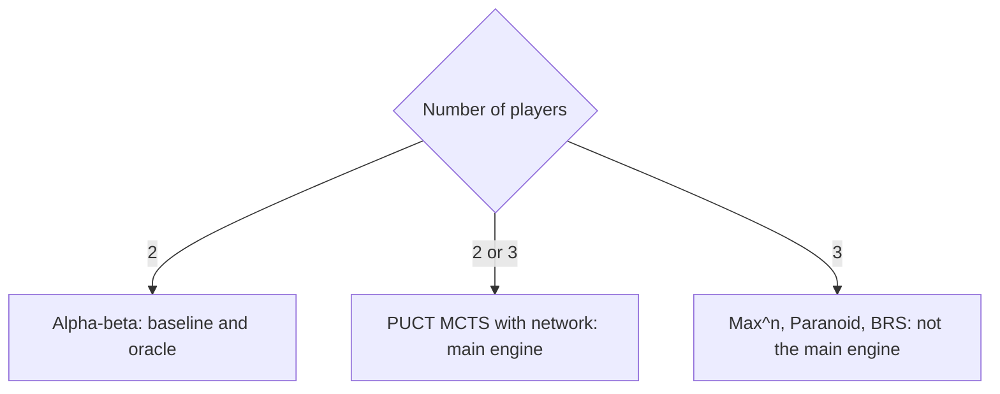
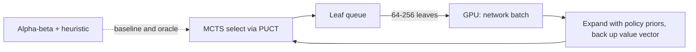

# Search and evaluation

**TL;DR:** The engine estimates the value of a position in five stages of rising cost, from a free row-distance sum up to exact solitaire distances. For two players the value is one number; for three players it is a vector with one entry per player. Implementation starts with a two-player alpha-beta baseline that uses the single-agent distance heuristic. After that comes the main engine for both player counts: AlphaZero-style MCTS with PUCT and leaf batching on the GPU. Alpha-beta stays in the code as a baseline opponent and as a test oracle. Strength levels come from the search budget, temperature and noise, not from search depth. A round-robin tournament between the levels must give a monotone Elo ladder.

This document builds on the [rules](rules.md) and the [architecture](architecture.md). The [endgame and opening](endgame-and-opening.md) document covers the endgame database and the opening book. Full bibliographic entries are in the [references](references.md).

## How to read the claims

Each claim in this document has one of three levels:

| Level | Meaning | Marker in the text |
|---|---|---|
| Established | A published source supports the claim. | A citation key, for example [Sturtevant2019] |
| Reported | The project owner's literature survey contains the claim. Nobody has checked it again against the source. | "reported" or "per the owner's survey" |
| Project decision | The project chose this. It is a choice, not a result. | "project decision" |

Some claims carry a citation key and the word "reported". This means that the owner's survey attributes the claim to the source, but this document did not re-verify the wording.

## Terms

- **Distance:** the number of moves one player needs to bring all pieces into the goal triangle, if no opponent piece stands on the board.
- **Heuristic:** a fast estimate of the value of a position. It is not exact.
- **Plateau:** a set of positions that the heuristic scores equally. A search cannot tell the moves inside a plateau apart.
- **Playout:** in MCTS, a fast simulated game from a leaf position to an end or a cut-off.
- **PUCT:** the tree policy used by AlphaZero. It combines the mean value of a child with a prior probability from the policy network.
- **Leaf batching:** the search collects many leaf positions and sends them to the network in one GPU call.

## Evaluation stages

The stages below come from the owner's survey (reported). Each stage adds information and costs more. The engine can stop at any stage.

| Stage | What it computes | Cost | Blind spot |
|---|---|---|---|
| 1. Row distance | Sum of the row distances of all pieces to the goal. | Free | Full of plateaus. A sideways move scores 0. |
| 2. Single-agent distance table | Breadth-first search (BFS) from the goal triangle on an empty board. One table of 121 entries per player. | Equally cheap (one table lookup per piece) | Ignores interaction: blocks and jump bridges over other pieces. |
| 3. Assignment bound | The 10 pieces must fill 10 *different* goal holes. The Hungarian method solves this assignment. | About 1000 operations on a 10x10 matrix | Still ignores interaction. |
| 4. Correction terms | A straggler term on the maximum distance, because the game ends only when the *last* piece arrives. A cohesion term, because pieces close together create jump bridges. | Not given in the survey | The weights are free parameters. Only tournament tuning can set them. |
| 5. Exact solitaire distance | Exact remaining moves for one player, by IDA* or BFS, when the position allows it. | Expensive in the mid-game | Exact only for one player alone. It is exact in the endgame, where the armies no longer interact. |

Stage 2 is the established starting point: "A common heuristic used for play is the single-agent distance to the goal" [Sturtevant2019, §2]. The paper cites [Sturtevant2002] for this heuristic. It also states that single-agent distances on the full board can be calculated [SturtevantRutherford2013] and used for game play [Sturtevant2015], both as cited in [Sturtevant2019, §2].

Per the owner's survey, stage 2 is slightly better than stage 1 (reported). Stage 3 corrects a systematic error of stage 2: the sum of single distances underestimates, because two pieces cannot both use the same goal hole.

The stage 4 terms match ideas from a lecture slide deck [MITSlides2010]: moving a marble a long distance by a sequence of jumps is best, lateral moves are of doubtful efficiency, and trailing marbles that cannot hop over anything take long to catch up. The slides are background for teaching, not a tested result.

### Stage 4 measured (experiment of 2026-11-07, branch exp/stage4)

`Stage4Evaluator` (arena name `stage4`) adds four weighted terms to the stage 2 distance difference: `ws` per step of the largest piece distance (straggler), `wq` per 10 of the sum of squared distances (smooth straggler), `wc` per adjacent own pair (cohesion) and `wj` per forward single jump that is possible now (jump bridges). The weights were tuned with the arena at 5000 nodes on seeds 3 and 4 and then measured at 20000 nodes on seeds 1 and 2, 200 pairs each:

| Variant | Opponent | Seed 1 | Seed 2 |
|---|---|---|---|
| `ws=15,wq=6,wj=3`, 20000 nodes | `distance`, 20000 nodes | +306 ± 41 | +371 ± 51 |
| `ws=15,wq=6,wj=3`, 16600 nodes (cost-adjusted, 0.83 x nodes/s) | `distance`, 20000 nodes | +343 ± 46 | +343 ± 46 |
| `ws=15,wq=6` (no jump term, equal cost) | `distance`, 20000 nodes | +239 ± 39 | +245 ± 37 |

The straggler terms give most of the gain. The jump term adds about 100 Elo at equal nodes and survives the cost adjustment. The cohesion term did not help: `wc=5` lost by more than 450 Elo, and `wc = ±1` changed nothing measurable, so the tuned setting leaves it at 0.

### Why every stage has a blind spot

Project reasoning: the single-agent distance is an abstraction of the true value, because it ignores interaction with other pieces, such as blocks and jump bridges. Stages 1 to 5 all compute values for one player alone. None of them sees that a piece of the opponent can be a bridge for a jump, or a block. Therefore a hand-written heuristic will always miss some tactical positions. The search or a learned network must find these.

Stage 5 becomes exact when the armies are past each other. The [endgame and opening](endgame-and-opening.md) document explains this case and the endgame database.

## Value: scalar for two players, vector for three

**Two players (reported):** the value is the difference of the two distances, with a correction for the side to move. One number is enough. A gain for one player is a loss for the other.

**Three players (reported):** the value is a vector with one entry per player. The game is not zero-sum, so one number cannot describe a position. A losing player can decide which of the other two players wins (the kingmaker problem). The [rules](rules.md) document explains why three players have no unique game value.

**End of game (project decisions of 2026-11-07, defined in the [rules](rules.md#rule-switches)):** a game that reaches the move limit (default 200 plies for two players) without a winner is scored by distance (`drawHandling = SCORE_BY_DISTANCE`, the default). The search uses the same score for these terminal positions. `DRAW` stays available for comparisons with solved tables. A three-player game ends at the first winner. The switch value `ranking = FULL_RANKING` (play on to rank second place) is reserved and not implemented.

Two rule switches change the search tree. `leaveGoal = FORBIDDEN` is a project decision; it differs from [Sturtevant2019, §3], whose rule set does not forbid leaving the goal. `repetition = MOVE_LIMIT` is a project decision; it differs from [Sturtevant2019, §3.4], where a game is drawn if any board state is repeated (Definition 4). The [rules](rules.md#deliberate-deviations-from-sturtevant2019) document records both.

**Project decision:** the value head of the network has one output per player from the start. The same network layout serves two and three players. The [architecture](architecture.md) document describes the head.

## Alpha-beta baseline for two players

**Project decision (2026-11-07):** the alpha-beta baseline is the first search the project builds, directly after the engine and before the neural network. Its heuristic is the single-agent distance (stage 2). Later stages are added only when experiment 1 shows a gain.

For two players the classical approach is alpha-beta search [CPW]. The baseline uses:

- iterative deepening,
- a transposition table with Zobrist hashing,
- move ordering by the heuristic change of the move (the "heuristic delta"). The order is a selection sort done lazily: step i runs only just before move i is searched (round 2, E01), so a node that cuts off after a few moves never sorts the rest. Ties keep the order of the full selection sort.

The branching factor in the mid-game is often well above 50 (reported), because every end cell of a jump chain is a separate move. This makes deep full-width search expensive.

Two pruning methods reduce the width. Both are risky (reported):

- **Forbid backward moves.** Backward jumps can be part of the best line. The search then cannot find these lines.
- **Beam search:** keep only the k best moves by the heuristic. The beam inherits every blind spot of the heuristic.

Only a tournament can measure the cost of these blind spots. The [experiment list](#experiments) contains this measurement.

### Search enhancements (measured 2026-11-07)

`AlphaBeta` has optional enhancements. Each is a `SearchOptions` field and a player-spec key, and all are off by default, so `ab:eval=distance,nodes=20000` plays exactly as before (a fingerprint test checks this):

| Key | Enhancement | Changes the value of a fixed-depth search? |
|---|---|---|
| `pvs=1` | Principal variation search: null windows after the first move, re-search on a fail high | No |
| `killers=1` | Two killer moves per height, ordered right after the table move | No |
| `history=1` | History table (from, to) breaks ties of the distance gain in move ordering | No |
| `asp=1` or `asp=<w>` | Aspiration window of half-width 50 (or w) around the previous iteration's score | No |
| `ttrep=1` | Table buckets of two: one keeps the deeper entry of the current search, one is always replaced | No |
| `mate=1` | Mate scores are stored relative to the node and converted back on probing | No (fixes the mate distance across moves) |
| `lmr=1/2/3` | Late move reductions after the third move at depth ≥ 3: by 1 ply, by ln d · ln i / 2, by ln d · ln i / 1.25 | Yes, by design |
| `partial=1` | Use the best move of the iteration the node limit interrupts, if the first root move was searched completely | Yes (it uses a deeper, incomplete iteration) |

A test checks the options of the "No" rows against plain negamax.

Four further keys belong to the player, not to the search: `race=1` plays a passed position (the armies have passed each other) from the race table or a solitaire plan without a search, `race=2` does so only while the race is not known to be lost, `racetable=0` disables the table (plan only), and `racerows=1` uses the optional rows ≥ 1 table instead of the default rows ≥ 2 table (E09; built into the cache on first use). They are off by default and leave the search tree untouched; see [the race module](endgame-and-opening.md#the-race-module).

**Why the exact options alone gain nothing:** with good move ordering, depth 4 costs about 9 000 nodes and depth 5 about 85 000 (mean over 40 random positions). At 20 000 nodes every exact option ends at depth 4 and throws the unfinished depth-5 iteration away. PVS, killers, aspiration and the table save at most 3 % of the nodes, which does not reach depth 5. Their match results stay inside the noise. History changes which of several equal root moves is chosen (about 45 % of positions have ties at depth 4), so its result is noise from tie-breaking (+44 then +15 Elo on the tuning seeds).

**What gains:** the two options that use the wasted nodes. LMR raises the mean completed depth at 20 000 nodes from 4.0 to 4.6. `partial=1` uses the interrupted depth-5 iteration. Together with the exact options they give about +160 Elo at equal nodes, more than 4x nodes for the baseline (+135).

Tuning matches (seeds 3 and 4, 200 pairs each, against `ab:eval=distance,nodes=20000`, Elo with 95 % interval):

| Variant | Seed 3 | Seed 4 |
|---|---|---|
| `pvs=1` | +0 ± 13 | |
| `killers=1` | −17 ± 21 | |
| `history=1` | +44 ± 28 | +15 ± 26 |
| `asp=1` | +5 ± 18 | |
| `ttrep=1,mate=1` | −2 ± 6 | |
| `lmr=1` | +4 ± 28 | |
| `lmr=2` | +53 ± 31 | +51 ± 31 |
| `lmr=3` | +67 ± 32 | +64 ± 34 |
| `partial=1` | +65 ± 28 | |
| `lmr=2,partial=1` | +155 ± 35 | +171 ± 36 |
| `pvs=1,lmr=2,partial=1` | +176 ± 36 | +172 ± 36 |
| all exact options + `partial=1` | +91 ± 31 | |
| all, `lmr=3` | +164 ± 34 | +145 ± 36 |
| all, `lmr=2` | +212 ± 38 | +180 ± 37 |

Result for the best variant `ab:eval=distance,nodes=20000,pvs=1,killers=1,history=1,lmr=2,asp=1,ttrep=1,mate=1,partial=1`, seeds 1 and 2 (not used for tuning), 200 pairs each:

| Match | Seed 1 | Seed 2 |
|---|---|---|
| Equal nodes (20 000 each) | +175 ± 36 | +143 ± 35 |
| Nodes/s, variant vs baseline (same run) | 991 k vs 1 096 k (0.905) | 906 k vs 998 k (0.907) |
| Cost-adjusted (variant 18 094 nodes, baseline 20 000) | +161 ± 37 | +113 ± 32 |

The variant is about 10 % slower per node. It still wins clearly at equal cost on both seeds. The search options are therefore a stronger baseline for the evaluation experiments; compare evaluators with the same options on both sides.

### Learned linear evaluation (`eval=linear`, measured 2026-11-07)

`LinearEvaluator` scores a position with a weighted sum of 12 cheap features, each "side to move minus opponent": summed distance, maximum distance, summed squared distance, pieces in the goal, pieces in the start corner, spread of the distances, distance from the centre line, forward single jumps, touching own pieces, forward steps, the distance difference times the game phase, and a tempo constant (table-driven over the piece lists since E02, values unchanged). A logistic regression of the game result on 68 255 positions from 2000 baseline games set the weights (`LinearWeights`; `LinearTraining` in the test sources reproduces the fit). On 400 held-out games the model predicts the winner of 78.8 % of the positions, the distance difference alone 76.8 %.

Arena result against `ab:eval=distance,nodes=20000`, 200 pairs each (tuned on seeds 3 and 4 only):

| Variant | Seed 1 | Seed 2 |
|---|---|---|
| `ab:eval=linear,nodes=20000` | +552 ± 89 Elo | +577 ± 96 Elo |
| `ab:eval=linear,nodes=13300` (equal time) | +499 ± 81 Elo | +478 ± 72 Elo |

The evaluation costs about a third of the search speed (nodes/s 0.66 of the baseline), so the equal-time match gives it 13 300 nodes. A second fitting round on games of the linear evaluator itself predicted better but played weaker (seed 4: +440 against +526 Elo), so the first-round weights stay.

## Results of the first improvement round (2026-11-07)

Five ideas were built in separate git worktrees and measured in the arena against `ab:eval=distance,nodes=20000`. An independent verifier repeated each measurement with new seeds (300 pairs) and with a cost-adjusted node budget, and read the diff for unfair advantages. Every author tuned on different seeds than the ones reported.

| Idea | Equal nodes, verifier (Elo, 95% interval) | Cost-adjusted | Decision |
|---|---|---|---|
| Learned linear evaluation (`linear`) | +506 ± 65, +466 ± 58 | +506 ± 63 | merged |
| Stage 4: straggler, squared distances, jump bridges (`stage4`) | +318 ± 34, +308 ± 35 | +299 ± 33 | merged |
| Search enhancements (LMR, partial iteration, killers, table) | +170 ± 28, +166 ± 29 | +153 ± 29 | merged |
| Jump-aware breadth-first distance (`jumpbfs`) | +258 ± 34, +217 ± 30 | **−85 ± 27** | discarded: too slow |
| Optimal piece-to-goal assignment (`assign`, stage 3) | −57 ± 23, −77 ± 25 | −156 ± 27 | discarded: loses |

Head-to-head after the merge (200 pairs each):

| Match | Elo |
|---|---|
| `linear` against `stage4`, equal nodes | +143 ± 35, +168 ± 34 |
| `linear` against `stage4`, `linear` with 0.8 of the nodes (equal cost) | +111 ± 33 |
| `linear` with all search options against plain `linear`, equal cost | +235 ± 39, +246 ± 43 |
| `linear` with all search options against the original baseline, 15 ms per move each | 198 of 200 games won |

What the results say:

- **The evaluation limits strength, not the depth.** Four times the nodes was worth +135 Elo. A better evaluation was worth +300 to +500.
- **Search enhancements alone gain nothing; they gain together.** At 20000 nodes every exact option still ends in depth 4 and throws away the unfinished depth-5 iteration. Late move reductions and the use of the interrupted iteration turn those nodes into depth.
- **`linear` generalises beyond its training opponent.** Its weights were fitted on games of the baseline and its variants. It also beats `stage4`, which is a different evaluation, by +111 Elo at equal cost.
- **Cohesion did not help.** The tuning of `stage4` found no useful weight for pairs of adjacent pieces; large weights lost by more than 450 Elo.
- **`assign` loses.** The authors guess that Definition 1 is the cause: opponent pieces left in the goal fill holes anyway, so forcing own pieces into the deepest cells wastes tempo. No run with another blockade rule has tested this.
- **`jumpbfs` is a real gain per node and a loss per second.** A faster implementation could change the decision.

Limits of these numbers:

- **The arena saturates.** At 99% of the points the Elo estimate is clamped and its interval is wide. The original baseline can no longer separate stronger players. From now on, new strategies are measured against `Strategies.BEST_SPEC`.
- **Openings and opponents.** All games start after 4 random plies and are played against other engines of this family. Strength against humans or against a different kind of player is not measured.
- **Machine load.** Node-limited matches do not depend on load. The nodes-per-second ratios behind the cost adjustment were measured while other runs used the machine and are accurate to a few percent. Round 2 measures them with `Bench` instead (next section).

## Round 2 yardstick

**TL;DR:** Round 2 is measured against a frozen reference player R2 (round 1's best player with its weights frozen as `linear-r1`), whose search tree is pinned by a test, and against a frozen jar of the pre-round build for speed. Speed ratios come only from `Bench` (single thread, thread CPU time, interleaved), never from an arena report. The full plan is [baseline-round2-plan.md](baseline-round2-plan.md); this section is the part that the code implements (experiment E00).

### Reference player and ladder

R2 = `ab:eval=linear-r1,pvs=1,killers=1,history=1,lmr=2,asp=1,ttrep=1,mate=1,partial=1,nodes=20000` (`ReferencePositions.R2_SPEC`). `linear-r1` is the registry name of `LinearWeights.R1`, a literal copy of the round-1 weights; `eval=linear` keeps the live weights (`LinearWeights.WEIGHTS`) and may be refitted. Every later build can construct R2, and the strategy contract tests cover `linear-r1` through `Evaluators.names()`.

| Rung | Spec | Use |
|---|---|---|
| R0 | `ab:eval=distance,nodes=20000` | sanity only (saturated at 198 of 200 games) |
| R1 | R2 at 5000 nodes | lower rung |
| R2 | as above | gating opponent of the round and of every network generation |
| R2-80k | R2 at 80000 nodes | upper rung of round 2, sensitive gate for weight refits (called "R3" in the E04 and E07 sections below, which were written before the integration) |
| R3 | `ab:eval=racelin1-r3,pvs=1,killers=1,history=1,lmr=2,asp=1,ttrep=1,mate=1,partial=1,fut=1,futk=20,fut2=1,race=1,racerows=1,nodes=20000` (`ReferencePositions.R3_SPEC`): the integrated BEST of round 2 | gating opponent from the integration of round 2 on; see [Integration of round 2](#integration-of-round-2-measured-2026-11-08) |

Re-base rule: when BEST scores above 0.80 against R2 (about +240 Elo), freeze the new BEST as a new reference with a new registry alias and fingerprint, and keep R2 in the ladder. Applied once so far: the integration of round 2 scored 0.95 against R2 at equal CPU time and froze R3.

### Seeds

| Seeds | Use |
|---|---|
| 31, 32 | authors' tuning |
| 33, 34 | authors' report (300 pairs each) |
| 41, 42 | verifier (300 pairs; 500 when the claimed gain is below +50 Elo) |
| 43 | integration match |
| 1002 to 1005 | data sets (E03: 1002, E04: 1003 and 1004, E05: 1005 for every official set) |
| 1006 and up | other data: E05 tuning 1006, E05 throughput runs 1007, E07 refit games 1008 (both texel rounds), E10 teacher check 1010 (quality set), 1011 (cost games), 1012 (temperature sweep) |

Official numbers use no other seeds. Seeds of round 1 and of the surveyors (1 to 4, 9, 11 to 13, 21 to 25, 77, 1001) are not reused. The reference positions below use the fixed generator seed 1000; they produce no Elo number, only trees and speed.

### Search-tree fingerprint

`ReferencePositions` generates 64 positions deterministically: 8 self-play games of R2 at 1000 nodes from 4 random plies (seed 1000), 8 distinct plies between 8 and 100 drawn from each. Two more openings start the full games. Nothing is stored on disk; the set is a list of move sequences from the start position and takes about a second to generate.

`Fingerprint` computes three checksums for a spec: per position the move, score, completed depth and node count of the node-limited search plus the move, score and exact node count of a depth-4 search (a node-limited search nearly always reports exactly its limit, so only the depth-4 count measures the tree size); and the move sequence and node totals of one self-play game at 1000 and one at 5000 nodes. `BestSpecFingerprintTest` records them for R2, for R3 and for `Strategies.BEST_SPEC` at 20000 nodes. At each freeze the new reference and BEST_SPEC have the same values (R2 and BEST at E00, because the weights were the same; R3 and BEST at the integration of round 2, because R3 is that BEST).

Rules:

- An identical-tree change (E01, E02, E13) keeps all nine constants. It needs no arena run: the fingerprint test green without touching a constant, plus the Bench ratio.
- A tree-changing feature is off by default, so it changes no constant while it is off.
- A refit of `linear` changed the `BEST_*` constants, never the `R2_*` constants, while BEST_SPEC used `linear` (round 1 up to the integration of round 2). Since then BEST_SPEC and R3 are built from frozen parts (`racelin1-r3`: `LinearWeights.ROUND3` and the rows ≥ 1 table), so a refit of `linear` changes no constant; an integration that moves BEST_SPEC re-records the `BEST_*` constants and leaves `R2_*` and `R3_*` alone.
- Every re-record needs a written reason in the commit message and in this section.
- To find where two trees part: `devenv shell -- ./gradlew --no-build-cache :search:fingerprint --args='<spec>'` prints one line per position and the game moves; diff the output of the two builds. Since the integration of round 2 the lines also name the score band of every search and mark the moves of the race module (the checksums are unchanged by this: a race move enters them through the move and through the node count, which it leaves at zero).

Re-records: one. The integration commit of round 2 (2026-11-08) switched BEST_SPEC from `eval=linear` to `eval=racelin1-r3` with futility pruning and race play and re-recorded the three `BEST_*` constants (positions 4852147404152522458, game at 1000 nodes 2660956470353287877, game at 5000 nodes −3579989785793258016); the same values were recorded as the new `R3_*` constants. The `R2_*` constants were reproduced unchanged on the same build before the switch. Details: [Integration of round 2](#integration-of-round-2-measured-2026-11-08).

### Cost reference: the frozen pre-round build

The pre-round build is frozen as `engine.jar` and `search.jar` in `.reference/` in the repository root (ignored by git), built by `devenv shell -- scripts/freeze-reference.sh`, which refuses to overwrite an existing reference without `--force`. `Bench` reads it from `-Dsternhalma.reference.dir` (default `.reference` in the working directory; the Gradle task runs in the repository root and accepts `-Psternhalma.reference.dir=<dir>`).

| Item | Value |
|---|---|
| Commit | `cb4b75011678758e485700a8605ac864a491d6c3` (the last commit before round 2) |
| Built | 2026-11-07, OpenJDK 25.0.3 |
| SHA-256 `engine.jar` | `6b8e8da29674d7a684919172b48a2f709a91d1e20ac353ce4f222d2c92813223` |
| SHA-256 `search.jar` | `d46b8b89bc0ac073b53b9b5ad22e1a65db1dacfaba004d2211f12a0f58771bda` |

The frozen build has no `linear-r1`; its `eval=linear` holds the same weights, and Bench uses it there automatically (it says so in its output). Bench confirms on every run that both builds search the identical trees.

The round-2 reference R3 is frozen the same way in `.reference-r3/` (`devenv shell -- scripts/freeze-reference.sh .reference-r3`; `.reference-*/` is ignored by git). Since E03 the search module needs the `tablebase` module, so the script now also copies `tablebase.jar`, and Bench loads it when it is present. Bench reads this reference with `-Psternhalma.reference.dir=.reference-r3`. The frozen jars read the race tables from `tablebase/tables/` of the checkout they run in, like the current build.

| Item | Value |
|---|---|
| Commit | `c644f78a79852c8d44309d978944b0ef7975d3f1` (the code of the integration of round 2; the documentation followed in the next commit, the jars do not depend on it) |
| Built | 2026-11-08, OpenJDK 25.0.3 |
| SHA-256 `engine.jar` | `2f81cd3fab410c22b02ad12bdd10a76559cfb8a2b0fbdc513767f2aae9802e11` |
| SHA-256 `tablebase.jar` | `f3ff1dd949568dcd8bf0e65cb2485945dffbf94032c0ff3092f2d49e22aa2ea1` |
| SHA-256 `search.jar` | `cbed337a0833860018d470089415de499bc59e44597da3f91c58a755c10e0c17` |

Bench of R3 on the build of that commit against `.reference-r3`: ratio 0.9876 (repetitions 0.9926, 0.9873, 0.9876), trees identical on 64 of 64 positions and 2 of 2 games, load 5 on 16 cores.

### Bench: nodes per CPU-second

```bash
devenv shell -- ./gradlew --no-build-cache :search:bench --args='<spec>'           # current vs frozen build
devenv shell -- ./gradlew --no-build-cache :search:bench --args='<specA> <specB>'  # two specs, current build
devenv shell -- ./gradlew --no-build-cache :search:bench --args='<spec> --copy'    # current vs a second copy of it
```

Protocol, as implemented in `Bench`:

- **Items:** the 64 reference positions (a fresh searcher each) plus 2 full self-play games (two fresh players that keep their tables, as in the arena), all at the spec's node budget (`--nodes N` overrides it).
- **Single thread, CPU time:** everything runs on the main thread. `ThreadMXBean.getCurrentThreadCpuTime()` is read around each `search` or `choose` call, never per node. Table allocation and position replay lie outside the timed region. Wall time is printed beside it for information.
- **Same code path for both builds:** both sides, also the current build, are driven by reflection through API that exists in the frozen build (`PlayerSpec.parse`, `Evaluators.byName`, `new AlphaBeta(...)`, `AlphaBeta.search`, `AlphaBetaPlayer.choose`). The frozen jars live in their own class loader whose parent is the platform class loader.
- **Interleaving:** one untimed warm-up pass of both sides over the positions, then 3 repetitions. In each repetition every item runs on both sides directly after each other, in the order A,B when item number plus repetition number is even, otherwise B,A. A change of load therefore hits both sides alike, and neither side always runs first. The ratio of a repetition is nps(A)/nps(B) over all its items; Bench reports the median of the repetitions.
- **Load:** the 1-minute load average is logged before and after. Above the core count Bench refuses to start (before) or prints `REFUSED` instead of `RESULT` (after), with exit code 3; `--ignore-load` reports anyway and marks the line `UNDER_LOAD`.
- **Tree check:** Bench reports on how many positions and games A and B searched identical trees (move, score, depth and nodes; for games the move sequence and the node total).

Measured on 2026-11-07 for R2 on the unchanged code (16 cores, load 3.7 to 4.8; three separate Bench runs against the frozen build):

| Comparison | nps(A) | nps(B) | Ratio (median of 3 repetitions) | Trees |
|---|---|---|---|---|
| current vs frozen, run 1 | 1 252 704 | 1 275 993 | 0.9803 | 64/64, 2/2 identical |
| current vs frozen, run 2 | 1 276 398 | 1 268 658 | 1.0045 | 64/64, 2/2 identical |
| current vs frozen, run 3 | 1 276 770 | 1 278 545 | 0.9991 | 64/64, 2/2 identical |
| current vs a second copy of itself (`--copy`) | 1 267 474 | 1 269 402 | 0.9958 | 64/64, 2/2 identical |
| `linear-r1` vs `linear`, current build | 1 270 823 | 1 275 566 | 0.9946 | 64/64, 2/2 identical |

Arena check of the alias (seed 41, 100 pairs, 20000 nodes, `--threads 4`): `linear-r1` against `linear` with all options scored exactly 0.5000 (100 wins each, every game decided by colour), 18 917 nodes per move on both sides, 15.01 against 14.99 CPU-ms per move.

CPU time per move of R2 at 20000 nodes: about 15 ms. Within one run the repetitions agree to about 1 %; between runs (separate JVMs, separate JIT compilations) the ratio moved between 0.980 and 1.005 on identical code. A speed claim therefore quotes the median of 3 Bench runs, and differences below about 2 % are not resolved.

### Speed packs

| Experiment | Change | Bench ratio vs frozen build (R2, median of 3 runs) | Trees |
|---|---|---|---|
| E01 | `AlphaBeta`: lazy selection in move ordering (`pick`, strict `>`, so the order is unchanged); LMR tables static per mode instead of per searcher | 1.474 (runs 1.474, 1.491, 1.441; 1.37M vs 0.94M nodes/CPU-s in the median run) | 64/64, 2/2 identical in every run; fingerprint tests unchanged |

E01 was measured on 2026-11-07 under load from parallel jobs (1-minute load 11.9 to 14.8 on 16 cores in two runs, 14.3 rising to 52 in the third, which Bench marked `UNDER_LOAD`); the verifier re-measures on an idle machine. Within runs the repetitions ranged from 1.34 to 1.58.

### Engine speed pack (E02, identical tree)

E02 makes move generation and the linear evaluation cheaper without changing a move, a move's position in the list or a score:

- `Position` keeps a sorted piece list per player (with a cell-to-index map), maintained by `put`, `make`, `unmake` and `copy`. `generate`, `pieces` and `distanceSum` read it instead of scanning 121 cells. New accessors: `pieceCount`, `pieceCell`, `goalOccupied`.
- `generate` uses flat step and jump-landing tables per player with the allowed cells folded in (`Layout`), a 128-bit visited set in two `long` values, and the leaveGoal test once per piece. The Definition-2 suicide test runs only when an opponent's goal already holds 9 or more pieces: a move adds at most one piece to another goal, so below 9 the test cannot fire.
- `LinearEvaluator` sums integers over the piece lists with a per-player table of "step lands closer" and "jump lands closer" bits per (cell, direction), then forms the doubles in exactly the order of the old code, so `Math.round` gives the same integer.

Order and values are pinned by three tests: `MoveOrderEquivalenceTest` (engine; the generator's arrays equal those of `LegacyMoveGenerator`, a verbatim copy of the old generator, on 1 280 626 positions and 57.9 M moves over eight rule variants including three players), `LinearEvaluatorEquivalenceTest` (search; raw IEEE bits of all 12 features and the scores for five weight sets equal those of `LinearEvaluatorReference`, the old code, on 1.1 M positions with both leaveGoal values) and `BestSpecFingerprintTest` (unchanged constants).

Measured on 2026-11-07, R2 against the frozen build, three Bench runs, under load (`--ignore-load`, 1-minute load 12.4 to 14.8 on 16 cores, other experiments running):

| Run | nps current | nps frozen | Ratio (median of 3 repetitions) | Trees |
|---|---|---|---|---|
| 1 | 1 144 874 | 977 794 | 1.1670 | 64/64, 2/2 identical |
| 2 | 1 095 571 | 931 431 | 1.1823 | 64/64, 2/2 identical |
| 3 | 1 128 524 | 965 630 | 1.1696 | 64/64, 2/2 identical |

Median of the three runs: **1.170**. The frozen build is the E00 state, so this ratio does not contain E01. Microbenchmark on 20 000 playout positions (separate JVMs per build, alternated six times, thread CPU time, also under load): `generate` 1.19 to 1.26 times faster, `LinearEvaluator.evaluate` 1.45 to 1.55 times faster; `make` plus `unmake` cost about 15 ns more per pair for the piece-list update.

### Arena: CPU column, cost adjustment, SPRT

`GameRunner` measures the thread CPU time and the wall time of every move choice per player, and `Arena` prints CPU-ms and wall-ms per move and nodes per CPU-second for both players. Cost criteria (for example E03's "not slower") use the CPU column. The report also prints the equal-cost node budget `nodes(A) = nodes(B) x nps(A)/nps(B)` from this run's CPU times; that ratio is measured under the arena's own load (`--threads 4` beside other jobs), so claims use the Bench ratio, fixed before the arena run and quoted with it. `--sprt elo0,elo1` (alpha = beta = 0.05, default off) stops a match early once a sequential test on the pair scores, read in pair order, accepts a hypothesis; it is for authors' tuning loops only, and verifier runs stay fixed-size.

### Protocol for strength claims

Paired games with colours swapped, 4 random opening plies, `--threads 4`, node limits. When the candidate's cost per node differs, run equal nodes first, then the candidate at 20000 x nps_candidate/nps_opponent from the Bench ratio. Acceptance: lower 95 % bound above 0 on both verifier seeds against the current BEST_SPEC; the result against R2 is reported as well. Only the integration commit after a wave changes `Strategies.BEST_SPEC`.

**Integration:** the new BEST_SPEC plays R2 and the previous BEST_SPEC, 500 pairs each on seed 43, at equal nodes and at equal cost (BEST at 20000 x nps_new/nps_old nodes, nps_old measured by Bench on the frozen build, against R2 at 20000). Both numbers are reported separately; their difference is the speed share. The parts were measured against different baselines and are not additive: investigate an interaction only when the equal-nodes result falls below the sum of the parts by more than sqrt(sum of the parts' squared half-widths + the integration run's squared half-width). Done for round 2 with two changes the owner asked for ([Integration of round 2](#integration-of-round-2-measured-2026-11-08)): the report seeds 33 and 34 instead of 43, and "equal cost" calibrated with the arena's CPU column until the CPU time per move of both players agrees within 5 %, because race moves cost CPU but no nodes, so a nodes-per-second ratio understates a race player's budget.

**Label policy:** scores with |score| >= RACE_BASE (the racelin band, E08; `Scores.kind` returns `RACE`) are never labels or value targets; only S1 (E03) may label passed positions. Every error claim for an adjudication rule states the number of firings, the errors found by playing the games to the end and the one-sided 95 % Clopper-Pearson upper bound (0 of n: about 3.0/n; 1 of n: about 4.74/n; 2 of n: about 6.3/n). The consumers that recognise the band are listed under [E08](#race-arithmetic-as-a-leaf-value-e08-racelin-and-racelin1-measured-2026-11-08).

### Refit of the linear weights (E04, `eval=linear-r2`, measured 2026-11-07)

**TL;DR:** Two texel rounds on passed-filtered self-play of BEST_SPEC give the frozen weight set `linear-r2` (`LinearWeights.ROUND2`). With the same search options and nodes it beats `linear-r1` by +191 ± 32 and +158 ± 30 Elo (seeds 33 and 34), and at 20000 nodes it plays even with R3 (R2 at 80000 nodes). `eval=linear`, `linear-r1` and `Strategies.BEST_SPEC` are unchanged; an integration commit decides whether BEST_SPEC switches.

`linear-r2` is a registry name for a weight set. Do not confuse it with the reference player R2, which plays `linear-r1`.

Passed filter: `LinearTraining.passed` treats a position as passed when every piece of player 0 stands on a higher row than every piece of player 1 (the definition from E03). The E03 module is not in this branch, so this six-line predicate is a duplicate. The fit drops passed positions. In those positions race play (E03, `race=1`) is expected to take over from the evaluation.

Data and fit (moves-only game files: `GameFiles`, `LinearTraining games | fit-games | score-games` in the search test sources). The files are in the git-ignored `data/e04/` (1.1 MB per set) and can be rebuilt with these commands:

```bash
devenv shell -- ./gradlew --no-build-cache :search:testClasses
CP=engine/build/classes/java/main:search/build/classes/java/main:search/build/classes/java/test
O=pvs=1,killers=1,history=1,lmr=2,asp=1,ttrep=1,mate=1,partial=1,nodes=20000
# round 1: BEST_SPEC of this commit (eval=linear = R1 weights), openings of arena seed 1003, one game per opening
java -cp $CP sternhalma.search.LinearTraining games data/e04/r1 2000 1003 8 "ab:eval=linear,$O"
java -cp $CP sternhalma.search.LinearTraining fit-games data/e04/w-r1-filtered.txt all data/e04/r1
# round 2: the same search with the round-1 weights, same openings; its fit is linear-r2
java -cp $CP sternhalma.search.LinearTraining games data/e04/r2 2000 1003 6 "ab:eval=linear-file:data/e04/w-r1-filtered.txt,$O"
java -cp $CP sternhalma.search.LinearTraining fit-games data/e04/w-r2-filtered.txt all data/e04/r2
```

The search is deterministic, so the game files are reproducible. `LinearRefitTest` replays one stored game. The generator writes 50-game shards atomically, resumes after an abort, and holds a lock.

Held-out prediction (every position from ply 6, passed positions dropped, games with id % 5 == 0 held out):

| Data set | Positions (held-out games) | Passed dropped | linear-r1 log loss / accuracy | Refit log loss / accuracy |
|---|---|---|---|---|
| Round 1 (BEST games) | 28 007 (400) | 34 551 of 176 037 | 0.5565 / 0.6968 | 0.5380 / 0.7101 (round-1 fit); `linear-r2` 0.5385 / 0.7110 |
| Round 2 (round-1-fit games) | 30 136 (400) | 29 587 of 180 819 | 0.5232 / 0.7226 | 0.5176 / 0.7278 (`linear-r2`) |
| Round 1, filter off (ablation) | 34 960 (400) | 0 | 0.5154 / 0.7323 | 0.4972 / 0.7433 |

Arena (300 pairs for official numbers, 200 for tuning; all players use `pvs=1,killers=1,history=1,lmr=2,asp=1,ttrep=1,mate=1,partial=1`; nodes 20000 unless stated; `--threads 4`). The authors tuned on seeds 31 and 32 and reported on seeds 33 and 34:

| Match | Seed | Elo (95 %) |
|---|---|---|
| tuning: round-1 fit, filter on, vs `linear-r1` | 31 / 32 | +137 ± 37 / +150 ± 35 |
| tuning: round-1 fit, filter off, vs `linear-r1` | 31 / 32 | +78 ± 33 / +71 ± 33 |
| tuning: round-2 fit vs round-1 fit | 31 / 32 | +34 ± 31 / +23 ± 33 |
| `linear-r2` vs `linear-r1` (R2) | 33 | **+191 ± 32** |
| `linear-r2` vs `linear-r1` (R2) | 34 | **+158 ± 30** |
| `linear-r2` vs the round-1 fit (second texel round) | 33 | +41 ± 25 |
| gate: `linear-r2` vs `stage4,ws=15,wq=6,wj=3` at 23 511 nodes (equal cost) | 33 | +335 ± 39 |
| gate: `linear-r1` vs the same `stage4` | 33 | +160 ± 31 |
| gate: `linear-r2` vs R3 (`linear-r1`, 80000 nodes) | 33 | +15 ± 27 |
| gate: `linear-r1` vs R3 | 33 | −200 ± 31 |

Findings:

- **The passed filter helps.** At the same evaluation code, the filtered fit gains about twice as much as the unfiltered fit, although the unfiltered fit has the lower held-out log loss on its larger set. The unfiltered fit spends weight on race positions, where the result follows from the distance arithmetic.
- **The second round still gains** (+41 ± 25 on seed 33). The cap of 2 rounds stops the loop here. Round 3 is not tested.
- **The gain is not only against the linear family.** Against `stage4` the score rises from 0.715 to 0.873, and against R3 from 0.240 to 0.522. Both gates pass with a wide margin. The criterion is: the candidate's score must not fall below `linear-r1`'s score by more than the combined interval.

Cost: Bench `linear-r2` against `linear-r1` gives 1.04 nodes per CPU-second (the same code, other trees; measured under load 16 to 20 on 16 cores). Equal nodes is therefore at least equal cost. The stage4 node budget comes from Bench `stage4` (all options) against `linear-r1`: ratio 1.1755, under load 10.7.

Deviations from the plan: the plan names `ab:eval=stage4,ws=15,wq=6,wj=3` without search options. The gate here gives stage4 the same search options, because without them stage4 would be saturated and the gate would be insensitive. The gates ran on author seed 33. Seed 41 is reserved for the verifier. Round 2 used games without `race=1`, because E03 is not in this branch.

Not done: the verifier re-measures on seeds 41 and 42. (E06 re-probed the futility margins with `linear-r2`, see the next section.)

### Futility pruning (E06, `fut`, `futk`, `fut2`, measured 2026-11-07)

**TL;DR:** At nodes with 1 or 2 plies left, the search stops at the first move whose bound `static eval + futk x distance gain + margin` cannot reach alpha. Moves are ordered by gain, so that move ends the loop. Tuned spec `fut=1,futk=30,fut2=1` with `linear-r2`, against the same spec without futility: **+139 ± 27 and +142 ± 28 Elo at equal cost** (seeds 33 and 34, 300 pairs, 15 500 against 20 000 nodes from the Bench ratio 0.775), and +192 ± 31 and +177 ± 29 at equal nodes. Mean completed depth at 20 000 nodes rises from 4.27 to 5.53 plies. The option is off by default; `Strategies.BEST_SPEC` is unchanged, and the spec is registered as `Strategies.FUTILITY_SPEC` for the contract tests.

Rule (`AlphaBeta.negamax`): at remaining depth 1 with margin `fut`, or depth 2 with margin `fut2` (0 = off), for every move after the first that is neither the table move nor a killer, take the gain g from the ordering key (`key >> 20` with history on). Evaluate the node once, lazily. If `stand + futk*g + margin <= alpha`, raise `best` to that bound, count a cut and break. The table stores the node as usual (UPPER on a fail low).

Exclusions (`AlphaBeta.futilityAllowed`, checked once per node; the root is never pruned):

| Exclusion | Why |
|---|---|
| a goal (either player's) holds `CORNER_SIZE - depth` or more pieces: 9 at depth 1, 8 at depth 2 | a win within `depth` plies, or the only defence against one, is scored `MATE`, outside the bound. A move adds at most one piece to a goal, so below this count no game can end by a win in time. The plan names 9; at depth 2 one more is needed, because the mover can add a piece to the opponent's goal (its own start corner) |
| `ply + depth >= moveLimit` | the game would end with a distance score at `END_SCALE` |
| `repetition = REPETITION_IS_DRAW` | a child can be a draw scored by distance (not in the plan; it only turns the option off in that rule variant) |
| `Evaluator.futilitySafe(pos, depth)` is false | hook for E08's race band: `RaceEvaluator` returns false where a race value can appear within `depth` plies ([E08](#race-arithmetic-as-a-leaf-value-e08-racelin-and-racelin1-measured-2026-11-08)). The default method returns true |
| `Scores.kind(alpha) != ORDINARY`, that is `abs(alpha) >= 5000` | covers mate scores, race-band scores and move-limit outcomes (E06 wrote this as the constant `FUTILITY_SCORE_LIMIT = 5000`, which E08 replaced by `Scores.RACE_BASE`) |

The no-moves terminal is not excluded. With 10 pieces a child without a legal move is practically unreachable: DeltaProbe counted 32 terminal children (win, move limit or no moves, not told apart) among 128 765 moves.

**DeltaProbe** (`search/src/test/.../DeltaProbe.java`) measures the bound: 2419 positions from 80 self-play games (`linear-r2`, all options, 1000 nodes, seed 31), all 128 765 legal moves. Of these, 112 486 are in the table, 16 247 lead into passed positions and 32 into terminal positions. Excess = value after the move (depth 1) or after the opponent's best reply (depth 2) minus the static value minus 30 x gain. Column "cut" is what the break rule needs: the largest excess over all moves with a gain of at most g0, measured against 30 x g0.

| Gain | Moves | Depth 1: max excess | q99.9 | cut | Depth 2: max excess | cut |
|---|---|---|---|---|---|---|
| -2 | 15 415 | 34 | 12 | 34 | 41 | 41 |
| 0 | 37 811 | 3 | -12 | 3 | 18 | 18 |
| 1 | 20 547 | 6 | -8 | 6 | 20 | 20 |
| 2 | 8 658 | 25 | -3 | 25 | 20 | 20 |
| 4 | 1 945 | 7 | 5 | 7 | -19 | -19 |
| 6 | 321 | -33 | -33 | -33 | -39 | -39 |

16 247 further moves go into passed positions. In this build, without race play, futility prunes there too. Their depth-1 excess is at most 14 (gain 3) and their depth-2 excess at most 33 (gain 0). With 30 per step, the 99.9 % quantile of the depth-1 excess is at most 5 for every gain from 0 to 6. Backward moves (gain < 0) fall by less than 30 per step, up to 92 above the line at gain -8. This matters only when the cut falls on a backward move. The arena prefers the smallest margins nevertheless: a cut that is wrong now and then costs less than the extra depth gains.

```bash
devenv shell -- ./gradlew --no-build-cache :search:testClasses
CP=engine/build/classes/java/main:search/build/classes/java/main:search/build/classes/java/test
java -cp $CP sternhalma.search.DeltaProbe probe linear-r2 30 80 31          # the table above
java -cp $CP sternhalma.search.DeltaProbe depth 20 31 '<spec>' ...           # mean completed depth
```

Arena (A = B + the futility keys; B = `ab:eval=linear-r2,pvs=1,killers=1,history=1,lmr=2,asp=1,ttrep=1,mate=1,partial=1`; `--threads 4`; 200 pairs for tuning, 300 for the report; Elo of A, 95 %):

| Futility keys of A | Nodes A | Seed 31 | Seed 32 |
|---|---|---|---|
| `fut=1,futk=20` | 20000 | +105 ± 32 | |
| `fut=20,futk=20` | 20000 | +93 ± 32 | |
| `fut=1,futk=30` | 20000 | +127 ± 34 | |
| `fut=20,futk=30` | 20000 | +79 ± 31 (+74 ± 44 at 100 pairs) | |
| `fut=1,futk=20,fut2=20` | 20000 | +160 ± 38 | +230 ± 40 |
| `fut=1,futk=20,fut2=40` | 20000 | +151 ± 34 | |
| `fut=20,futk=20,fut2=20` | 20000 | +129 ± 35 | |
| `fut=20,futk=30,fut2=20` | 20000 | +137 ± 35 | |
| `fut=20,futk=30,fut2=40` | 20000 | +144 ± 35 | |
| `fut=1,futk=30,fut2=1` | 20000 | +177 ± 36 | +189 ± 35 |
| `fut=1,futk=30,fut2=20` | 20000 | +194 ± 36 | +166 ± 35 |
| `fut=1,futk=30,fut2=40` | 20000 | +172 ± 36 | +153 ± 33 |
| `fut=1,futk=40,fut2=20` | 20000 | | +168 ± 35 |
| `fut=1,futk=40,fut2=1` | 20000 | | +151 ± 34 |
| `fut=1,futk=30` (equal cost) | 17314 | +64 ± 31 | +47 ± 32 |
| `fut=1,futk=30,fut2=20` (equal cost) | 15036 | +128 ± 34 | +121 ± 32 |
| `fut=1,futk=20,fut2=20` (equal cost) | 15044 | +140 ± 34 | +123 ± 33 |
| `fut=1,futk=30,fut2=1` (equal cost) | 15472 | +164 ± 33 | +128 ± 35 |

Report on seeds 33 and 34 (300 pairs) for the chosen `fut=1,futk=30,fut2=1`:

| Match | Seed 33 | Seed 34 |
|---|---|---|
| equal cost: A at 15 500 nodes vs B at 20 000 | **+139 ± 27** (0.690) | **+142 ± 28** (0.693) |
| equal nodes: both at 20 000 | +192 ± 31 (0.752) | +177 ± 29 (0.734) |
| A at 15 500 nodes vs R2 (`linear-r1`, 20 000 nodes) | +292 ± 37 (0.843; 13.36 vs 13.47 CPU-ms per move) | |

The match against R2 contains the refit (E04) as well. Its score is above the re-base threshold of 0.80, but only the integration commit applies the re-base rule. The nodes for A against R2 come from the Bench ratio against `linear-r2`. That run's CPU column shows equal cost within 1 %.

Cost: Bench, A against B on the current build, 20 000 nodes. Runs: 0.7736 (load 66 on 16 cores, `--ignore-load`, `UNDER_LOAD`), 0.7787 (load 9.8 to 8.8) and 0.7750 (load 8.8 to 7.9). The median is **0.775**, so A gets 20000 x 0.775 = 15 500 nodes. The tuning Bench runs for the other candidates ran under load 40 to 75 (`--ignore-load`): `fut=1,futk=30,fut2=20` 0.7518, `fut=1,futk=20,fut2=20` 0.7522, `fut=1,futk=30` 0.8657. The cost per node rises because the cuts remove mostly cheap leaves, and the lazy static evaluation adds one evaluation per pruning node. The arena's own CPU ratio under load (0.78 to 0.80) agrees.

Depth (`DeltaProbe depth`, 606 positions from 20 self-play games, seed 31): mean completed depth at 20 000 nodes 4.27 without futility, 5.00 with `fut=1,futk=30`, 5.43 with `fut2=20` added, 5.53 with `fut2=1` added, and 5.23 for the chosen spec at 15 500 nodes. With `fut2=1` there are 823 cuts per search.

Tests: `WinInOneTest` covers a gain-1 winning goal entry behind gain-2 jumps, and the opponent's threatened jump into its last goal hole, whose only defences have gain 0. Each case is tested at the root and at an interior node with a chosen window (`AlphaBeta.searchNode`), with a control position without the near-win in which the same call prunes. With the near-win exclusion removed, both interior tests fail; this was checked once by mutation. `FutilityTest` covers the spec keys, that off is the old options, every exclusion, that the root is never pruned, and the bound property on 200 self-play positions: 1719 cuts, 13 positions skipped because the bound with margin 20 fails for some move there. The exactness tests of `SearchOptionsTest` run with futility off, as before, and the fingerprint and `DefaultBehaviourTest` constants are unchanged.

Deviations from the plan: the plan's comparison is `BEST_SPEC,race=1` against the same with futility. E03 is not in this branch, and the owner chose `linear-r2` without `race` as the base. The near-win threshold at depth 2 is 8, not 9 (see the table above). The repetition-draw exclusion is added. The tuning grid was extended to `fut2=1` and `futk=40`; seeds 31 and 32 only.

Open: E08 (racelin) changes the evaluation and must rerun DeltaProbe and the margins (E07 did so for `linear-r3`, see the next section). The verifier re-measures on seeds 41 and 42.

### bestGain (E07, `eval=linear-r3`, measured 2026-11-08)

**TL;DR:** `linear-r3` adds a 13th feature, `bestGain`: the largest one-move distance gain of a side over steps and jump chains, side to move minus opponent, capped at 6. Refitted on 4000 passed-filtered games of the wave-1 BEST candidate and run with the futility gain factor re-tuned to `futk=20`, it beats that candidate by **+78.9 ± 27.8 and +85.7 ± 27.2 Elo at equal cost** (seeds 33 and 34, 300 pairs, 12 108 against 20 000 nodes from the Bench ratio 0.605), +203 at equal nodes. A plain 12-feature refit on the same games is worth +45 of that (seed 33), and `linear-r3` beats that refit by +54 ± 25 at equal cost. The feature costs: one evaluation is 4.05 times as expensive, nodes per CPU-second fall to 0.605 of the candidate's, below the plan's 0.65. `linear`, `linear-r1`, `linear-r2` and `Strategies.BEST_SPEC` are unchanged; the tuned spec is registered as `Strategies.GAIN_SPEC`.

Players (all with `pvs=1,killers=1,history=1,lmr=2,asp=1,ttrep=1,mate=1,partial=1`):

| Name | Spec |
|---|---|
| B (the wave-1 BEST candidate) | `eval=linear-r2,fut=1,futk=30,fut2=1,race=1` |
| C (`Strategies.GAIN_SPEC`) | `eval=linear-r3,fut=1,futk=20,fut2=1,race=1` |
| B0, C0 (futility off) | B and C without the three `fut` keys |
| refit12 | `eval=linear-file:data/e07/w1-12.txt,fut=1,futk=30,fut2=1,race=1`: the 12 features fitted on the same samples as `linear-r3` |

**Feature.** For each piece of a side outside its goal: the largest `DIST[from] - DIST[to]` over its steps and over every cell that a chain of jumps reaches (any piece is a hurdle; only allowed cells are landings). The maximum over the pieces is floored at 0 and capped at 6. The suicide rule (Definition 2) is ignored. Mode `both` (registered) uses side to move minus opponent. Mode `mover` (side to move only) is available in weight files.

**Implementation.** A jump search per piece cost 4.5 times one evaluation. The final code labels jump components once per position instead. Two cells are joined when one is a jump landing from the other over an occupied hurdle. These edges are symmetric, so the cells that a chain from a piece reaches are the components of the piece's first landings. The piece's own cell, which it leaves, is never a hurdle of its own chain: landings lie at even offsets from it, hurdles at odd ones. Each component is labelled lazily with its smallest distance for both players, as a 128-bit set. Both sides share the components, because two players may stand on the same cells. Pieces are visited by falling distance, and the loop stops once a piece's distance cannot beat the best gain. The cost stayed high. `GainCost` (test sources) measured one evaluation, on the 64 reference positions and all their children, interleaved and in thread CPU time: `linear-r2` 307 ns, `linear-r3` 1245 ns (4.05 x), mover mode 690 ns (2.25 x). Labelling the components costs about half of the extra time. Several cheaper variants (an early exit in the labelling, bit sets instead of arrays) did not help.

Data and fit (`LinearTraining fit-games ... --gain both --s1-labels`). The game files are in the git-ignored `data/e07/`:

```bash
devenv shell -- ./gradlew --no-build-cache :search:testClasses
CP=engine/build/classes/java/main:tablebase/build/classes/java/main:search/build/classes/java/main:search/build/classes/java/test
O=pvs=1,killers=1,history=1,lmr=2,asp=1,ttrep=1,mate=1,partial=1
java -cp $CP sternhalma.search.LinearTraining games data/e07/r1 4000 1008 6 "ab:eval=linear-r2,$O,fut=1,futk=30,fut2=1,race=1,nodes=20000"
java -cp $CP sternhalma.search.LinearTraining fit-games data/e07/w1-both.txt all --gain both --s1-labels data/e07/r1   # linear-r3
java -cp $CP sternhalma.search.LinearTraining fit-games data/e07/w1-mover.txt all --gain mover --s1-labels data/e07/r1
java -cp $CP sternhalma.search.LinearTraining fit-games data/e07/w1-12.txt all --s1-labels data/e07/r1               # refit12
# second texel round (not adopted): games of the round-1 fit, same openings
java -cp $CP sternhalma.search.LinearTraining games data/e07/r2 4000 1008 6 "ab:eval=linear-file:data/e07/w1-both.txt,$O,fut=1,futk=30,fut2=1,race=1,nodes=20000"
java -cp $CP sternhalma.search.LinearTraining fit-games data/e07/w2-both.txt all --gain both --s1-labels data/e07/r2
```

`--s1-labels` labels a game with its first S1 verdict, because the verdict is the game value (E03 amendment). In these games, race play converted every won race, so the verdict changed no label (3993 of 4000 games had one). Fits write the versioned weight-file format: the feature count first, then for 13 features the mode (`13 both <scale> <13 weights>`). Files without a version are still read as 12-feature files.

Held-out prediction (every position from ply 6, passed positions dropped, game id % 5 == 0 held out):

| Data set | Positions (games) | `linear-r2` | refit12 | 13 features, mover | 13 features, both |
|---|---|---|---|---|---|
| Round 1 (games of B) | 62 957 (800) | 0.5478 / 0.7084 | 0.5471 / 0.7073 | 0.5446 / 0.7101 | **0.5423 / 0.7126** (`linear-r3`) |
| Round 2 (games of the round-1 fit) | 62 526 (800) | 0.5523 / 0.7160 | 0.5514 / 0.7151 | | 0.5461 / 0.7181 (round-2 fit) |

Log loss / accuracy. The gain lowers the log loss by 0.005 over the 12-feature refit on the same samples. The surveyor measured 0.004.

Bound (DeltaProbe, 2419 positions, 112 486 moves, `futk=30`). The excess over `30 x gain` rises markedly with the gain feature, far more than the plan's 20 %. Depth-1 column "cut", `linear-r2` against `linear-r3`: gain 0: 3 against 67; gain 1: 6 against 87; gain 2: 25 against 88; gain 4: 7 against 28. The 99.9 % quantile at gain 0: −12 against 27. A move changes both sides' best gain, and the static value already contains the gain of the best move. The margins were therefore re-tuned once, at equal nodes, 200 pairs, against the same evaluator with E06's `fut=1,futk=30,fut2=1`:

| Change | Seed 31 | Seed 32 |
|---|---|---|
| `fut=30,fut2=30` | −26.1 ± 33.6 | |
| `futk=40` | +0.0 ± 31.4 | |
| `futk=20` | +14.8 ± 29.9 | +33.1 ± 33.7 |
| `futk=10` against `futk=20` | −35.7 ± 31.7 | |

The arena again prefers the small margins over the probe's bound. `futk=20` is chosen.

Tuning (seeds 31 and 32, 200 pairs, all before the margin re-tuning, so with `futk=30`; nodes from tuning Bench runs under load 5 to 14):

| Match | Nodes A / B | Seed 31 | Seed 32 |
|---|---|---|---|
| round-1 fit, both, vs B | 11 170 / 20 000 | +59.6 ± 31.6 | |
| round-1 fit, mover, vs B | 14 100 / 20 000 | +57.9 ± 31.1 | |
| refit12 vs B | 20 000 / 20 000 | +81.4 ± 30.1 | |
| both vs refit12, equal nodes | 20 000 / 20 000 | +146.1 ± 34.2 | |
| both vs refit12, equal cost | 11 170 / 20 000 | +18.2 ± 29.5 | |
| mover vs refit12, equal cost | 14 100 / 20 000 | +14.8 ± 29.5 | |
| both vs mover, equal cost | 15 860 / 20 000 | | +11.3 ± 29.9 |
| round-2 fit vs round-1 fit (`futk=20` both) | 20 000 / 20 000 | −6.1 ± 31.8 | +32.2 ± 30.6 |

Both modes play alike at equal cost. `both` is kept: it has the lower log loss, and the plan names it. The second texel round is not better: −6 and +32, about +13 ± 22 combined. The loop stops after it, and `linear-r3` keeps the round-1 weights.

Cost (Bench, current build, 20 000 nodes; self-ratio of C with `--copy` 0.9945, 0.9899, 0.9901, load 4.7 to 8.5 on 16 cores):

| Pair | Runs | Median |
|---|---|---|
| C against B | 0.6005, 0.6067, 0.6054 | **0.605**: C gets 12 108 nodes |
| C0 against B0 | 0.4586, 0.4582, 0.4581 | **0.458**: C0 gets 9 164 nodes |
| C against R2 | 0.4535 (one run) | C gets 9 070 nodes |
| `stage4` (all options, `race=1`) against B | 1.3448 (one run) | `stage4` gets 26 896 nodes |

Report (seeds 33 and 34, 300 pairs, `--threads 4`; Elo of A, 95 %):

| Match | Seed 33 | Seed 34 |
|---|---|---|
| **C (12 108) vs B (20 000), equal cost** | **+78.9 ± 27.8** (0.612; 12.05 vs 11.96 CPU-ms per move) | **+85.7 ± 27.2** (0.621; 15.46 vs 15.28) |
| C0 (9 164) vs B0 (20 000), equal cost | +26.1 ± 25.3 (0.538; 8.53 vs 8.53) | +27.9 ± 26.1 (0.540; 8.42 vs 8.34) |
| C vs B, equal nodes (20 000) | +203.4 ± 30.7 (0.763) | |
| C (12 108) vs refit12 (20 000), equal cost | +54.3 ± 25.1 (0.578) | |
| refit12 vs B, equal nodes | +44.9 ± 25.0 (0.564) | |
| C (9 070) vs R2 (`linear-r1`, 20 000), equal cost | +434.3 ± 55.5 (0.924; saturated) | |

Independent gate (seed 33, 300 pairs). C and B each play the same two opponents. The candidate must not score below B by more than the combined interval:

| Opponent | C | B |
|---|---|---|
| `stage4,ws=15,wq=6,wj=3`, all options, `race=1`, 26 896 nodes | 0.925 ± 0.010 (+436) | 0.903 ± 0.012 (+388) |
| R3 (`linear-r1`, 80 000 nodes) | 0.840 ± 0.014 (+288) | 0.787 ± 0.015 (+227) |

Findings:

- **The feature is worth much per node and costs almost as much.** It adds +146 at equal nodes over the 12-feature refit on the same data. With E06's margins, the cost of 0.56 left only +18 ± 30 at equal cost. With `futk=20` the margin is +54 ± 25.
- **Futility interacts with the feature.** With futility the gain at equal cost is +79 and +86 against B. Without futility it is +26 and +28 against B0, at a cost ratio of 0.458, below the plan's failure line of 0.5. The static value with `bestGain` already anticipates the best move, so a smaller gain factor in the bound is enough.
- **Part of the gain is the new data.** The 12-feature refit on games with race play and futility gives +45 (seed 33) and +81 (seed 31) against `linear-r2` at no cost. The E04 amendment asks for this refit at integration. If the integration does not take `linear-r3`, it should take this refit.
- The plan's cost criterion (nodes per second at least 0.65 of BEST) is not met: 0.605. The plan then requires the gain to exceed the cost at equal cost, which it does on both report seeds.

Tests: `LinearEvaluatorGainTest`, `LinearRefitGainTest`; see [testing](testing.md).

Not done: the verifier re-measures the fut-on pair on seeds 41 and 42.

Open: E07 (bestGain) changes the evaluation and must rerun DeltaProbe and the margins. E08 (racelin) did: its main tables equal these, and all larger excess lies at nodes its hook excludes from pruning (see [E08](#race-arithmetic-as-a-leaf-value-e08-racelin-and-racelin1-measured-2026-11-08)). The verifier re-measures on seeds 41 and 42.

### Self-play data tool (E05, measured 2026-11-07)

The tool is described in [training](training.md#self-play-data-tool-round-2-e05). All official sets use seed 1005, softmax openings (4 to 10 plies, T = 30, depth 1), the default layers (S1; margin 500 on 2 own moves; layer 3 off) and `--control all`, so every game is played to its end and every label is checked against the play-out by the same players. BEST is the round-1 BEST (`eval=linear`, no race play; `Strategies.BEST_SPEC` at the time, `Strategies.BEST_R1_SPEC` since the integration of round 2). Measured on 16 shared cores (1-minute load 7 to 120); node limits make the labels independent of the load, the CPU figures are not.

| Set (seed 1005) | Games | Mean plies | S1: fires, plies saved | S1 play-out disagreements | Margin: firings, wrong, CP95 upper | Margin alone saves | Combined saving |
|---|---|---|---|---|---|---|---|
| BEST, 20 000 nodes | 23 000 | 95.7 | 99.9 %, 7.86 % | 201 (0.87 %), all verified, 0 label errors | 993 (4.3 % of games), 1, **0.477 %** | 1.29 % | **8.87 %** (8.49 plies per game) |
| BEST, 1000 nodes | 2000 | 99.9 | 99.9 %, 8.06 % | 41, all verified | 244, 0, 1.22 % | 4.00 % | 11.26 % |
| `ab:eval=distance,nodes=1000` | 1000 | 130.7 | 67.2 %, 2.44 % | 3, all verified | 33, 0, 8.7 % | 0.03 % | 2.46 % |

- **S1** is a game value; a disagreement is a won race that the players failed to convert. Every one of the 245 disagreements was checked by `VerdictCheck`: the plan against the loser's recorded moves and against every loser move (none hit the 2 M node cap); 0 failures, so 0 label errors in 22 966 + 1998 + 672 verdicts (one-sided 95 % bound 0.013 % for the 20 000-node set).
- **Margin layer at 20 000 nodes: accepted** under the plan's rule (1 wrong needs at least 950 firings for a bound below 0.5 %). The set was extended from 12 000 to 15 500 to 23 000 games for this, as the plan asks; at 12 000 games the count was 491 firings, 0 wrong (bound 0.61 %), at 15 500 games 644 and 1 (0.73 %). The one wrong label (game 15288) is a game that went to the move limit with the labelled side ahead by distance (0.042), not a win of the other side. Stronger continuation: the first 300 margin positions played on by BEST at 80 000 nodes on both sides gave the same winner 300 times (0 overturned, bound 0.99 %). This is self-consistency of the classical engine; a network player needs its own control set.
- **The margin layer saves little:** 1.29 % of the plies alone and 1.0 point on top of S1 at 20 000 nodes, because it fires in 4.3 % of the games and on average 28.5 plies before the end. The offline sweep over the stored scores shows the price of more: margin 400 on one own move saves 5.4 % alone (12.1 % with S1) but has 35 wrong labels in 3557 firings (bound 1.30 %); 500 on one own move gives 1316 firings, 2 wrong (0.48 %), 9.24 % combined. The plan's estimate of 12 to 16 % combined is not reached with an error bound below 0.5 %.
- **Weak-player lower bound:** on `ab:eval=distance,nodes=1000` games adjudication saves 2.5 % of the plies (S1 2.4 %); the margin of 500 is 50 distance steps for that evaluator and fires almost only on mate scores.
- **Diversity** (distinct positions up to the mirror per 1000 games): BEST at 20 000 nodes 0.933 / 0.996 / 0.995 / 0.996 at plies 4 / 10 / 20 / 40 (minimum over the 23 blocks 0.991 at ply 20); BEST at 1000 nodes 0.990 at ply 20.
- **Colour advantage** (score of the first mover, from the labels): BEST at 20 000 nodes +24.7 Elo [+20.2, +29.2]; BEST at 1000 nodes +50.4 [+35.1, +65.9]; the distance player +483. It depends on the parity of the opening length (20 000 nodes: 0.57 to 0.58 after an even number of random plies, 0.47 to 0.50 after an odd number, when player 0 has made one random move more). Softmax openings gave a smaller advantage than uniform ones on the tuning seed (1000 nodes, 1000 games: +57 [+36, +79] against +80 [+58, +102], diversity 0.988 and 0.991 at ply 20), so they are the setting of the official sets.

**Throughput** (seed 1007, 4 threads, load about 7, thread CPU time per game; `plain` = no adjudication and no samples, `production` = the default layers, no control games, samples written):

| Nodes | plain: games per CPU-second | production: games per CPU-second | production: plies per game, samples per CPU-second | CPU share of layers 1 and 3 |
|---|---|---|---|---|
| 1000 | **24.4** (41.0 ms per game) | 23.0 | 89.9 (plain 100.9), 2070 | 13.6 % |
| 5000 | **5.59** | 5.75 | 87.1 (96.5), 500 | 3.9 % |
| 20 000 | **1.31** | 1.34 | 89.6 (97.3), 120 | 0.8 % |

- At 1000 nodes 24.4 games per CPU-second per core, against 16.9 with the round-1 speed prototypes and 10.1 before the round; the plan asked for at least 19.
- Searcher reuse and `tt=16` gain nothing measurable: fresh players per game with `tt=18` give 24.1 games per CPU-second (1 % less, within noise). `tt=16` against `tt=18` at 1000 nodes, 500 pairs, seed 33: score exactly 0.5000 (499 / 2 / 499), the two players played identical games, so the non-inferiority bound (> −15 Elo) holds trivially.
- **Adjudication does not make classical self-play cheaper per sample.** S1 is checked before every move in a passed position until it fires and costs 13.6 % of the CPU time at 1000 nodes (about 1 ms per check), more than the 11 % of the plies it and the margin save; at 20 000 nodes the late plies it cuts are cheap (the search stops early on found wins), so games get 2 % cheaper while 8 % of the plies go. The saving that matters is the share of plies, 8.9 % on BEST games and 2.5 % on weak games, for network self-play, where a ply costs a search with network calls and a check about 1 ms. Making the check cheaper (it allocates two `Solitaire` instances per call and runs a beam of width 300 for both sides) belongs to the race module.
- The official 20 000-node set ran at 1.08 s CPU per game under load 13 to 120, against 0.77 s in the throughput run under load 7: CPU time per game grows with the machine's load (shared caches and cores), so throughput figures need a quiet machine and are quoted with their load.

### Race arithmetic as a leaf value (E08, `racelin` and `racelin1`, measured 2026-11-08)

**TL;DR:** `RaceEvaluator` (spec names `racelin` with the rows ≥ 2 table, `racelin1` with the rows ≥ 1 table; both wrap `linear-r2`) returns, in a passed position whose two configurations the race table covers, the verdict of the conversion rule of [endgame and opening](endgame-and-opening.md#when-the-database-replaces-the-evaluation) as a score in the **race band** `|score| >= Scores.RACE_BASE = 5000`: `RACE_BASE + 200 x (b - a)` for a won race and `-(RACE_BASE + 200 x (a - b - 1))` for a lost one (a the table count of the side to move, b the opponent's; a race won by a larger margin scores higher). Everywhere else the wrapped evaluator decides. On top of race play and futility (`race=1,fut=1,futk=30,fut2=1`, both sides with the same table) the rows ≥ 2 variant gains nothing (**+5.8 ± 12.2 and +6.9 ± 10.6** at equal nodes, seeds 33 and 34; −16.2 ± 24.1 at equal cost), because the table covers almost no leaf of a contact search; the rows ≥ 1 variant gains **+45.4 ± 15.7 and +49.0 ± 17.4 at equal nodes and +43.1 ± 26.0 and +45.4 ± 25.4 at equal cost** (300 pairs each), and +37.2 ± 13.5 with futility off. The race values never become labels: the band is recognised by the self-play tool's margin and static layers, by the aspiration window, by the futility exclusions and by the evaluator's own futility hook, and a 200-game label-leak check found 0 margin labels backed by a race-band score. `Strategies.BEST_SPEC` is unchanged; `Strategies.RACELIN_SPEC` (`racelin1` with race play, `racerows=1` and futility) is registered for the contract tests.

**The band and who recognises it** (`Scores`, the label policy of the [yardstick](#round-2-yardstick)):

| Consumer | Rule |
|---|---|
| `Scores.kind(score)` | `MATE` for `|score| >= MATE_BOUND`, `RACE` for `RACE_BASE <= |score| < MATE_BOUND`, else `ORDINARY`; the band also holds move-limit leaves with a distance value of at least 0.5, which label consumers then ignore as well (safe side) |
| `Adjudication` layers 2 and 3 (module selfplay) | a RACE score is "no information" and resets the streak; the report counts them (`race-band scores ignored by layer 2`) and checks every margin label against the scores behind it (`margin firings backed by a race-band score (must be 0)`) |
| `AlphaBeta`, aspiration | after a previous iteration whose score is not ORDINARY the root is searched with the full window, as after a mate score (a window of ±50 around a value quantised in steps of 200 would fail three times and end at the full window anyway) |
| `AlphaBeta`, futility | no pruning when alpha is not ORDINARY (this replaces E06's constant `FUTILITY_SCORE_LIMIT = 5000`, which anticipated `RACE_BASE`) |
| `RaceEvaluator.futilitySafe(pos, depth)` | false wherever a race value can appear within `depth` plies (below) |
| `AlphaBetaPlayer.lastScoreKind()` | the band of the last search score, null after a race move |

Every race value lies in the band: the largest table count is 19, and `ScoresTest` checks `RACE_BASE + 200 x 20 < MATE_BOUND`.

**The futility hook.** Futility pruning compares a static value with leaf values through the bound `stand + 30 x gain + margin`; a race value 5000 away breaks it in both directions. `futilitySafe` returns false when two necessary conditions for a race value within `depth` plies both hold. Within `depth` plies the side to move moves ceil(depth / 2) times and the opponent floor(depth / 2) times, and every move moves one piece, so (1) the position can only become passed if the rearmost rows of the pieces each side need not move already pass each other (player 0's (moves + 1)-th rearmost piece against player 1's), and (2) both configurations can only be covered if neither side has more pieces behind the table's region than moves. The first version checked condition 1 alone and switched pruning off at about a quarter of the late-game nodes, which cost the depth that race play had gained: `racelin` with race play and futility scored **−27.9 ± 24.7** on tuning seed 31 against +5.8 ± 6.8 for the same pair with futility off on both sides. With condition 2 the same pair scores +16.2 ± 18.7 on seed 31. `RaceEvaluatorTest` checks the hook by brute force over every position within `depth` plies on 4758 self-play positions: wherever the evaluator returns a race value in reach, the hook forbids pruning; it is conservative (forbids pruning without a race value in reach) at depth 1 on 28 and at depth 2 on 91 of 3944 contact positions (`racelin`; 145 and 155 with the estimate below), and it allows pruning on more than 100 positions where a pass but no race value is in reach. `RaceBandTest` runs real searches with a checking wrapper that asserts the same at every hook call.

**DeltaProbe with racelin** (`DeltaProbe probe racelin 30 80 31`, the E06 setting; the tool now splits the moves at nodes where the hook forbids pruning into their own tables): the main tables of `racelin` and `racelin1` are those of `linear-r2` or below (depth-1 maximum excess 3 at gain 0 and 1, 14 at gain 2, 7 at gain 4; depth 2 at most 20 for gains 0 to 2), every move into a passed child with a race value sits in a hook table, and every excess above the linear ones (5026 to 10 400) is in the hook tables (`racelin`: 20 818 depth-1 moves at 575 of 2419 nodes, 484 of them passed nodes; `racelin1`: 14 408 at 440 nodes). So the E06 margins stay valid for `racelin`: futility prunes with the linear bound exactly where the evaluator returns linear values.

**Why the plan's fallback fails with the rows ≥ 2 table, and the estimate `wout=1`.** The plan returns the wrapped linear value when a passed configuration is not covered. The search exploits the discontinuity: a side that is losing the race keeps one piece behind the region, because an ordinary leaf value beats −5000. Measured on 6 self-play games at 300 nodes without race play: with `linear-r2` 5 to 17 of the 8 to 27 passed plies per game had both sides inside the rows ≥ 2 region, with `racelin` 0 (2 in one game); with race play the race module moves and the shares return to 5 to 13. The weight `wout=1` (`RaceEvaluator.estimateOutside`) removes the discontinuity: a configuration with pieces behind the region counts one step per row for each such piece plus the table count of the configuration with them placed on the nearest free cells of the region's first row, so a step into the region lowers the count by exactly one (`RaceEvaluatorTest`). It is a crude count (steps only) and it did not help: `racelin,wout=1` with race play and futility **−47.8 ± 25.7** on seed 31 (150 pairs), without race play against `linear-r2` without race play −45.5 ± 26.1, `racelin1,wout=1` with `racerows=1` +16.2 ± 26.1 against +45 to +49 for `racelin1` without it. The surveyor's "+65 for racelin alone" (against BEST without race play) is not reproduced in this build; the two measured settings without race play lose. `wout` stays an experiment key.

**Bench** (single thread, thread CPU time, 3 interleaved repetitions; the `--copy` self-ratios of the baseline spec were 0.9967 / 0.9897 / 0.9809 and 1.0027 / 0.9849 / 1.0070 right before the runs, load 7 to 9 on 16 cores): `racelin` against the baseline 0.9878 (0.9878, 0.9754, 0.9904; trees identical on 53 of 64 positions and 1 of 2 games, so the evaluator changes few trees before the race), `racelin1` with `racerows=1` against the baseline with `racerows=1` 1.0218 (0.9971, 1.0218, 1.0278; 47 of 64, 0 of 2). Both are within the 2 % that Bench resolves, so equal nodes is equal cost; the cost-adjusted runs give A 20000 x ratio nodes (19 756 and 20 436).

**Arena** (B is always `ab:eval=linear-r2,pvs=1,killers=1,history=1,lmr=2,asp=1,ttrep=1,mate=1,partial=1,fut=1,futk=30,fut2=1,race=1` at 20 000 nodes, A the same with another evaluator; `--threads 4`, 4 random opening plies; CPU-ms per move varied between 10 and 18 ms across the runs because the machine was shared, so those columns are indicative only):

| A | Changes against B | Seed, pairs | Score (A) | Elo (A − B), 95 % |
|---|---|---|---|---|
| `racelin` (hook with condition 1 only) | | 31, 150 (tuning) | 0.4600 | −27.9 ± 24.7 |
| `racelin,wout=1` (same hook) | | 31, 150 (tuning) | 0.4316 | −47.8 ± 25.7 |
| `racelin` | both without `fut`, `fut2` | 31, 150 (tuning) | 0.5083 | +5.8 ± 6.8 |
| `racelin,wout=1` | both without `race=1` | 31, 150 (tuning) | 0.4350 | −45.5 ± 26.1 |
| `racelin` (final hook) | | 31, 150 (tuning) | 0.5233 | +16.2 ± 18.7 |
| **`racelin`** | | **33, 300** | 0.5083 | **+5.8 ± 12.2** |
| **`racelin`** | | **34, 300** | 0.5100 | **+6.9 ± 10.6** |
| `racelin` at 19 756 nodes (equal cost) | | 33, 300 | 0.4767 | −16.2 ± 24.1 |
| **`racelin1`** | both with `racerows=1` | **33, 300** | 0.5650 | **+45.4 ± 15.7** |
| **`racelin1`** | both with `racerows=1` | **34, 300** | 0.5700 | **+49.0 ± 17.4** |
| **`racelin1` at 20 436 nodes (equal cost)** | both with `racerows=1` | **33, 300** | 0.5617 | **+43.1 ± 26.0** |
| **`racelin1` at 20 436 nodes (equal cost)** | both with `racerows=1` | **34, 300** | 0.5650 | **+45.4 ± 25.4** |
| `racelin1` | both with `racerows=1`, both without `fut`, `fut2` | 33, 300 | 0.5533 | +37.2 ± 13.5 |
| `racelin1,wout=1` | both with `racerows=1` | 31, 150 (tuning) | 0.5233 | +16.2 ± 26.1 |

Reading the table:

- **The table's region decides.** With race play on both sides the race itself is played exactly by both, so the leaf value can only help in the plies before and during the pass. A rows ≥ 2 race value needs all 20 pieces on their own rows ≥ 2, which a leaf 3 to 5 plies after a contact root almost never reaches (E09 measured the first ply with both sides covered 7 plies after the pass for rows ≥ 2, 3 plies for rows ≥ 1); `racelin` therefore plays the baseline's game in most positions (the equal-nodes intervals are narrow because most pairs are decided by colour alone) and gains nothing. `racelin1` fires at the transition and gains about +45 Elo at equal nodes and at equal cost, with lower 95 % bounds of +29.7, +31.6, +17.1 and +20.0 on the four report runs.
- **Acceptance (plan E08):** the lower bound is above 0 on both report seeds at equal nodes and at equal cost for `racelin1` with `racerows=1`; for `racelin` with the rows ≥ 2 table it is not (−6.4 and −3.7), so `racelin` stays an experiment key and the candidate for integration is `racelin1` together with `racerows=1`. The verifier re-measures on seeds 41 and 42.
- **Futility and the hook:** the gain survives futility (+45/+49 with, +37 without), so the refined hook costs little; the first hook version cost about 30 Elo (−27.9 against +5.8 for the pair without futility, both on seed 31).
- **Cost:** CPU time per move of A and B agree within 2 % in every run (for example 16.99 against 17.01 ms on seed 33 at equal nodes), and Bench gives 1.02 for `racelin1`; the race lookups at the leaves (a flip, a sort and a rank, about 1 µs) are paid at few leaves and the hook saves the lazy static evaluation at the nodes it excludes.

**Label-leak check** (`scripts/selfplay.sh run --spec 'ab:eval=racelin,wout=1,<all options>,fut=1,futk=30,fut2=1' --games 200 --seed 1008 --control all --margin 500 --s1 1 --samples 0`; without race play, so that the search itself scores passed positions, and with the estimate, so that every passed leaf carries a race value): 200 games played out, mean 105.0 plies; the margin layer saw 115 race-band scores and ignored all of them; 187 margin labels, 0 wrong, 0 in passed positions, 0 backed by a race-band score; S1 20 verdicts, 0 label errors. The margin layer fires in 93.5 % of these games (BEST at 20 000 nodes without futility: 4.3 %), because the deeper futility search reports mate scores earlier; that is a property of the margin layer with `fut` on, not of the band, and belongs to its re-validation at integration.

Deviations from the plan: `racelin` wraps `linear-r2`, not `linear` (the plan predates E04's decision to keep `linear` at the round-1 weights; wrapping `linear` would have mixed the refit into the comparison). The plan's hook ("remove the mover's rearmost piece and, for depth 2, the opponent's frontmost piece, and test passed on the rest") is condition 1 above; condition 2 is new and necessary for the gain. `AlphaBeta.FUTILITY_SCORE_LIMIT` is replaced by `Scores.kind`. `racelin1` and the weight `wout` are additions; the plan's "DeltaProbe reports that all excess deltas come from passed transitions" is reported as "from nodes the hook excludes", which is the property the search needs. The contract test loads the rows ≥ 1 table for `racelin1` (0.8 s from the Git LFS file; a build of minutes when only the pointer is present, as with `racerows=1`). Tuning used seed 31 only (32 was not needed: the decision between the variants was clear), the label-leak check seed 1008.

Not done: the verifier re-measures on seeds 41 and 42; E07 (bestGain) changes the wrapped evaluator and should re-run the table above for `racelin1` (done at the integration: `racelin1-r3`, see the next section).

### Integration of round 2 (measured 2026-11-08)

**TL;DR:** The integration commit switches `Strategies.BEST_SPEC` to `ab:eval=racelin1-r3,pvs=1,killers=1,history=1,lmr=2,asp=1,ttrep=1,mate=1,partial=1,fut=1,futk=20,fut2=1,race=1,racerows=1`: the race arithmetic of E08 (`racelin1`, rows ≥ 1 table) as the leaf value over the bestGain evaluator of E07 (`linear-r3`), futility pruning with E07's gain factor, and race play with the rows ≥ 1 table (E03, E09; race play in the BEST is an owner decision). Against the wave-1 candidate W1 (`linear-r2` with futility and race play) at equal CPU time per move it scores **+133.3 ± 21.3 and +129.0 ± 21.6 Elo** (seeds 33 and 34, 500 pairs), the best lower bound of the candidates. Against R2 it scores 0.9735 and 0.9690 at equal nodes (+626 ± 69, +598 ± 63) and **0.9545 and 0.9460 at equal CPU time** (+529 ± 52, +497 ± 47; 10 300 against 20 000 nodes); the round-1 BEST (`eval=linear`, the same tree as R2) gives the identical games. That is above the re-base threshold of 0.80, so the new BEST at 20 000 nodes is frozen as the reference R3 (`ReferencePositions.R3_SPEC`, fingerprint constants, jars in `.reference-r3/`). The old BEST stays constructible as `Strategies.BEST_R1_SPEC`, W1 as `Strategies.W1_SPEC`. Self-play throughput of the new BEST: 10.8, 2.64 and 0.656 games per CPU-second at 1000, 5000 and 20 000 nodes (single thread), against 24.4, 5.59 and 1.31 for the round-1 BEST (E05): one leaf costs 4 times as much and buys more than that in strength.

**Candidates.** Every candidate played W1 = `ab:eval=linear-r2,<all options>,fut=1,futk=30,fut2=1,race=1` at 20 000 nodes with its own node budget, calibrated on seeds 31 and 32 until the arena's CPU time per move agreed with W1's within 5 % (race moves cost CPU but no nodes, so a nodes-per-second ratio understates a race player's budget: for BEST against R2, Bench gives 0.472 and 9446 nodes, equal CPU time needs 10 300). Report on seeds 33 and 34, 500 pairs each, 4 random opening plies, `--threads 6`; Elo of the candidate with its 95 % interval, score, CPU-ms per move candidate / W1:

| Candidate | Evaluator and keys (all with `<all options>`) | Nodes | Seed 33 | Seed 34 | Lower 95 % bounds |
|---|---|---|---|---|---|
| W1 (base) | `linear-r2,fut=1,futk=30,fut2=1,race=1` | 20 000 | | | |
| B = `Strategies.GAIN_SPEC` (E07) | `linear-r3,fut=1,futk=20,fut2=1,race=1` | 12 300 | +96.9 ± 21.2 (0.636; 11.58 / 11.80) | +80.3 ± 20.8 (0.614; 11.95 / 12.21) | +75.7, +59.5 |
| C = `Strategies.RACELIN_SPEC` (E08) | `racelin1,fut=1,futk=30,fut2=1,race=1,racerows=1` | 20 000 | +51.8 ± 12.7 (0.574; 11.51 / 11.62) | +48.3 ± 13.4 (0.569; 13.51 / 13.65) | +39.1, +34.9 |
| **D = the new BEST_SPEC** | `racelin1-r3,fut=1,futk=20,fut2=1,race=1,racerows=1` | 12 300 | **+133.3 ± 21.3** (0.683; 10.11 / 10.40) | **+129.0 ± 21.6** (0.678; 10.70 / 10.90) | **+112.0, +107.4** |
| E = plain 12-feature refit on race-aware games (E07's finding) | not built, see below | | | | |

Calibration (seeds 31 and 32, 300 pairs, Elo against W1): B at 11 000 nodes was 11 % cheaper than W1 (+47.8 ± 27.0) and at 12 300 within 2 % (+75.3 ± 26.0, +62.6 ± 25.7); C at 20 000 within 1 % (+54.9 ± 17.1, +31.4 ± 16.9); D at 12 300 within 3 % (+117.8 ± 28.4, +122.4 ± 28.0). The gain factor was re-checked on D at equal nodes: `futk=20` against `futk=30` gives −12.7 ± 24.6 and +18.0 ± 25.6 (seeds 31 and 32, 300 pairs), so E07's value stays. Provenance: the calibration runs, the futk check and the report runs of B, C (seed 33) and D were made by the first attempt at this commit, which died on an expired login before it could record them; the committed code reproduces its behaviour (D on seed 31, 150 pairs: +92.5 ± 38.3 at 10.15 against 10.35 CPU-ms per move, the same CPU ratio within the interval of the 300-pair run), and C on seed 34 and everything below was run with the committed code. Candidate E, the plain 12-feature refit on race-aware games that E07 found worth +45 to +81 over `linear-r2` at no cost, was not built: E07's game files (`data/e07/`, git-ignored) no longer exist, and E07 measured `linear-r3` +54 ± 25 above that refit at equal cost, so E cannot be expected to beat D. The refit the E04 amendment asks for stays open for a later round.

D is chosen by the lower 95 % bound at equal CPU time on both report seeds. The combination adds up: D over W1 (+133 / +129) is about B over W1 (+97 / +80) plus C over W1 (+52 / +48), so the E08 gain survives the change of the wrapped evaluator, and no interaction needs investigating.

**The two plan numbers** (BEST against R2 = `ab:eval=linear-r1,<all options>,nodes=20000`; 500 pairs on seeds 33 and 34, 4 random opening plies, `--threads 6`; wins / draws / losses of BEST):

| Match | Seed 33 | Seed 34 | Both seeds |
|---|---|---|---|
| **Equal nodes:** BEST at 20 000 vs R2 at 20 000 | 0.9735 (+626.1 ± 69.0; 973 / 1 / 26) | 0.9690 (+598.0 ± 63.1; 968 / 2 / 30) | 0.9713 |
| **Equal CPU time:** BEST at 10 300 vs R2 at 20 000 | **0.9545** (+528.7 ± 51.6; 954 / 1 / 45; 8.53 / 8.72 CPU-ms per move) | **0.9460** (+497.4 ± 47.0; 945 / 2 / 53; 8.52 / 8.69) | 0.9503 |
| Equal CPU time: BEST at 10 300 vs the round-1 BEST (`Strategies.BEST_R1_SPEC` at 20 000) | 0.9545 (+528.7 ± 51.6; 9.65 / 9.86) | 0.9460 (+497.4 ± 47.0; 9.70 / 9.92) | the identical games as against R2: the same tree (E00) |

Both numbers are saturated (the arena clamps the Elo estimate above a score of about 0.95), so the Elo values and their difference, the plan's "speed share" (about +100 Elo here), are indicative; the scores are the result. The equal-nodes matches ran at 17 to 24 CPU-ms per move for BEST against 9 to 13 for R2 (the seed-33 run under a 1-minute load of 40 from another job on the machine, so its CPU columns are indicative only; the Elo is node-limited). Equal CPU time was calibrated on seeds 31 and 32 (100 pairs): 9300 nodes left BEST 10 % cheaper than R2 (8.45 against 9.39 ms), 10 300 within 3 % (9.01 against 9.26 ms); the report runs confirm it (2 % cheaper). The plan's formula "BEST at 20000 × nps_new/nps_old against R2" would give 20 000 × 0.472 × 1.825 ≈ 17 200 nodes (0.472 from Bench of BEST against R2 on this build, 1.825 the E01/E02 ratio of R2 against the pre-round build): that is the old build's time budget per node, not equal CPU time on this build, and the owner asked for the latter.

**Re-base.** The score against R2 at equal CPU time is above 0.80 on both seeds, so the yardstick's rule applies: the new BEST at 20 000 nodes is frozen as R3. `ReferencePositions.R3_SPEC` is a literal spec (not a reference to BEST_SPEC, so a later integration cannot move it) whose evaluator `racelin1-r3` is built from frozen parts only (`LinearWeights.ROUND3`, the rows ≥ 1 table with its recorded checksum); `BestSpecFingerprintTest` pins its tree, and `.reference-r3/` holds the jars of commit c644f78 (see [the cost reference](#cost-reference-the-frozen-pre-round-build)). R2 stays in the ladder; the rung "R2 at 80 000 nodes" is called R2-80k from now on, because the owner named the new reference R3.

**Fingerprint re-record.** The R2 constants are unchanged and were reproduced on this build before the switch. The BEST constants are re-recorded because BEST_SPEC changed, and the same three values are the new R3 constants: positions 4852147404152522458, game at 1000 nodes 2660956470353287877, game at 5000 nodes −3579989785793258016. In the fingerprint games the race module plays the last 9 (1000 nodes) and 16 (5000 nodes) plies; one reference position (index 30, ply 84) gets a race-band score.

**Throughput** (self-play tool, `--threads 1`, no adjudication, no samples, seed 1007; hygiene check right before: Bench self-ratio of the new BEST 1.0158 / 1.0128 / 1.0068 at load 4 on 16 cores, and R2 ran at 2.31 M nodes per CPU-second in the same session, the idle reference):

| Nodes | Games per CPU-second | CPU-ms per game | Plies per game | Round-1 BEST (E05, 4 threads) |
|---|---|---|---|---|
| 1000 | **10.83** | 92.3 | 96.7 | 24.4 |
| 5000 | **2.64** | 379 | 95.4 | 5.59 |
| 20 000 | **0.656** | 1525 | 101.7 | 1.31 |

**Cost.** Bench of the new BEST against R2 on this build: 0.4723 (repetitions 0.4717, 0.4727, 0.4723; 1.09 M against 2.31 M nodes per CPU-second, 15.9 against 8.3 CPU-ms per move at 20 000 nodes, trees different on every item as expected).

**Code.** `Evaluators` registers `racelin1-r3` (`RaceEvaluator` over `linear-r3` with the rows ≥ 1 table; `RaceEvaluator` was generalised to wrap any registered evaluator, and the prefixes `racelin:<name>` and `racelin1:<name>` build such a wrapper for experiments without a rebuild). `Strategies` gains `OPTIONS`, `BEST_R1_SPEC` (the round-1 BEST, unchanged text) and `W1_SPEC`; all three BESTs and the experiment specs are registered for the contract. Existing evaluator names and specs behave as before. `scripts/freeze-reference.sh` also freezes `tablebase.jar`, and `Bench` loads it when present.

**Not done:** candidate E (above); the verifier's seeds 41 and 42 and the plan's seed 43; the re-validation of the self-play tool's margin layer with the new BEST (E08 noted that the layer fires far more often with futility on, and it is off by default).

### Incremental evaluation (E13, identical tree, measured 2026-11-08)

E13 makes the leaf evaluation of `linear-r3` (and so of `racelin1-r3`, which wraps it) cheaper without changing a move, a score or a node count. `Evaluator.incremental()` (default null, so `distance`, `stage4` and the other evaluators are unchanged) returns an `EvalState`; `AlphaBeta` plays every move through it (`make`/`unmake` around `Position.make`/`unmake`) and takes leaf and futility values from it. The full `evaluate` stays the oracle.

- **Sums.** `dsum`, `dsq`, `inGoal`, `inStart` and `lateral` change for the moved piece only. `dmax` and `dmin` (for `spread`) come from a count per distance. `steps`, `jumps` and `adjacent` are sums over (piece, direction) pairs that read the neighbour and the landing, so filling or emptying one cell changes at most 18 pairs; a move is the two toggles "empty from" and "fill to" on a private copy of the board, which needs no case for from and to being near each other. The plan's variant (recompute every piece within two cells of from and to, before and after) was not used: in the dense armies of the middle game that is, by estimate, 10 to 14 pieces twice, about as much as the full evaluation.
- **bestGain** is not local: a jump chain is as long as the board, so the plan's "recompute only near from and to" does not apply to it, and it was 65% of the leaf evaluation (860 of 1230 ns for make, evaluation and unmake of a child, measured on the children of 256 positions; 371 ns without `bestGain`). It is still searched at the leaf, but on a `JumpGraph` that the state keeps up to date: for every cell the set of landings over an occupied hurdle (twelve bit flips per move, self-inverse), so a component of the jump graph is a flood fill with 128-bit set operations instead of a walk over edge lists, and the first landings of a piece are the set `adj[from] & free`. The pieces of each side are kept sorted by distance for the search. A step gains at most 1 (neighbouring cells differ by one in distance; checked when the tables are built), so it is one mask test. `GainSearch` in `LinearEvaluator` is unchanged and serves as the oracle for this code.
- **Same rounding.** The state forms the same integer sums as `side()` and passes them through the same `LinearEvaluator.combine` and `score`, so the doubles are produced by the same operations in the same order.
- **Fallbacks.** `reset` refuses three players, more than ten pieces per side and pieces on cells their owner may not enter; `AlphaBeta` then evaluates from scratch.
- **Assert mode.** `new AlphaBeta(evaluator, bits, true, options, true)` wraps the state in `VerifyingEvalState`: every evaluation is compared with the full one, and after every make and unmake the sums, the sorted piece keys, the board copy and the jump graph are compared with a recomputation.

**Tests** (`IncrementalEvaluationTest`, in docs/testing.md): 1 040 000 positions along random, greedy and scattered-start playouts under both leaveGoal values, each also left through a probe move that is taken back (so 3 comparisons per position), five evaluators (live weights, random 13-weight sets in both gain modes, `linear-r3`, `racelin1-r3`); a search of the 64 reference positions in assert mode with the BEST_SPEC options returns the same move, score, depth and node count as the same search without a state. Mutation check: flipping a sign in the jump term, or turning the bit flip of the jump graph into an `or`, made two of the four tests fail. `BestSpecFingerprintTest` and all other fingerprint tests are unchanged (no constant was touched), the full build including nn, nn-tornado and selfplay is green.

**Cost** (all numbers under load, 1-minute load average 7.2 to 7.9 on 16 cores, so indicative; Bench of the current BEST_SPEC against the frozen R3 jars in `.reference-r3`, which is the code of the integration commit, trees identical on 64/64 positions and 2/2 games in every run):

| Run | nps current | nps R3 | Ratio (median of 3 interleaved repetitions) |
|---|---|---|---|
| 1 | 1 107 183 | 868 012 | 1.2715 |
| 2 | 1 237 968 | 922 970 | 1.3223 |
| 3 | 1 330 063 | 1 026 590 | 1.2965 |

Median of the three runs: **1.2965** (acceptance in the plan: at least 1.10; drop below 1.05). The self-ratio of the same build against its own copy (`--copy`) read 0.9950, 1.0131 and 1.0076 (median 1.0076), inside the required 0.98 to 1.02. An earlier build of the same branch with the state but with `bestGain` on the old edge-list search measured 1.10; the jump graph is the larger part of the gain. Games per CPU-second of a full BEST_SPEC self-play game at 1000 nodes (30 games, 2702 plies, identical games on both builds, separate JVMs one after the other, same load): 6.69 for R3 against 9.73 for the current build (1.45 times, including the race plies that need no search).

### Exact root scores and teacher samples (E10, measured 2026-11-08)

`AlphaBeta.rootScores(Position, depth)` returns, for every move of `Position.legalMoves()` (same order), the negamax score of the child after `depth - 1` further plies, each searched with the full window, so every entry is the exact depth value and not the bound that the later root moves of an alpha-beta search carry. The searcher must have futility and late move reductions off (`SearchOptions.exactRoot()`, `exact()`; otherwise `IllegalStateException`); PVS, killers, history, the replacement scheme and `mate=1` stay allowed because they do not change values inside a window. No aspiration window, no node limit. The score bands are untouched: a consumer asks `Scores.kind`.

- **The table cannot make a result depend on earlier calls.** Every call mixes a fresh salt into the table keys (the entries of other calls are invisible; the incremental evaluation state is reset as in `search`), counts a new table generation (without it the depth-preferred table treats generation 0 as "empty" and the table would be dead in a fresh searcher), clears history and killers, and accepts only entries of exactly the depth asked for. `RootScoresTest` compares against a plain negamax for 2 evaluators, depths 1 to 5 and positions from ply 0 to 80; asks one reused searcher for depth 3, 2, 1 and other positions in turn and demands the scores and the node count of a fresh searcher; checks that an ordinary search in between changes nothing; and that a win in one move scores `MATE - 1`.
- **Cost:** no pruning at the root and none by futility or LMR inside: depth 3 visits about 14,000 nodes per position (BEST_SPEC evaluator), depth 2 about 3,300.

**Teacher quality and cost** (`SelfPlay teacher-check`; BEST_SPEC at its 20,000 nodes plays the games, S1 adjudication, one position per game at a ply uniform in 10 to min(90, cut - 1); reference move from BEST_SPEC at 100,000 nodes, the same engine, so a within-family proxy; one thread, CPU time per thread; **indicative**: load average 7.3 to 7.6 on 16 cores during the runs, no Bench self-ratio taken):

| Seed 1010 (300 positions) | depth 2 (tau 0.06) | depth 3 (tau 0.1) | target |
|---|---|---|---|
| policy NLL of the 100k-node move | 2.917 | 2.157 | <= 2.8 / <= 2.2 |
| the same, one-hot (1 - 0.05 on the 20k-node move) | 3.061 | 3.061 | teacher below one-hot |
| uniform | 4.030 | 4.030 | |
| teacher top-1 = 100k-node move | 33.8% | 37.5% | (20k-node move: 57.0%) |
| value log loss of the blended target vs result | 0.195 | 0.195 | <= 0.45 |
| value log loss of the pure sigma(score/75) vs result | 0.522 | 0.524 | |
| winner by the sign of the best score | 75.9% | 75.5% | |
| teacher CPU per sample (positions of the quality set / all positions of 20 games, seed 1011) | 1.97 / 1.52 ms | 10.7 / 9.1 ms | <= 1.5 / <= 7 ms |

A second set (seed 1012, 300 positions) agrees: NLL 2.850 and 2.293 (one-hot 2.628, because the 20k-node move equals the 100k-node move in 63.3%), blended log loss 0.197 and 0.202. Tau sweep (NLL of the 100k-node move; seed 1010 / seed 1012): depth 3: 0.04 2.090 / 2.226, 0.05 1.978 / 2.115, **0.06 1.941 / 2.077**, 0.08 2.000 / 2.135, 0.10 2.157 / 2.293, 0.15 2.723 / 2.852; depth 2: 0.04 2.864 / 2.861, **0.05 2.851 / 2.819**, 0.06 2.917 / 2.850, 0.08 3.185 / 3.043, 0.10 3.548 / 3.332. The temperatures of the plan (0.1, 0.06) are one grid step sharper than the NLL optimum on both sets (0.06 at depth 3 and 0.05 at depth 2 are better by 0.08 to 0.22 nats at depth 3 and 0.03 to 0.07 at depth 2); the defaults of the tool stay at the plan's values and the owner can switch them with `--teacher-tau`. **Open tuning item:** the NLL optimum (0.06 at depth 3, 0.05 at depth 2) is not adopted; whether the sharper or the softer target trains a better network is a stage-2 question. The depth-2 NLL misses its target (2.8) even at its best tau (2.85 and 2.82). Where the one-hot target is as good as the teacher (seed 1012, depth 2) the reason is that the played 20k-node move and the reference share an engine and agree in 63% of the positions; the proxy favours one-hot targets and says nothing about what a network learns from them (the stage-2 measurement of the plan).

**Cost of a 1M-sample teacher set** (20 games of seed 1011, 1,804 samples; the game itself, with BEST_SPEC at 20,000 nodes for the mover, costs 13.6 ms per sample): teacher alone 1.52 ms (depth 2) and 9.09 ms (depth 3) per sample, that is **0.42 and 2.53 core-hours per million samples**; with the game's own search 4.19 and 6.29 core-hours. The target "1M samples in <= 4 core-hours at depth 3" holds for the labels (2.53 h) and not for labels plus a 20,000-node mover (6.29 h); the mover search is a free parameter (labels do not depend on it), 5,000 nodes would cost roughly a quarter of the 13.6 ms (estimate, not measured). Cost per sample against the targets: depth 2 is 1.0x to 1.3x (1.52 against 1.5 in the cost games, 1.97 on the quality positions, which lie in the middle game with more moves), depth 3 is 1.3x of 7 ms; both are inside the 2x failure bound. There is no exact way to make the labels cheaper: every root move needs its own full window.

## Results of round 2

Each experiment of [the round-2 plan](baseline-round2-plan.md) is measured by its author on seeds 33 and 34 and re-measured by a verifier on seeds 41 and 42; `Strategies.BEST_SPEC` changed only in the integration commit after wave 2 ([Integration of round 2](#integration-of-round-2-measured-2026-11-08)).

| Experiment | Change | Author, equal nodes (Elo, 95 %) | Author, equal cost | Verifier | Decision |
|---|---|---|---|---|---|
| E03 race module | `race=1`: table or solitaire plan instead of a search in passed positions; S1 adjudication (labels only) | +66.8 ± 16.0 (seed 33), +58.5 ± 15.5 (seed 34) against BEST_SPEC | +46.6 ± 25.7, +44.2 ± 24.6 (A at 0.924 of B's nodes, still 12 % cheaper per move) | pending | author: merge; `race=1` for BEST_SPEC at integration |
| E05 self-play data tool | module `selfplay`: S1 plus score margin, control games, openings, sample files | no Elo claim; 8.87 % of the plies saved on BEST games at 20 000 nodes (S1 7.86 %), margin 993 firings, 1 wrong, bound 0.477 %; 24.4 games per CPU-second at 1000 nodes | - | pending | author: merge ([measurements](#self-play-data-tool-e05-measured-2026-11-07)) |
| E09 rows ≥ 1 table | generic builder; the 254 M-state table, committed with Git LFS as `tablebase/tables/rows1.bin` and rebuilt into the cache when only a pointer exists, selected by `racerows=1`; rows ≥ 2 stays the default | +5.8 ± 5.0 (seed 33), +2.3 ± 3.2 (seed 34), `race=1,racerows=1` against `race=1`, 300 pairs each | same cost (CPU-ms per move 11.1 vs 11.4 and 11.7 vs 12.0) | pending | author: merge as an optional table and label source; no change of BEST_SPEC; exact table moves in 88.7 % instead of 68.0 % of the race plies |
| E07 bestGain | `eval=linear-r3`: 13th feature `bestGain` (both sides), refit on 4000 passed-filtered games of the wave-1 BEST candidate, `futk=20` re-tuned (`Strategies.GAIN_SPEC`) | +203.4 ± 30.7 (seed 33) against `linear-r2,fut=1,futk=30,fut2=1,race=1` | **+78.9 ± 27.8, +85.7 ± 27.2** (A at 0.605 of B's nodes); futility off +26.1 ± 25.3, +27.9 ± 26.1 (0.458) | pending | author: merge as a new evaluator; candidate for BEST_SPEC at integration ([measurements](#bestgain-e07-evallinear-r3-measured-2026-11-08)) |

| E08 race arithmetic as a leaf value | `RaceEvaluator` (`racelin`, `racelin1`) in the race band `|score| >= 5000`, recognised by the margin layers, the aspiration window and futility (`futilitySafe` hook); `wout=1` estimate | `racelin1` with `racerows=1`: **+45.4 ± 15.7 (seed 33), +49.0 ± 17.4 (seed 34)** against the wave-1 candidate with `race=1,racerows=1,fut=1,futk=30,fut2=1`; `racelin` (rows ≥ 2): +5.8 ± 12.2, +6.9 ± 10.6 | `racelin1` at 20 436 nodes (Bench 1.022): +43.1 ± 26.0, +45.4 ± 25.4; `racelin` at 19 756 (Bench 0.988): −16.2 ± 24.1 | pending | author: merge `racelin1` as the leaf evaluator for integration together with `racerows=1`; `racelin` and `wout` stay experiment keys; 0 race-band labels in the 200-game leak check ([measurements](#race-arithmetic-as-a-leaf-value-e08-racelin-and-racelin1-measured-2026-11-08)) |

E03's soundness evidence (proof, lemma tests, exhaustive adversary over 997 verdicts, mutation check) and the self-play figures (S1 fires in 99.7 % of BEST games at mean ply 86.0 and saves 7.9 % of the plies; 68.5 % and 2.6 % on games of `ab:eval=distance,nodes=1000`) are in [endgame and opening](endgame-and-opening.md#measurements-e03). E09's build cost (305.6 s on 4 threads, 113.1 s on 8, 579 MB peak), its validation (every one of the 254,186,856 entries layer-consistent with the engine's moves; never longer than rows ≥ 2 on the 13.1 M shared states) and its coverage figures are in [endgame and opening](endgame-and-opening.md#the-rows--1-table-e09-optional) and [its measurements](endgame-and-opening.md#measurements-e09-the-rows--1-table-in-race-play).

## Algorithms for more than two players

Alpha-beta assumes that one player's gain is the other player's loss. With three players this is false. The literature offers four families:

| Algorithm | Idea | Pruning | Source |
|---|---|---|---|
| Max^n | Each player maximises its own entry of the value vector. | Almost none | [Sturtevant2003] |
| Paranoid | The root player assumes that all opponents play together against it. This turns the game into a two-player game. | Alpha-beta possible | [Sturtevant2003] |
| Best Reply Search (BRS) | Only the strongest single reply among all opponents is searched; the other opponents pass. | Alpha-beta possible | [SchaddWinands2011] |
| Multiplayer MCTS | Monte-Carlo tree search with one value per player and heuristic playouts. | Not needed (selective by sampling) | [NijssenWinands2010], [Nijssen2013] |

The source column names where the survey places each algorithm. The pruning entries for Max^n and Paranoid come from the survey. The idea column and the other pruning entries are this document's summary of the usual definitions, not statements checked against the sources.

Paranoid is pessimistic: real opponents seldom cooperate perfectly. Per the owner's summary, [SchaddWinands2011] tested BRS on Chinese Checkers, and BRS beat both Max^n and Paranoid there (reported).



## Three-player browser player

**TL;DR:** The browser plays three seats with `ThreePlayerPlayer`, a paranoid alpha-beta over the linear evaluation. It needs no race table, works for both jump rules and runs on a node budget. Measured (2026-11-19): it won all 240 games against two random players and 112 of 120 games against two greedy distance players. It is a classical stand-in, not the main engine of this document.

**What it is.** `ThreePlayerSpec.parse("ab3:...").create()` builds a `ThreePlayerPlayer`. Spec keys: `nodes` (default 20000), `depth` (30), `ms` (none), `tt` (log2 table size, 16), `eval` (`linear-r2`, `linear-r1` or `linear`) and `jump=adjacent|long`. `Strategies.BROWSER_3P_SPEC` and `Strategies.BROWSER_3P_LONG_SPEC` are the browser constants. The search is `ThreePlayerSearch`; its result is the `SearchResult` of the two-player player (move, score, depth, nodes), where `score` is the paranoid score from the view of the player to move.

**How it searches.**

- Paranoid alpha-beta (see the table above): the player to move maximises its own score, the two other players minimise it. This is a two-player zero-sum game between one player and a coalition, so alpha-beta and a transposition table apply unchanged.
- Score of a position for player r: the mean, over the two opponents q, of the linear evaluation "r against q" (the 12 features of `LinearEvaluator` as "r minus q", weights `linear-r2`, no tempo term). A win of r at height h scores `AlphaBeta.MATE` minus h, a win of an opponent the negative.
- Iterative deepening, killer moves, and a move order by the mover's distance gain (jump chains first). The transposition table is keyed by position hash and root player, because the same position has a different score for another root player.
- Nodes are counted as in `AlphaBeta`: one per call, leaves included. An unfinished iteration is discarded; the first iteration always finishes, so there is always a move. The result is deterministic for a node or depth budget; a time budget (`ms`) makes it machine dependent.
- No race table, no solitaire beam, no `bestGain` feature: these exist for two players or single jumps only. The jump features of the evaluator count single jumps also under `jump=long`.

**One bug the tests found.** The `lateral` feature measures the distance from the centre line `|q - s|`, which is the axis of player 0 only. For players 1 and 2 it penalised the cells of their own goal corner by about one step of distance per cell, and the last pieces of seats 1 and 2 never entered the goal (against two random players, seat 0 won 40 of 40 games, seats 1 and 2 won 7 and 3). The three-player search computes `lateral` per player from the axis of that player (`|q - r|` for player 1, `|r - s|` for player 2). The two-player code is unchanged.

**Measured (2026-11-19, `ThreePlayerTest`, 20000 nodes per move, fixed seeds).**

| Opponents | Rule | Result per seat 0 / 1 / 2 | Total |
|---|---|---|---|
| 2 random players | adjacent | 40 / 40 / 40 of 40 | 120 of 120 (100 %) |
| 2 random players | long hop | 40 / 40 / 40 of 40 | 120 of 120 (100 %) |
| 2 greedy distance players, 4 random opening plies | adjacent | 20 / 20 / 20 of 20 | 60 of 60 (100 %) |
| 2 greedy distance players, 4 random opening plies | long hop | 18 / 17 / 17 of 20 | 52 of 60 (about 87 %) |

A greedy distance player picks the move that reduces its own distance sum most, ties broken at random. Chance level against two opponents is 1 of 3. Speed on one core in a test JVM: about 1.8 million nodes per second with `jump=adjacent` (11 ms per move of 20000 nodes) and about 1.0 million with `jump=long` (19 ms). The tests assert that a move of 20000 nodes takes under one second.

**Limits.**

- **Kingmaker problem.** The game is not zero-sum. A player that cannot win any more can choose which of the two others wins. The paranoid assumption does not model this; it treats both opponents as one coalition against the player to move. Real opponents seldom cooperate perfectly (see above), so the player is pessimistic.
- **No strength measurement against strong play.** The opponents above are a random player and a one-ply greedy player. The numbers show that the player is far above both; they do not rank it against a network or against humans. Max^n and Best Reply Search were not implemented, so there is no measurement that says paranoid is the best of the three families here.
- **Search depth.** At 20000 nodes the search reaches about depth 4 (one move of each player and one more of the player to move). Endgames in which the last pieces need a plan longer than that are decided by the evaluation, not by search.
- **Analysis.** The player has no move-guide hook for the web; `analyse` returns only the result of its own search.
- **Origin of the weights.** The weights were fitted on two-player games. Their use for three players is an assumption that the measurements above support but do not prove optimal.

## Warning: random playouts do not end

Purely random MCTS playouts practically never end in Chinese Checkers (reported). Pieces can move backwards, so a random game has no bound on its length. A random playout gives no useful result.

The fix (reported) has two parts:

1. **Epsilon-greedy playouts** along the distance heuristic. In the usual meaning of the term, the playout plays the move with the best heuristic value with probability 1 − ε, and a random move with probability ε. The survey does not give more detail.
2. **Move limit.** After a fixed number of moves, the playout stops. The heuristic evaluates the position at the cut-off. This playout cut-off is a search parameter. It is separate from the game's move limit in the rules (default 200 plies).

The AlphaZero-style search below does not use playouts. The network evaluates the leaf. The fix still matters for any plain MCTS baseline, and for the bootstrap phase if that phase uses playouts.

## Project decision: one PUCT engine for both player counts

**Project decision:** the main engine is one MCTS with PUCT and a neural network, in the style of AlphaZero. It serves two and three players.

**Implementation order (project decision, 2026-11-07):**

1. Engine: board, rules and move generation.
2. Alpha-beta baseline for two players with the single-agent distance heuristic.
3. Neural network, then the MCTS with PUCT on top of it.

The MCTS and the network come after the baseline, so that each network generation has a working opponent and a test oracle from its first day.

- **Leaf batching:** the search collects 64 to 256 leaves and evaluates them in one GPU call (TornadoVM).
- **Virtual loss** keeps parallel simulations from selecting the same path.
- **Parallel games** on virtual threads fill the GPU batches.
- **Bootstrapping:** the first generations use the hand-written distance heuristic, so that early self-play is not random.

Reasons for this decision:

- One engine for both player counts. Max^n, Paranoid and BRS each need their own code and their own tuning.
- MCTS is selective by sampling. It needs no risky pruning rule to handle a branching factor above 50.
- Batched network evaluation is the GPU workload that this project wants to show.

**Alpha-beta keeps two roles:**

1. **Baseline opponent.** Network generations play against it. A generation that loses against the baseline after the bootstrap phase points to a regression. The plan gates each generation against the previous network; this baseline match is an addition.
2. **Test oracle.** In small positions, alpha-beta with a deep search gives a reliable best move. The MCTS should select a move of the same value.



## Strength levels

Search depth alone does not give a smooth strength scale (reported). A depth-1 player is erratic, not weak.

**Project decision:** a strength level is a combination of three settings:

| Setting | Effect |
|---|---|
| Budget | Time or number of simulations per move. A larger budget gives a stronger move. |
| Temperature | Softmax sampling over the root move values. A high temperature selects weaker moves more often. |
| Noise (optional) | Random noise on the evaluation. It adds variation to the move choice. |

The `Opponent` API exposes levels 1 to N. Each level is a fixed tuple of these three settings.

### Elo calibration procedure

Use this procedure after each change to the level table or to the network. The survey gives the round-robin, the rating tools and the goal (reported). Equal game counts, changing start sides and the game file are additions of this document.

1. Set the level table (budget, temperature and noise for each level).
2. Play a round-robin tournament between all levels. Each pair plays the same number of games. Change the start side from game to game (with three players, rotate the seats).
3. Write all results to a game file in PGN-like form.
4. Calculate the Elo rating of each level with BayesElo or Ordo.
5. Sort the levels by number. Make sure that the Elo rating increases with each level.
6. If the ratings do not increase, change the level table and go back to step 2.

**Acceptance criterion:** the Elo ladder is monotone. Level n + 1 has a higher Elo rating than level n, for all n. Any other result means that the levels are a placebo (reported).

## Learning-based work for context

[Sturtevant2019, §1] expects the AlphaZero approach to learn to play Chinese Checkers. Because some board sizes can be strongly solved, the paper says that this gives the opportunity to measure precisely how learning takes place, and suggests Chinese Checkers as a testbed for evaluating learning in two-player games. This project does not solve any variant; it trains a neural network and uses [Sturtevant2019] only for verification. An optional small-board engine mode, proposed in the [rules](rules.md) but not scheduled, could later check the engine's counting rules against the paper's Table 1.

Further AlphaZero-style work on Chinese Checkers exists:

- [Liu2019] studies heuristics, MCTS and deep reinforcement learning for Chinese Checkers.
- A University of Alberta master's thesis (title not verified) [AlbertaThesis] trained an AlphaZero agent on a 4x4 board with 3 pieces and on a 5x5 board with 6 pieces.

Per the owner's survey (reported), the full board needs serious compute, and three players need a multi-value head. This project's value head already has one output per player.

## Experiments

Each experiment names what to measure and which result would change a decision. All experiments are proposals. Experiments 7 and 8 are not in the approved plan. The phase column follows the implementation order: experiments 1 to 3 need only the alpha-beta baseline and run before the network exists. Experiments 4 to 8 need the MCTS or the network. Experiment 9 runs whenever the level table changes.

| # | Phase | Experiment | Measure | Result that changes a decision |
|---|---|---|---|---|
| 1 | Alpha-beta | Evaluation stages | Tournament of alpha-beta with stages 1, 2, 3, 3+4 at equal time. | If stage 3 does not beat stage 2, drop the Hungarian method from the hot path. |
| 2 | Alpha-beta | Correction weights | Tune straggler and cohesion weights by tournament. | If no weight setting beats stage 3 alone, remove stage 4. |
| 3 | Alpha-beta | Risky pruning | Alpha-beta with and without the backward-move ban; beam widths k = 5, 10, 20 against full width. | If a pruned version wins at equal time, use it in the baseline. If it loses, keep full width. |
| 4 | MCTS and network | Playout policy | Mean playout length and share of playouts that end before the limit, for ε = 0, 0.1, 0.3, 1.0. | If most playouts with ε = 1.0 (random) end before the limit, the warning is too strict for this rule set. Record it. |
| 5 | MCTS and network | Leaf batch size | Simulations per second and Elo at equal time for batch sizes 64, 128, 256. | Select the batch size with the best Elo, not with the best throughput. |
| 6 | MCTS and network | PUCT against alpha-beta (2 players) | Win rate of each network generation against the baseline. | If generation n does not beat the baseline after the bootstrap phase, stop scaling and check the training loop. |
| 7 | MCTS and network | PUCT against BRS (3 players) | Win rate of PUCT against a BRS reference player. | If BRS wins clearly, reconsider the single-engine decision for three players. |
| 8 | MCTS and network | Oracle agreement | Share of small test positions where MCTS and deep alpha-beta select the same move. | A low share can point to a bug in search or value backup. Check for a bug before blaming weak play. |
| 9 | Any | Strength ladder | Elo per level from the round-robin. | A non-monotone ladder blocks the release of the level table. |
